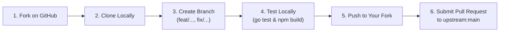

# Contributing to Specra

Thank you for your interest in contributing to **Specra** (AI Requirements Studio)! We welcome contributions from developers, technical writers, and requirements engineers.

This document outlines the contribution workflow, local environment setup, and coding guidelines to help you get started quickly.

---

## 1. Project Mission & Architecture

Specra is a local-first, chat-first desktop application that transforms user briefs into verified, publication-ready software specifications:
- **PRD** (20 sections, led by `product-analyst`)
- **IEEE 830 SRS** (22 sections, led by `system-analyst`)
- **C4 System Architecture** (16 sections, led by `software-architect`)
- **Design System** (16 sections, led by `ui-ux-agent`)

### Technology Stack:
- **Desktop Shell**: Wails v3 (WebKit on macOS, WebView2 on Windows)
- **Backend Core**: Go 1.24+ (Modular domain services, SQLite WAL mode, OS Keyring)
- **Frontend UI**: React 19, TypeScript (Strict Mode), Tailwind CSS
- **Design System Tokens**: MQ-Studio 0.4.2 Token Scale (`src/design/tokens.css`)
- **AI Providers**: Pure Real AI execution (Antigravity CLI `agy`, OpenCode CLI `opencode`, Gemini REST API) — **Zero-Mock Policy**.

---

## 2. Fork & Pull Request Workflow

All external contributions must follow the **Fork & Pull Request** model. Direct pushes to `main` are disabled via branch protection.



### Step-by-Step:
1. **Fork the Repository**:
   Click the **Fork** button at the top-right of the [repository page](https://github.com/Luftinurfahmi/dev-agent-assistant).
2. **Clone Your Fork**:
   ```bash
   git clone https://github.com/<your-username>/dev-agent-assistant.git
   cd dev-agent-assistant
   ```
3. **Configure Upstream Remote**:
   ```bash
   git remote add upstream https://github.com/Luftinurfahmi/dev-agent-assistant.git
   ```
4. **Create a Feature Branch**:
   ```bash
   git checkout -b feat/your-feature-name
   # or
   git checkout -b fix/issue-description
   ```
5. **Make Changes and Test Locally** (see Section 3 below).
6. **Commit with Conventional Commits**:
   ```bash
   git commit -m "feat(providers): add support for custom CLI flag"
   ```
7. **Push to Your Fork**:
   ```bash
   git push origin feat/your-feature-name
   ```
8. **Open a Pull Request**:
   Go to the upstream repository and click **Compare & pull request**. Complete the PR checklist.

---

## 3. Local Environment Setup & Testing

### Prerequisites:
- **Go**: 1.24+ ([Download Go](https://go.dev/dl/))
- **Node.js**: 20+ or 22 LTS ([Download Node.js](https://nodejs.org/))
- **Wails v3 CLI**:
  ```bash
  go install github.com/wailsapp/wails/v3/cmd/wails3@latest
  ```

### Development Commands:

#### On macOS / Linux:
```bash
# 1. Install frontend dependencies & build
cd frontend && npm install
npm run build
cd ..

# 2. Run backend tests (must pass 100%)
go test -v ./internal/...

# 3. Launch live development mode
wails3 dev -config ./build/config.yml -port 9245
```

#### On Windows (PowerShell):
```powershell
# 1. Install frontend dependencies & build
cd frontend; npm install; npm run build; cd ..

# 2. Run backend tests
go test -v ./internal/...

# 3. Launch live development mode
wails3 dev -config ./build/config.yml -port 9245
```

---

## 4. Mandatory Coding Rules & Standards

1. **Zero-Mock Policy**:
   - Synthesizing fake AI responses or silent mock fallbacks in production code is strictly forbidden.
   - If an AI subprocess or API returns an error, surface the real error immediately so it is actionable.
2. **Strict TypeScript & No `any`**:
   - All Wails bindings and React components must have explicit types. Avoid `any`.
3. **High-Contrast Design System**:
   - Follow the MQ-Studio token scale (`tokens.css`). Base typography is `14px/1.55`. Prohibit micro-fonts (`text-[10px]`, minimum `12px`).
   - All components must support 3 color modes: Warm Stone (Light), Obsidian Slate (Dark), and System Auto.
4. **Git Hygiene & Machine Log Prohibition**:
   - Multi-megabyte machine logs (`.jsonl`) generated by AI agent sessions must **NEVER be committed to Git**.
   - Raw conversation transcripts are persisted locally in `~/.gemini/antigravity-cli/brain/` and are excluded via `.gitignore`.
5. **Path Traversal & Security**:
   - All file operations must be validated with `filepath.Clean` and sandboxed within `workspaces/projects/{id}/`.
   - Never hardcode or log API keys.

---

## 5. Commit Convention

We follow [Conventional Commits](https://www.conventionalcommits.org/):
- `feat:` A new feature or capability
- `fix:` A bug fix
- `docs:` Documentation changes only
- `refactor:` Code change that neither fixes a bug nor adds a feature
- `test:` Adding or updating tests
- `chore:` Maintenance tasks, dependency updates

Example:
```text
feat(settings): decouple chat language from document specification language
fix(macos): resolve launchd path environment for coding agent discovery
docs(changelog): record v0.1.1 improvements
```

---

## 6. Review & Merge Process

1. Once your PR is submitted, GitHub Actions CI will automatically run tests and typechecking (`.github/workflows/ci.yml`).
2. The repository maintainer will review your code for architectural consistency and Zero-Mock compliance.
3. Once approved and all status checks pass, your PR will be **Squashed and Merged** into `main`.

Thank you for helping build Specra!
