<div align="center">

# Specra

**The Local-First AI Requirements Engineering Studio for Desktop**

Turn vague ideas, scattered briefs, and meeting notes into production-ready software specifications: PRD, IEEE 830 SRS, C4 System Architecture, and Design Systems.

[](https://go.dev)
[](https://react.dev)
[](https://v3.wails.io)
[]()
[]()
[](./LICENSE)

[Features](#-features) • [Pipeline](#-specification-pipeline) • [Quickstart](#-quickstart) • [Specialist Personas](#-4-specialist-personas) • [Architecture](#-architecture--security)

---

</div>

## 💡 What is Specra?

Modern software projects rarely fail from bad code; they fail from **unclear, drifting, and unverified requirements**.

**Specra** is a local-first desktop requirements engineering studio built on Wails v3, Go, and React 19. It acts as a dedicated requirements workspace that pairs you with **4 specialized AI personas**. Together, they transform unstructured briefs and chat discovery into an interconnected, verified, and standards-compliant suite of software blueprints.

Unlike generic chatbot interfaces that hallucinate details and forget context, Specra enforces **strict upstream-to-downstream context inheritance** and **approval gating**: your architecture and technical specifications are mathematically grounded in an approved PRD.

---

## 🚀 Specification Pipeline

```mermaid
flowchart LR
    A["💡 Raw Brief / User Idea"] --> B["💬 Discovery Chat & Q&A Loop"]
    B --> C["📋 Product Analyst (PRD 20 Sections)"]
    C --> D{"🔒 Approval Gating"}
    D -- "Approved" --> E["⚙️ System Analyst (SRS 22 Sections)"]
    E --> F["🏗️ Software Architect (C4 & APIs, 16 Sections)"]
    F --> G["🎨 UI/UX Agent (Tokens & Flows, 16 Sections)"]
    G --> H["📦 Export (.md, .html, .json)"]

    style A fill:#282420,stroke:#6366f1,color:#f7f5f3
    style B fill:#282420,stroke:#4f46e5,color:#f7f5f3
    style C fill:#1e1b18,stroke:#3b82f6,color:#f7f5f3
    style D fill:#38332e,stroke:#f59e0b,color:#f7f5f3
    style E fill:#1e1b18,stroke:#14b8a6,color:#f7f5f3
    style F fill:#1e1b18,stroke:#8b5cf6,color:#f7f5f3
    style G fill:#1e1b18,stroke:#f97316,color:#f7f5f3
    style H fill:#282420,stroke:#10b981,color:#f7f5f3
```



---

## ✨ Features

### 🖥️ Native Chat-First Split View Workspace
- **Dual-Pane Resizable Artboard**: Chat comfortably on the left while simultaneously reviewing live formatted documents on the right.
- **Collapsible Panes**: Collapse the Left Project Navigator (`Ctrl+B`) or Right Project Co-Pilot (`Ctrl+J`) for a distraction-free, focused writing environment.
- **Adaptive HiDPI Scaling**: Choose from 8 precision display zoom levels (Auto HiDPI, 90% Compact up to 125% Extra Large) with zero viewport clipping.

### 🤖 4 Specialist Personas
- **Product Analyst (`product-analyst`)**: Drives discovery, user personas, problem validation, and MoSCoW prioritization. Produces comprehensive **PRDs (20 Sections)**.
- **System Analyst (`system-analyst`)**: Maps requirements to IEEE 830 functional requirements (`FR-xxx`), data schemas, and full Traceability Matrices. Produces **SRS (22 Sections)**.
- **Software Architect (`software-architect`)**: Evaluates trade-offs, drafts REST/gRPC API contracts, mitigates threats via STRIDE, and renders C4 Mermaid topology. Produces **Architecture specs (16 Sections)**.
- **UI/UX Agent (`ui-ux-agent`)**: Defines screen flows, atomic component hierarchies, semantic tokens, and WCAG 2.2 AA accessibility checklists. Produces **Design Systems (16 Sections)**.

### 🛡️ Approval Gating & Change Impact Healing
- **Downstream Protection**: Downstream documents (SRS, Architecture, Design) remain safely locked until the upstream PRD is reviewed and approved.
- **Automatic Outdated Healing**: If a PRD is modified after downstream documents were generated, Specra alerts you with an **Outdated** status and allows one-click synchronized regeneration.

### 💬 The Interactive Clarification Loop (Q&A Cards)
- Rather than blindly hallucinating when given an ambiguous prompt, Specra pauses and surfaces **interactive Clarification Cards** directly inside the chat stream.
- Your answers are instantly recorded into the project’s fact base, steering all downstream AI generation.

### ⚡ TOON Token Optimization
- Includes a native implementation of **TOON** (Token-Oriented Object Notation), reducing LLM prompt overhead by **30%–60%** during repetitive requirement and data matrix extraction compared to verbose JSON.

### 🔒 Zero-Mock & Local-First Security
- **Zero-Mock Policy**: All AI operations run through real local CLI tools or official REST endpoints. No fake responses or simulated fallbacks.
- **OS-Encrypted Credential Storage**: Sensitive API keys are never written to disk or plain SQLite; they are securely protected in the OS Keyring (Windows Credential Manager / macOS Keychain).
- **Local SQLite (WAL Mode)**: All project files, drafts, version histories, and transcripts live entirely on your machine.

---

## 📑 Specification Document Standards

| Document | Standard / Template | Sections | Key Outputs |
|---|---|---|---|
| **PRD.md** | Specra Enterprise Standard | **20 Sections** | Executive Summary, Problem Statement, User Personas, MoSCoW Requirements, Success Metrics |
| **SRS.md** | IEEE 830 Standard | **22 Sections** | System Scope, `FR-xxx` Functional Specs, Non-Functional Attributes, Data Schemas, Traceability Matrix |
| **architecture.md** | C4 Model & Modern Distributed Systems | **16 Sections** | C4 Context/Container/Component Diagrams, REST/gRPC APIs, Data Storage, STRIDE Security Analysis |
| **design.md** | Semantic Design System & Accessibility | **16 Sections** | Semantic Design Tokens, Core Screen Flows, Component Anatomy, WCAG 2.2 AA Compliance |

---

## 🛠️ Quickstart

### Prerequisites
- **Go**: 1.24 or later
- **Node.js**: 20.x or later (with `npm`)
- **Wails CLI**: Wails v3 alpha / latest (`go install github.com/wailsapp/wails/v3/cmd/wails3@latest`)
- **AI Tooling** (At least one):
  - [Google Antigravity CLI](https://github.com/google) (`agy`)
  - [OpenCode CLI](https://github.com) (`opencode`)
  - Google Gemini API Key

### Installation & Development

```bash
# 1. Clone the repository
git clone https://github.com/luftinur/Specra.git
cd Specra

# 2. Install frontend dependencies
cd frontend && npm install && cd ..

# 3. Run in Wails v3 development mode
wails3 dev -config ./build/config.yml -port 9245
```

### Production Build

```bash
# Build standalone native release binary
wails3 task build
```

Binary outputs will be located in the `bin/` directory.

---

## ⌨️ Desktop Shortcuts & Slash Commands

### Global Shortcuts
| Shortcut | Action |
|---|---|
| `Ctrl+1` / `Cmd+1` | Discovery Chat Only Mode |
| `Ctrl+2` / `Cmd+2` | Side-by-Side Split View (Chat + Documents) |
| `Ctrl+3` / `Cmd+3` | Full Document Canvas Mode |
| `Ctrl+B` / `Cmd+B` | Toggle Left Sidebar (Project Navigator) |
| `Ctrl+J` / `Cmd+J` | Toggle Right Sidebar (Project Co-Pilot) |
| `Ctrl+N` / `Cmd+N` | New Project Dialog |
| `Ctrl+O` / `Cmd+O` | Open Project Manager |
| `Ctrl+,` / `Cmd+,` | Studio Settings |

### Built-in Slash Commands
Type `/` in the prompt input to open the quick command palette:
- `/discovery` — Activate Exploration Mode (proactive questions & assumption tracking)
- `/exec` — Activate Execution Mode (direct specification drafting without questions)
- `/plan` — Generate step-by-step technical implementation plan
- `/clarify` — Trigger targeted clarification questions on context gaps
- `/prd` — Generate or regenerate PRD draft (20 Sections)
- `/srs` — Generate or regenerate SRS specification (22 Sections)
- `/arch` — Generate or regenerate Architecture & C4 topology (16 Sections)
- `/design` — Generate or regenerate UI/UX Design System (16 Sections)
- `/validate` — Run comprehensive requirement and traceability audit
- `/clear` — Clear active conversation session history

---

## 🔒 Architecture & Security

```
Specra Desktop Shell (Wails v3)
├── Backend Core (Go 1.24+)
│   ├── Domain Services (Document, Requirement, Validation, Conversation, Project)
│   ├── Storage Engine (SQLite in WAL Mode, Sandboxed Local Workspaces)
│   ├── Security Engine (OS Keyring Credential Storage, Prompt Redactor)
│   └── Multi-Agent Orchestrator (Antigravity CLI, OpenCode CLI, Gemini REST)
└── Frontend UI (React 19 + TypeScript Strict + Tailwind CSS)
    ├── DesktopMenuBar (Native Menu System & Layout Switcher)
    ├── DocumentCanvasPane (Markdown Preview & Interactive Mermaid Blocks)
    ├── Project Co-Pilot (Requirements Backlog, Q&A Clarifications, Stepper)
    └── Two-Pane Studio Settings (Display Scaling, MCP Servers, Skills Library)
```

- **Zero Telemetry**: Specra never transmits code, drafts, or usage telemetry to third-party tracking servers.
- **Project Isolation**: Subprocesses execute strictly inside the user's isolated local workspace directory (`cmd.Dir`).
- **No Mock Fallbacks**: Production errors are exposed transparently so developers always have full visibility into AI provider status.

---

## 📄 License

This project is licensed under the [MIT License](./LICENSE).

---

<div align="center">
<sub>Built with precision for software architects, technical product managers, and engineering teams.</sub>
</div>
