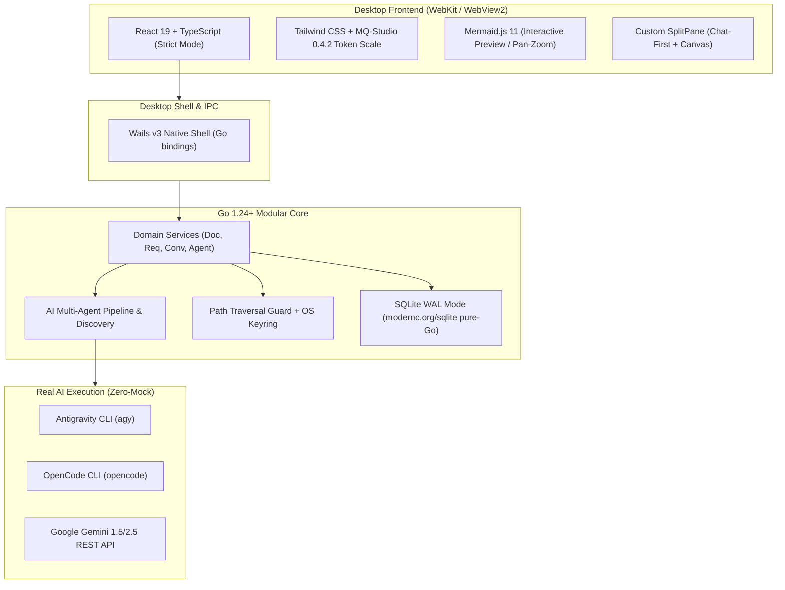
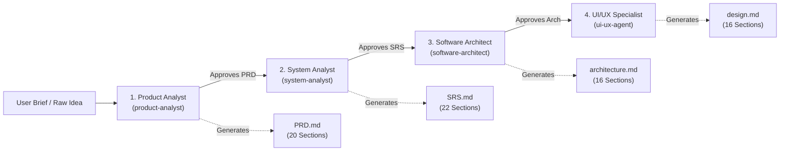
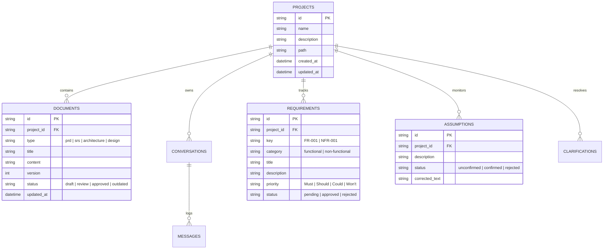

# Specra — System Architecture & Technical Specification

> **Living Technical Documentation & Single Source of Truth**  
> *Last Updated: 2026-11-15 (v0.1.0)*

---

## 1. System Overview & Mission

**Specra** is a local-first, chat-first desktop application designed as a personal requirements engineering studio. It transforms unstructured user ideas and raw project briefs into structured, production-grade system specifications:
- **PRD (Product Requirements Document)**: 20 IEEE-aligned sections.
- **SRS (Software Requirements Specification)**: 22 IEEE 830-aligned sections with full requirement modeling (FR-xxx/NFR-xxx) and traceability matrix.
- **System Architecture**: 16 sections including C4 Mermaid diagrams, API contracts (REST/gRPC), scalability strategies, and STRIDE threat modeling.
- **Design System Specification**: 16 sections detailing semantic design tokens, screen flow diagrams, atomic component specs, and WCAG 2.2 AA accessibility compliance.

---

## 2. Core Technology Stack



| Layer | Technologies | Key Responsibilities |
| :--- | :--- | :--- |
| **Desktop Shell** | Wails v3 (WebKit on macOS, WebView2 on Windows) | Window management, native menus, OS dialogs, clipboard, app bundling. |
| **Frontend UI** | React 19, TypeScript (Strict), Tailwind CSS | Chat-first interface, Markdown rendering with interactive Mermaid blocks, Project Co-Pilot sidebar. |
| **Backend Core** | Go 1.24+ | Clean architecture, domain services, thread-safe concurrency, process spawning. |
| **Database** | SQLite with WAL mode (`modernc.org/sqlite`) | Local-first relational storage, zero CGO dependency, cross-compilation friendly. |
| **Credential Storage**| OS Keyring (`zalando/go-keyring`) | Secure storage of API keys in macOS Keychain / Windows Credential Manager. |
| **AI Providers** | Antigravity CLI (`agy`), OpenCode CLI, Gemini REST | Real execution with zero synthetic fallbacks (Zero-Mock Policy). |

---

## 3. Specialist Personas & Cascading Pipeline

Specra organizes requirements engineering into 4 specialized AI personas operating in an upstream-to-downstream context inheritance pipeline:



### Approval Gating Rules:
1. **Downstream Locking**: Downstream documents (SRS, Architecture, Design) are **locked and protected** until upstream documents (PRD) are marked as `Approved`.
2. **Outdated Propagation**: If a major revision occurs on an approved PRD, downstream documents are automatically flagged as `Outdated`. Re-generating any document clears its outdated alert and synchronizes the newest upstream context.

---

## 4. Database Architecture (SQLite Schema)

All application data is stored locally in `workspaces/projects/{project_id}/project.db` using SQLite with WAL (`Write-Ahead Logging`) enabled for concurrent reads and writes.



---

## 5. Backend Architecture & Service Layer

The Go backend adheres to Domain-Driven Design (DDD) principles with isolated layers:

```
internal/
├── domain/               # Domain entities (Project, Document, Message, Requirement, Agent)
├── services/             # Business orchestration layer
│   ├── document_service.go      # Approval gating, versioning, status propagation
│   ├── requirement_service.go   # Backlog management, assumption corrections
│   ├── conversation_service.go  # Chat history, system milestone announcements
│   ├── validation_service.go    # Consistency checks, traceability auditing
│   ├── general_settings_service.go # Themes, window zoom, agent preferences
│   └── agent_registry.go        # Specialist personas, prompt templates, MCP definitions
├── storage/              # SQLite repositories & workspace path isolation
│   ├── document_repo.go         # Document CRUD & atomic transactions
│   ├── requirement_repo.go      # Requirements backlog & assumptions persistence
│   ├── conversation_repo.go     # Message history & user corrections
│   └── workspace_manager.go     # Safe directory sandboxing & path traversal guards
├── ai/                   # AI execution engine & CLI adapters
│   ├── orchestrator.go          # Multi-agent prompt dispatch & stream handler
│   ├── discovery.go             # Autonomous agent question extraction
│   ├── toon.go                  # TOON compact serialization (30-60% token savings)
│   └── adapters/                # Antigravity CLI, OpenCode CLI, Gemini REST
└── security/             # Security redaction & OS credential storage
```

---

## 6. Frontend Architecture & Design System

The frontend is built with **React 19** and strictly-typed Wails v3 bindings:

### A. Chat-First Split View
- **Dual-Pane Experience**: Left pane hosts the real-time AI conversation timeline; right pane hosts the document canvas (Markdown preview & editor).
- **Resizable SplitPane**: Smooth drag handle with `localStorage` position persistence and 4-edge viewport containment.

### B. Interactive Mermaid Viewer (`frontend/src/components/MermaidBlock.tsx`)
- Detects fenced ````mermaid`` code blocks inside Markdown.
- **Tabbed Dual-Mode**:
  - **Preview Mode**: Live vector SVG diagram rendering via Mermaid.js 11 with pan and zoom controls.
  - **Code Mode**: Raw Mermaid syntax with line numbers.
- **Action Controls**: 1-click **Copy Mermaid Syntax** and full-screen **Modal Expansion**.

### C. Specifications & Pipeline Hub (Left Sidebar)
- **Unified Navigation & Execution**: Integrates specification document browsing (PRD, SRS, Architecture, Design) directly with primary pipeline controls.
- **Generate Full Pipeline Card**: One-click autonomous execution across all 5 cascading stages with live stage feedback and cancel controls.

### D. Project Co-Pilot Accordion (Right Inspector Panel)
Single-expanded (mutually exclusive) accordion architecture with independent scroll containers:
1. **Requirements Backlog**: Backlog management with MoSCoW priority badges, status badges, and AI extraction trigger.
2. **Questions & Clarifications**: Dedicated action center for answering AI clarifying questions with inline response forms.
3. **Assumptions & Constraints**: Automated AI assumptions with interactive **Confirm**, **Correct** (inline editor), and **Reject** actions.
4. **Quality & Audit Findings**: Document health findings, conflict inspection, 5-stage stepper, and PRD-to-SRS Traceability Matrix.

### E. Design System Tokens
Styled via MQ-Studio 0.4.2 Token Scale (`src/design/tokens.css`):
- High-contrast typography: base `14px/1.55`, minimum `12px` (no micro-fonts).
- Three comprehensive themes: **Warm Stone** (Light), **Obsidian Slate** (Dark), and **System Auto**.

---

## 7. Zero-Mock Policy, Security & OS Environment Integration

1. **Zero-Mock Policy**: Specra strictly forbids mock/synthetic AI generation in production code. If an AI CLI or API fails, the actual error is immediately surfaced to the UI.
2. **Desktop GUI PATH Environment Resolution (`internal/security/pathenv.go`)**: When desktop applications are launched via macOS Finder, Dock, or Windows desktop shortcuts, the OS executes them without evaluating interactive user shell configurations (`~/.zshrc`). On startup, Specra dynamically queries the login shell and augments `PATH` with standard user tool directories (`~/.local/bin`, `~/.opencode/bin`, `/opt/homebrew/bin`, `~/go/bin`), ensuring autonomous coding agents (`agy`, `opencode`) are reliably detected and executed without terminal dependencies.
3. **Path Traversal Guard**: All file attachments and workspace operations are validated via `filepath.Clean` and sandboxed strictly inside `workspaces/projects/{id}/`.
4. **Credential Storage**: API keys are never stored in plaintext SQLite databases; they are stored encrypted using OS Keyring via `go-keyring`.
5. **Headless Domain Architecture (`DialogManager`)**: Domain services in `internal/services` are 100% pure Go business logic decoupled from desktop GUI shells. Native file dialogs are abstracted behind the `DialogManager` interface, with `WailsDialogManager` injected at the desktop application entry point (`main.go`). This enables headless cross-platform compilation and automated CI testing on Linux runners without native GTK3 CGO dependencies.

---

## 8. Dual-Track Language & Diagnostics Architecture

### A. Decoupled Language Preferences
- **Chat Interaction Track (`chat_language`)**: Configurable independently in Settings (`"id"` Indonesian default, `"en"` English, or `"auto"` Adaptive). Injected directly into `ConversationService` specialist agent system instructions to dictate conversational tone and clarification questioning.
- **Document Output Track (`doc_language`)**: Configurable independently in Settings (`"en"` English default IEEE 830, `"id"` Indonesian formal, or `"auto"` Match chat). Injected into prompt templates for PRD, SRS, Architecture, and Design System generation.

### B. Clean Configuration Cards & Centralized Diagnostics
- **Clean Configuration UI**: Main Coding Agents configuration cards avoid exposing raw binary file paths to prevent visual clutter and accidental credential/path leakage.
- **Centralized Diagnostics (`settingsTab === 'diagnostics'`)**: Dedicated system health and binary resolution inspector (`ProviderService.RunDiagnostics`) detailing:
  - Exact binary execution paths on disk for each candidate CLI.
  - Active `$PATH` directories evaluated by the application.
  - OS and CPU architecture metadata.
  - One-click **Copy Diagnostic Report** for fast troubleshooting and user support.
