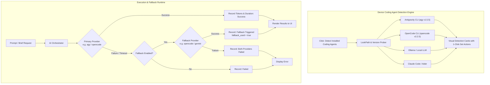

# Implementation Plan: Coding Agent Detection, Advanced AI Providers, Fallback Chaining, Token Usage Audit Log & Global Scrollbar Hiding

Comprehensive technical planning document for:
1. **Device Coding Agent Auto-Detection:** Automated scanner (*Detect Installed Coding Agents*) identifying installed CLI AI coding agents on the host (e.g. **Google Antigravity CLI `agy`**, **OpenCode `opencode` v2.2.5**, **Claude Code**, **Aider**, **Ollama**, **Cursor**, etc.), displaying version, binary paths, and one-click **[Set as Primary]** and **[Set as Fallback]** actions.
2. **Advanced Pluggable AI Adapters:**
   - **Antigravity CLI Adapter:** Non-interactive subprocess `agy -p` (v1.5.5).
   - **OpenCode Adapter:** Non-interactive subprocess `opencode run --format json` and/or `opencode serve` server endpoints.
   - **OpenAI-Compatible / Ollama / LocalLLM Adapter:** Standard `/v1/chat/completions` HTTP endpoints.
   - **Google Gemini Direct API Adapter:** Direct `generateContent` REST API.
3. **Automatic Failover & Fallback Chaining:** Resilient failover mechanism where primary provider timeouts or failures automatically trigger fallback execution without crashes, recording `fallback_success`.
4. **Token Usage Tracking & Audit Logs:** Aggregation and persistence in SQLite of token metrics (Prompt Tokens, Completion Tokens, Total Tokens, execution latency, fallback counts) rendered in an interactive audit log table.
5. **Universal Scrollbar Hiding:** Elimination of physical scrollbar tracks across all UI panes without impairing mouse wheel or touchpad scrolling.
6. **Advanced Settings Modal:** Multi-tab studio configuration dialog (*Coding Agents & Providers*, *Token Usage & Logs*, *Diagnostics & Keyring*).

---

## 1. Goal & Architecture Overview

### Provider Detection & Failover Architecture


---

## 2. Proposed Changes

### Component 1: Global Scrollbar Removal (`frontend/src/index.css`)
- **[MODIFY] [index.css](file:///E:/dev-agent-assistant/frontend/src/index.css):**
  Apply universal CSS rules (`*` and `*::-webkit-scrollbar`) ensuring scrollbar tracks across the app are hidden while scroll functionality remains 100% responsive:
  ```css
  /* Universal scrollbar hiding across all containers */
  *::-webkit-scrollbar {
    display: none !important;
    width: 0 !important;
    height: 0 !important;
  }
  * {
    -ms-overflow-style: none !important; /* IE and Edge */
    scrollbar-width: none !important;    /* Firefox */
  }
  ```

---

### Component 2: Coding Agent Detection Engine (`internal/ai/detector.go`)
- **[NEW] [detector.go](file:///E:/dev-agent-assistant/internal/ai/detector.go):**
  Implement intelligent detection prober scanning binaries via `exec.LookPath`:
  - Agents scanned:
    1. **Google Antigravity CLI:** `agy` (`agy -v`).
    2. **OpenCode CLI:** `opencode` (`opencode -v`, detected `opencode v2.2.5`).
    3. **Claude Code:** `claude` (`claude --version`).
    4. **Aider:** `aider` (`aider --version`).
    5. **Ollama:** `ollama` (`ollama --version`).
    6. **Cursor CLI:** `cursor`.
    7. **Goose:** `goose`.
  - Returns `[]domain.DetectedAgent`:
    - `ID string` (`antigravity-cli`, `opencode`, `claude`, `aider`, `ollama`, etc.)
    - `Name string`
    - `Executable string`
    - `Installed bool`
    - `Version string`
    - `Path string` (Absolute path to executable)
    - `SuggestedType string` (`cli` or `http`)

---

### Component 3: Domain Models & SQLite Storage (`internal/domain` & `internal/storage`)
- **[MODIFY] [models.go](file:///E:/dev-agent-assistant/internal/domain/models.go):**
  - Add struct `DetectedAgent`:
    ```go
    type DetectedAgent struct {
        ID          string `json:"id"`
        Name        string `json:"name"`
        Executable  string `json:"executable"`
        Installed   bool   `json:"installed"`
        Version     string `json:"version"`
        Path        string `json:"path"`
        Description string `json:"description"`
    }
    ```
  - Update `ProviderExecution` struct with token usage metrics:
    - `DurationMs int64`
    - `PromptTokens int`
    - `CompletionTokens int`
    - `TotalTokens int`
    - `FallbackUsed bool`
  - Create struct `TokenUsageSummary`:
    ```go
    type TokenUsageSummary struct {
        TotalRequests    int   `json:"total_requests"`
        TotalPrompt      int   `json:"total_prompt_tokens"`
        TotalCompletion  int   `json:"total_completion_tokens"`
        TotalTokens      int   `json:"total_tokens"`
        AverageDuration  int64 `json:"average_duration_ms"`
        FallbackCount    int   `json:"fallback_count"`
    }
    ```
- **[MODIFY] [migrations.go](file:///E:/dev-agent-assistant/internal/storage/migrations.go):**
  - Add `app_settings` table for provider & fallback persistence:
    ```sql
    CREATE TABLE IF NOT EXISTS app_settings (
        key TEXT PRIMARY KEY,
        value TEXT NOT NULL,
        updated_at DATETIME NOT NULL
    );
    ```
  - Add migration columns `duration_ms`, `prompt_tokens`, `completion_tokens`, `total_tokens`, and `fallback_used` to `provider_executions`.
- **[MODIFY] [provider_repo.go](file:///E:/dev-agent-assistant/internal/storage/provider_repo.go):**
  - Implement `ListExecutions(ctx, projectID string, limit int) ([]domain.ProviderExecution, error)`
  - Implement `GetTokenUsageSummary(ctx, projectID string) (*domain.TokenUsageSummary, error)`
  - Implement `GetSetting(key)` and `SetSetting(key, value)`.

---

### Component 4: Multi-Provider Adapters & Orchestrator Failover (`internal/ai/`)
- **[NEW] [opencode/adapter.go](file:///E:/dev-agent-assistant/internal/ai/adapters/opencode/adapter.go):**
  - Adapter for **OpenCode CLI / Server**:
    - CLI Subprocess mode: Invokes `opencode run --format json "<prompt>"` with managed timeouts.
    - HTTP Server mode: Supports `opencode serve` or OpenAI-compatible endpoints (`/v1/chat/completions`).
    - Extracts token usage and execution latency.
- **[NEW] [gemini/adapter.go](file:///E:/dev-agent-assistant/internal/ai/adapters/gemini/adapter.go):**
  - Adapter for **Google Gemini Direct API**:
    - Calls REST API `generateContent` using API keys from OS Keyring.
    - Extracts `promptTokenCount` and `candidatesTokenCount`.
- **[MODIFY] [orchestrator.go](file:///E:/dev-agent-assistant/internal/ai/orchestrator.go):**
  - Manages `primaryProviderID`, `fallbackProviderID`, and `fallbackEnabled`.
  - In `Execute(ctx, req)`:
    1. Executes primary provider.
    2. On failure or timeout and if `fallbackEnabled == true`, triggers automatic fallback.
    3. Persists real execution status (`success`, `fallback_success`, `failed`), token usage, and latency.

---

### Component 5: Backend Service Layer (`internal/services/provider_service.go`)
- **[MODIFY] [provider_service.go](file:///E:/dev-agent-assistant/internal/services/provider_service.go):**
  - Expose Wails v3 service methods:
    - `DetectInstalledCodingAgents() ([]domain.DetectedAgent, error)`
    - `ConfigureProviders(primaryID, fallbackID string, fallbackEnabled bool) error`
    - `GetProviderConfiguration() (map[string]any, error)`
    - `ConfigureOpenCode(mode, baseURL, model, apiKey string) error`
    - `ConfigureGemini(model, apiKey string) error`
    - `GetTokenUsageSummary(projectID string) (*domain.TokenUsageSummary, error)`
    - `ListExecutionLogs(projectID string, limit int) ([]domain.ProviderExecution, error)`

---

### Component 6: Advanced Settings & Detection UI (`frontend/src/App.tsx`)
- **[MODIFY] [App.tsx](file:///E:/dev-agent-assistant/frontend/src/App.tsx):**
  - Redesign Settings modal into a multi-tab studio dialog:
    - **Tab 1: Coding Agents & Providers:**
      - **[Detect Installed Coding Agents]** button with loading indicator.
      - Grid of detected host agents (Antigravity CLI v1.5.5, OpenCode v2.2.5, Claude, Ollama, etc.) with green (*Installed*) / gray (*Not Found*) badges.
      - 1-click **[Set as Primary]** and **[Set as Fallback]** actions directly on cards.
      - Manual provider dropdowns and fallback toggle.
      - Configuration cards for OpenCode and Google Gemini.
    - **Tab 2: Token Usage & Audit Logs:**
      - Metric summary cards: *Total AI Calls*, *Prompt Tokens*, *Completion Tokens*, *Grand Total Tokens*, *Fallback Events*.
      - Interactive audit log table displaying past prompt executions (Timestamp, Provider & Model, Task, Duration ms, Tokens, Status `Success` / `Fallback Triggered` / `Failed`).
      - **[Refresh Logs]** action.
    - **Tab 3: Diagnostics & Keyring:**
      - **[Run Diagnostics]** button verifying latency, SQLite WAL status, and OS Credential Manager integrity.
  - Display cumulative token usage in sidebar footer.

---

## 3. Verification Plan

### Automated Tests
```powershell
# 1. Run Go unit tests covering detection, multi-provider adapters, fallback logic, and token usage
$env:PATH = "C:\Program Files\Go\bin;$env:USERPROFILE\go\bin;$env:PATH"; go test -v ./...

# 2. Re-generate Wails v3 TypeScript bindings
$env:PATH = "C:\Program Files\Go\bin;$env:USERPROFILE\go\bin;$env:PATH"; wails3 generate bindings -ts -i

# 3. Frontend compilation (Dev & Prod)
cd frontend; npm run build:dev; npm run build; cd ..

# 4. Wails v3 production build
$env:PATH = "C:\Program Files\Go\bin;$env:USERPROFILE\go\bin;$env:PATH"; wails3 task build
```

### Manual Verification
1. **Coding Agent Detection:**
   - Open Settings > Coding Agents & Providers, click **[Detect Installed Coding Agents]**.
   - Verify detected binaries: `Google Antigravity CLI (agy v1.5.5)` and `OpenCode CLI (opencode v2.2.5)`.
   - Click **[Set as Fallback]** on OpenCode; verify OpenCode is selected as fallback provider.
2. **Global Scrollbar:**
   - Scroll through long PRD/SRS specifications and audit tables; verify smooth scrolling with zero physical scrollbar tracks.
3. **Token Usage Audit Log:**
   - Open Settings > Token Usage & Audit Logs; verify prompt calls log prompt tokens, completion tokens, latency, and status.
