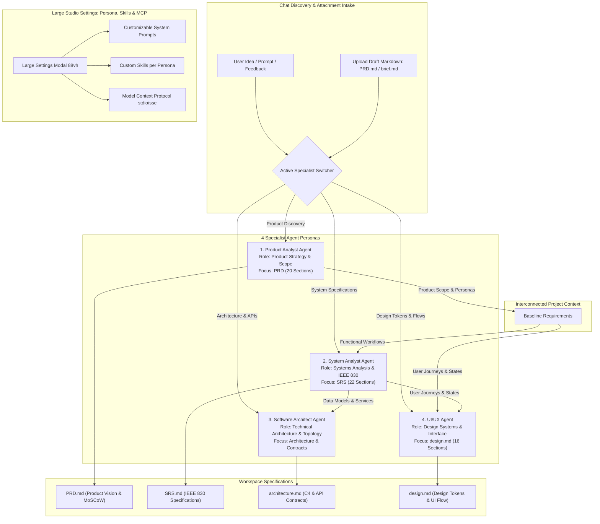

# Architectural Specification: 4 Specialist Agent Personas

Detailed plan and specification for decomposing the agent architecture into **4 Interconnected Specialist Personas**:

---

## 1. Specialist Personas, Skills, and MCP Tools

### Persona 1: Product Analyst Agent (Focus: PRD - Product Requirements Document)
- **Agent ID:** `product-analyst`
- **Role Title:** `Product Analyst & Business Strategist`
- **Core Responsibilities:**
  - Analyze raw ideas, business vision, and problem statements.
  - Formulate User Personas, Target Audience, and User Journey Maps.
  - Perform requirements categorization and MoSCoW prioritization (*Must Have, Should Have, Could Have, Won't Have*).
  - Draft and maintain the **`PRD.md` (20 sections)**.
- **Built-in Skills:**
  - `product-discovery` (Extracting implicit requirements from conversation)
  - `user-story-mapping` (User story mapping and acceptance criteria)
  - `moscow-prioritization` (Objective feature prioritization classification)
  - `business-kpi-definition` (Defining product success metrics)
- **Recommended MCP Tool Integrations:**
  - *Jira / Linear MCP* (Epics and user stories synchronization)
  - *Notion / Confluence MCP* (Product brief synchronization)

---

### Persona 2: System Analyst Agent (Focus: SRS - Software Requirements Specification)
- **Agent ID:** `system-analyst`
- **Role Title:** `Lead System Analyst & IEEE 830 Specialist`
- **Core Responsibilities:**
  - Translate PRD business requirements into functional and non-functional technical specifications.
  - Model conceptual data models, data dictionaries, and business rules.
  - Enforce the *Traceability Matrix* between PRD Requirement IDs (`REQ-XXX`) and System Specifications.
  - Draft and maintain the **`SRS.md` (22 sections)**.
- **Built-in Skills:**
  - `ieee-830-specification` (International software engineering documentation standard)
  - `functional-flow-modeling` (System flow modeling and state transitions)
  - `traceability-verification` (Orphan requirement and inconsistency detection)
  - `non-functional-sla-definition` (Latency, throughput, reliability, and disaster recovery criteria)
- **Recommended MCP Tool Integrations:**
  - *PostgreSQL / SQLite Schema MCP* (Table schema extraction and validation)
  - *OpenAPI / Swagger MCP* (Data contract validation)

---

### Persona 3: Software Architect Agent (Focus: Architecture & Technical Topology)
- **Agent ID:** `software-architect`
- **Role Title:** `Principal Software Architect`
- **Core Responsibilities:**
  - Formulate high-level system architecture (C4 Model: Context, Containers, Components, Code).
  - Define architectural patterns (Modular Monolith, Event-Driven, Microservices, Local-First WAL).
  - Establish API interface contracts (REST endpoints, gRPC protos, GraphQL schemas).
  - Define security strategies (OAuth2, JWT, RBAC, Data Encryption at Rest & in Transit).
  - Draft and maintain **`architecture.md`** alongside Mermaid topology diagrams.
- **Built-in Skills:**
  - `c4-architecture-modeling` (C4 Mermaid diagrams: System Context & Container diagrams)
  - `api-contract-engineering` (Request/response schemas and payload validation specifications)
  - `security-threat-modeling` (STRIDE threat analysis and data encryption)
  - `scalability-fault-tolerance` (Caching strategies, circuit breakers, rate limiting)
- **Recommended MCP Tool Integrations:**
  - *Git / GitHub MCP* (Repository structure and code architecture audits)
  - *Docker / Kubernetes MCP* (Container topologies and manifests inspection)

---

### Persona 4: UI/UX Agent (Focus: Design System & Interface)
- **Agent ID:** `ui-ux-agent`
- **Role Title:** `UI/UX Architect & Design System Specialist`
- **Core Responsibilities:**
  - Establish visual direction, aesthetics, and interface themes (*Light & Dark mode*).
  - Formulate Semantic Design Tokens: color palettes (hex/hsl), typography scale, layout grids, and elevation shadows.
  - Design atomic component architectures (Buttons, Form Controls, Dialogs, Cards, Badges, Navbars).
  - Generate Mermaid user screen navigation flows.
  - Draft and maintain **`design.md` (16 sections)** and Tailwind CSS utility class mappings.
- **Built-in Skills:**
  - `semantic-design-tokens` (CSS variables and Tailwind configuration token generation)
  - `atomic-component-hierarchy` (Atoms, Molecules, Organisms component patterns)
  - `mermaid-screen-flows` (Mermaid visual screen interaction diagrams)
  - `wcag-accessibility-audit` (Contrast ratio and WCAG 2.1 AA keyboard accessibility compliance)
- **Recommended MCP Tool Integrations:**
  - *Figma MCP* (Importing color tokens, font hierarchies, and wireframes)
  - *Iconify / Lucide MCP* (Visual asset search and alignment)

---

## 2. Interconnected Intelligence Pipeline

During consultation in **Chat Discovery**:
1. **Product Analyst** extracts requirements (`REQ-001`, `REQ-002`, etc.) with MoSCoW prioritization.
2. Switching to **System Analyst** automatically includes the approved PRD summary so the agent focuses on system validation and edge case handling rather than repeating basic questions.
3. Switching to **Software Architect** incorporates PRD + SRS context, allowing immediate recommendations for database engines, monolith vs microservices topologies, and precise API contracts.
4. Switching to **UI/UX Agent** evaluates personas from the PRD and system workflows from the SRS to structure component hierarchies, feedback states (*loading/empty/error*), and semantic color palettes.

---

## 3. Implementation Plan in Phase 3

### Step 1: Register 4 Personas in Backend (`internal/ai/agent_registry.go`)
- Update `initDefaults()` to register all 4 agents:
  - `product-analyst`
  - `system-analyst`
  - `software-architect`
  - `ui-ux-agent`
- Update `ListAgents()`, `SaveAgent()`, and SQLite `app_settings` storage.
- Register `DocTypeArchitecture = "architecture"` in the domain model.

### Step 2: Persona Selector in Chat Header (`frontend/src/App.tsx`)
- Add **Specialist Selector Tab** above Chat Discovery:
  - `[Product Analyst]` `[System Analyst]` `[Software Architect]` `[UI/UX Agent]`
- Send active `agentID` with each user message.
- Assistant responses display persona badge, specialized icon, and role title.

### Step 3: Attachment Paperclip in Chat Bar (`frontend/src/App.tsx`)
- Paperclip icon button (<kbd><Paperclip size={16} /></kbd>) in the chat bar:
  - Supports `.md`, `.txt`, `.json` drafts.
  - Previews file name and size before sending.
  - Invokes `ConversationService.SubmitAttachment(..., agentID)`.

### Step 4: Large Studio Settings Modal (`max-w-5xl h-[88vh]`)
- Comprehensive 4-tab Settings Modal:
  1. **Specialist Agents & Personas:**
     - Select from 4 specialist agents.
     - Editable custom System Prompt textarea.
     - Built-in skill toggle checkboxes per persona.
     - Active MCP server associations.
  2. **MCP Connection Manager:**
     - Connected MCP server list (`stdio` / `sse`).
     - Add/Edit new MCP endpoints (e.g. Figma MCP, Database MCP).
  3. **Coding Agents & Providers:**
     - Local coding agent detection (`agy`, `opencode`, `claude`, `aider`).
     - Primary & fallback provider configuration.
  4. **Token Usage & Logs:**
     - Live token usage metrics and latency per execution.
