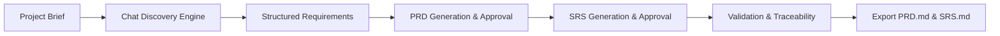
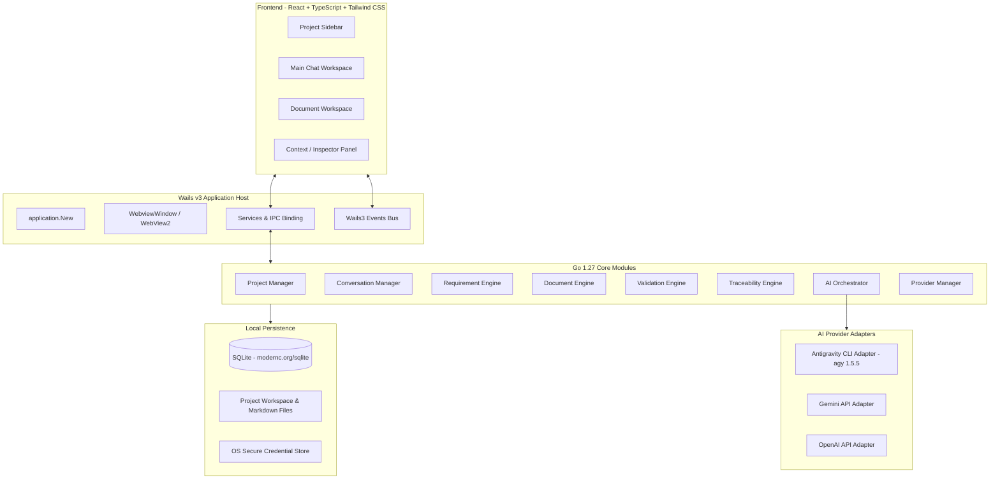

# AI Requirements Studio — Phased Implementation Plan

Technical phased implementation plan for engineering **AI Requirements Studio** based on the foundational specification documents:
- [PRD.md](file:///E:/dev-agent-assistant/prd.md) (v1.2 Final)
- [SRS.md](file:///E:/dev-agent-assistant/srs.md) (v1.0 Final)
- [design_system.md](file:///E:/dev-agent-assistant/design_system.md) (v1.0)

**Technology Baseline:**
- **Go Runtime:** Go latest (`1.27.x` via [go.dev/dl](https://go.dev/dl/))
- **Desktop Framework:** **Wails v3** (`github.com/wailsapp/wails/v3`, CLI: `wails3`)
- **Frontend:** React + TypeScript + Vite + Tailwind CSS
- **Local Persistence:** SQLite (Pure-Go `modernc.org/sqlite`) + Markdown files
- **AI Integration:** Pluggable Adapters (Antigravity CLI `agy` v1.5.5 + Gemini/OpenAI API)

---

## 1. Goal Description

Build a *local-first*, *chat-first* desktop application based on **Go 1.27.x + Wails v3 + React + Tailwind CSS** with local persistence backed by **SQLite & Markdown**. The application integrates pluggable AI providers (specifically **Antigravity CLI** and API adapters) to transform user *project briefs* into structured, validated, human-in-the-loop verified **PRD** and **SRS** specification documents with *full requirement traceability*.



---

## 2. User Review & Toolchain Decisions

> [!IMPORTANT]
> **Go Runtime (Latest 1.27.x from go.dev/dl):**
> Go is locked to the latest release from [https://go.dev/dl/](https://go.dev/dl/) (`go1.27.x`). The official MSI installer `go1.27.x.windows-amd64.msi` is installed and verified in PATH.

> [!IMPORTANT]
> **Wails Framework (Version 3 / `wails3`):**
> Desktop framework uses **Wails v3** (`github.com/wailsapp/wails/v3`).
> - Wails v3 requires modern Go (Go 1.26+) and provides the unified `wails3` CLI.
> - Advantages: Efficient event & IPC architecture, modular native windowing, integrated task runner build system, and seamless pure-Go rendering on Windows (WebView2).
> - CLI installation: `go install github.com/wailsapp/wails/v3/cmd/wails3@latest`.

> [!NOTE]
> **SQLite Driver (Pure Go):**
> Utilizes pure-Go `modernc.org/sqlite` so Wails v3 compilation on Windows is completely free of GCC/MinGW dependencies (CGO-free build).

> [!TIP]
> **Antigravity CLI Integration (`agy` v1.5.5):**
> Verified `agy` CLI on host (`v1.5.5`) integrated via non-interactive adapter: `agy -p "<prompt>" --output-format json --json-schema "<schema>"`.

---

## 3. High-Level Architecture (Wails v3)



---

## 4. Phased Implementation Plan

### Phase 0: Technical Spike & Toolchain Setup (Go 1.27 + Wails v3)
**Focus:** Prepare Go 1.27.x and Wails v3 environment, validate Windows dependencies (WebView2), and perform initial subprocess communication spikes with `agy`.

#### Tasks:
1. **Go 1.27.x Installation & Verification:**
   - Download official Go installer from [https://go.dev/dl/](https://go.dev/dl/).
   - Ensure `%USERPROFILE%\go\bin` and Go binary directory are present in `PATH`.
   - Verify with `go version`.
2. **Wails v3 CLI Installation:**
   - Install CLI: `go install github.com/wailsapp/wails/v3/cmd/wails3@latest`.
   - Run `wails3 setup` to verify platform runtime dependencies (WebView2).
   - Verify environment readiness via `wails3 doctor`.
3. **Scaffold Wails v3 Application:**
   - Initialize Wails v3 React + TypeScript template (`wails3 init -n ai-requirements-studio -t react-ts`).
   - Configure Tailwind CSS and Lucide Icons following design tokens.
   - Run Wails v3 dev server to confirm desktop window rendering.
4. **Technical Spikes:**
   - **Antigravity CLI Subprocess:** Execute `agy -p "ping" --output-format json` via Go `os/exec` to test stdout/stderr capture and exit code handling.
   - **SQLite Spike:** Create test database using `modernc.org/sqlite` ensuring smooth CGO-free compilation on Windows.
   - **Credential Spike:** Test dummy key persistence in Windows Credential Manager via `zalando/go-keyring`.

**Phase 0 Deliverables:**
- Go 1.27.x and `wails3` toolchain active and passing `wails3 doctor`.
- Wails v3 project template configured with React, Tailwind, and Go backend modules.

---

### Phase 1: Core Application, Storage Foundation & Desktop Shell
**Focus:** Build storage layer, baseline SQLite schema, local workspace isolation, provider adapter registry, and native desktop UI layout.

#### Tasks:
1. **Local Storage & Database Setup (SRS Section 9 & 10):**
   - Create SQLite baseline schema (`projects`, `conversations`, `messages`, `requirements`, `requirement_sources`, `clarifications`, `assumptions`, `decisions`, `documents`, `document_versions`, `traceability_links`, `validation_runs`, `validation_findings`, `ai_providers`, `provider_executions`).
   - Implement Go migration runner initializing schema on initial application boot.
   - Local directory layout:
     ```text
     AI-Requirements-Studio/
     ├── app.db
     └── projects/{project-id}/
         ├── brief.md
         ├── PRD.md
         ├── SRS.md
         ├── documents/
         └── exports/
     ```
2. **Go Domain Services:**
   - `ProjectManager`: Create, Read, Update, Archive, Delete (with confirmation).
   - `ConversationManager`: Create per-project conversation sessions, persist user & AI interaction logs.
   - `ProviderManager`: Register adapters, detect `agy.exe`, store model configurations & non-secret settings.
3. **AI Adapter Foundation:**
   - Define `AIProvider` interface, `GenerateRequest`, and `GenerateResponse` types (SRS Section 5.2).
   - Build `AntigravityCLIAdapter`:
     - Detect `agy.exe` executable from `PATH`.
     - Check version `agy --version`.
     - Execute subprocess with controlled arguments, timeout, and buffered output.
   - Build `GeminiAPIAdapter` as API provider implementation.
   - Implement response normalization (handling success, malformed JSON, timeout, exit code errors).
4. **Desktop UI Shell (Wails v3 + React + Tailwind):**
   - Implement Three-Pane Layout:
     - **Left Pane (`w-64`):** Project Sidebar & Settings button.
     - **Center Pane (`flex-1`):** Main Chat Workspace & Message Input.
     - **Right Pane (`w-96` collapsible):** Context/Inspector & Document Panel.
   - Apply color tokens (`bg-app`, `bg-panel`, `border-subtle`, `primary`, `success`, `warning`, `danger`).
   - Bind Go service methods to frontend via Wails v3 service bindings.

**Phase 1 Deliverables:**
- Wails v3 desktop application running with responsive UI.
- Local project creation and switching.
- Antigravity CLI detection visible in UI.

---

### Phase 2: Chat-First Discovery Engine & Requirement Management
**Focus:** Process project briefs through interactive dialogue, extract structured requirements, and conduct human-in-the-loop review.

#### Tasks:
1. **AI Prompts & Logical Roles (PRD Section 6):**
   - Author prompt templates for:
     - `Product Analyst`: Vision, target audience, problem statements, core scope.
     - `Business Analyst`: Business rules, gaps, ambiguities, conflicts, constraints.
     - `System Analyst`: Non-functional requirements, integrations, data requirements.
2. **Discovery Pipeline (SRS Section 7.1):**
   - Ingest project brief from chat input.
   - Gap & ambiguity extraction: generate clarification questions (`clarifications` table).
   - Persist user answers and feed into project context.
3. **Requirement Extraction & Management (SYS-REQ-001..010):**
   - Unique ID generator: `REQ-001`, `REQ-002`, `NFR-001`, etc.
   - Categorize requirements (Functional, Non-Functional, Business Rule, UI/UX).
   - Default prioritization using **MoSCoW** (Must, Should, Could, Won't) with AI rationale.
   - Assumption and Decision tracking.
4. **Chat UI & Action Cards:**
   - Bubble styling for User vs AI (AI style: prominent left border `border-l-2 border-indigo-500`).
   - Interactive requirement cards in the chat stream:
     - MoSCoW priority badge.
     - **[Approve]** and **[Reject]** buttons.
     - Inline revision inputs.
   - Inspector Panel tabs for *Clarification Questions*, *Assumptions*, and *Confirmed Requirements*.

**Phase 2 Deliverables:**
- Complete discovery pipeline: brief input -> interactive clarifications -> structured requirements.
- Requirements persisted in SQLite with human approval statuses.

---

### Phase 3: PRD & SRS Generation Engine & Document Workspace
**Focus:** Generate complete PRD (20 sections) and SRS (22 sections), document versioning, Markdown preview, and file export.

#### Tasks:
1. **Template & Document Generator (SRS Section 8):**
   - Implement 20-section PRD template (Executive Summary through Open Questions).
   - Implement 22-section SRS template (Introduction through Constraints & Assumptions).
   - PRD Pipeline: generate draft from user-approved requirements.
   - SRS Pipeline: **Gated by PRD Approval** (SRS can only be generated once PRD status is `Approved`).
2. **Section-Level Regeneration:**
   - Enable users to regenerate specific sections (e.g. "Section 9: Features") without altering remaining sections.
3. **Document Versioning & Storage:**
   - Tables `documents` & `document_versions`: tracking `version_number`, `content_hash`, `source_version_id`, and `status` (`Draft`, `In Review`, `Approved`, `Superseded`, `Outdated`).
   - Atomic disk writes to `projects/{id}/PRD.md` and `projects/{id}/SRS.md`.
4. **Document Workspace UI:**
   - Integrated CommonMark-compliant Markdown viewer.
   - Direct edit mode with syntax highlighting.
   - Version history tabs and **[Approve Document]** action.
   - **Export Markdown** to custom user directory using native Wails v3 dialogs (`dialog.SaveFileDialog`).

**Phase 3 Deliverables:**
- PRD and SRS documents can be generated, reviewed, edited, and approved.
- `PRD.md` and `SRS.md` persisted and exportable locally.

---

### Phase 4: Validation Engine, Traceability & Change Impact
**Focus:** Completeness validation, conflict detection, traceability matrix construction, and PRD-to-SRS change impact tracking.

#### Tasks:
1. **Validation Engine (SYS-VAL-001..008):**
   - Structural completeness validation (ensure all 20 PRD and 22 SRS sections are populated or marked N/A).
   - Rule-based checks:
     - Detect requirements lacking acceptance criteria.
     - Detect unsupported assumptions.
   - AI-assisted checks:
     - Ambiguity detection.
     - Conflicting requirements detection.
   - Findings logged in `validation_findings` with severity (`Warning`, `Conflict`, `Info`).
2. **Traceability Engine (SYS-TRACE-001..005):**
   - Map PRD Requirement ID <-> SRS Requirement ID in `traceability_links`.
   - Detect *Orphan PRD Requirements* (product requirements not covered in SRS).
   - Detect *Unlinked SRS Requirements* (technical specs without product requirement justification).
   - Interactive **Traceability Matrix** visualization in the Inspector panel.
3. **Change Impact Detection (SYS-SRS-008 & SYS-TRACE-005):**
   - When an approved PRD is modified, automatically flag connected SRS requirements.
   - Downstream SRS status automatically transitions to `Outdated`.
   - Surface actionable update recommendations for affected SRS sections.

**Phase 4 Deliverables:**
- Interactive validation panel with color-coded findings (amber/rose).
- Traceability Matrix visualization.
- Automated inconsistency notifications between PRD and SRS.

---

### Phase 5: Security Hardening, Diagnostics, Testing & Packaging
**Focus:** Credential security, CLI sandboxing, comprehensive testing (unit, integration, E2E), and desktop binary packaging via Wails v3.

#### Tasks:
1. **Security & Sandboxing (SRS Section 12):**
   - Integrate `go-keyring` for secure OS credential storage (Windows Credential Manager / macOS Keychain).
   - Subprocess execution hardening: isolate working directory to project workspace; prohibit arbitrary shell execution.
   - Automated redaction of sensitive tokens and API keys in application logs.
2. **Provider Diagnostics & Resilience:**
   - Health check diagnostic tool in Settings to verify connectivity and authentication of Antigravity CLI and API providers.
   - Timeout and cancellation handling: graceful `context.Context` cancellation preserving database integrity.
3. **Automated Testing Suite (SRS Section 15):**
   - **Unit Tests:** Requirement ID generator, MoSCoW prioritization, document versioning, validation rules, response normalization.
   - **Integration Tests:** SQLite transactions, project isolation, CLI adapter subprocess execution, atomic file writes.
   - **End-to-End Scenarios:**
     - *Scenario A:* Project -> Chat Brief -> Discovery -> PRD Generate -> PRD Approve -> Export.
     - *Scenario B:* Approved PRD -> SRS Generate -> Traceability Check -> SRS Approve -> Export.
     - *Scenario C:* Provider Switching (zero data loss).
     - *Scenario D:* PRD Change Impact -> SRS Outdated Trigger.
4. **Desktop Packaging & Distribution (Wails v3):**
   - Configure build runner for production Windows `.exe` and NSIS installer generation.
   - Verify cold startup latency, memory footprint, and UI responsiveness.

**Phase 5 Deliverables:**
- Production-ready Wails v3 desktop binary, verified against MVP acceptance criteria.

---

## 5. Verification Plan

### Automated Tests
```powershell
# 1. Run all Go unit and integration tests
go test -v -race ./internal/...

# 2. Run frontend lint and type-checking
cd frontend; npm run lint; npm run typecheck; npm test; cd ..

# 3. Verify Wails v3 build compilation
wails3 task build
```

### Manual Verification Scenarios (End-to-End Acceptance)
1. **Project Setup & Brief Discovery:**
   - Create a project named "Sample E-Commerce".
   - Submit product brief via chat.
   - Verify AI poses clarification questions and interactive requirement cards appear.
2. **Approval & PRD Generation:**
   - Click **Approve** on requirement cards.
   - Generate PRD draft, review 20 sections, and click **Approve PRD**.
3. **SRS Generation & Traceability:**
   - Generate SRS from approved PRD.
   - Open Traceability Matrix panel and verify all SRS requirements link to PRD IDs.
4. **Validation & Change Impact:**
   - Edit a requirement in PRD.
   - Verify SRS status automatically transitions to `Outdated`.
   - Run validation check and review findings.
5. **Export & Offline Check:**
   - Export `PRD.md` and `SRS.md` to local disk.
   - Disconnect network / disable provider: verify projects, chat history, and Markdown specs remain accessible offline.
