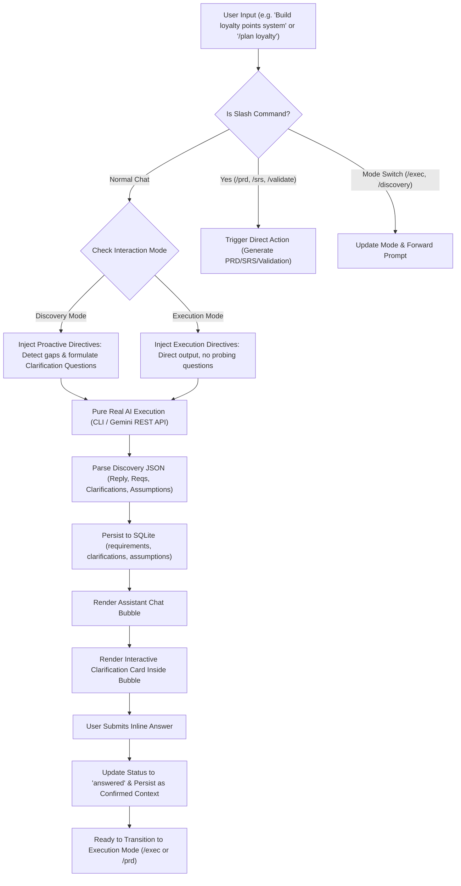

# Implementation Plan: Agentic AI Interaction, Slash Commands & Interactive Clarification UX

Technical planning document designing the evolution of the chat workspace into a modern **Agentic AI Workspace** on par with leading developer tools (Cursor, Windsurf, Claude Artifacts, Antigravity).

---

## 1. Goal Description
Transforming chat discovery into an agentic environment through 3 foundational pillars:
1. **Interactive Clarification Cards (The Q&A Loop)**:
   - Proactive gap and ambiguity detection generating structured clarification questions.
   - Questions render **directly inside the assistant's chat bubble** as interactive cards (not plain prose).
   - Users can answer directly within the card, persisting answers to SQLite and refreshing project context.
2. **Slash Commands System (`/` commands)**:
   - Command bar autocomplete triggered when users type `/` into the prompt input.
   - Quick actions to switch modes, request plans, extract requirements, or trigger document generation:
     - `/discovery` or `/explore` — Activate Discovery Mode (proactive exploration, surfacing assumptions).
     - `/plan [feature]` — Request a step-by-step feature implementation plan.
     - `/exec` or `/generate` — Switch to Execution Mode (direct generation without probing questions).
     - `/clarify` — Force the AI to audit context gaps and ask targeted questions.
     - `/prd` — Generate `PRD.md` (20 sections).
     - `/srs` — Generate `SRS.md` (22 sections, IEEE 830).
     - `/arch` — Generate `architecture.md` (16 sections).
     - `/design` — Generate `design.md` (16 sections).
     - `/validate` — Run completeness audit and ambiguity checks.
     - `/clear` — Clear active session chat history.
3. **Agentic Interaction Modes**:
   - Mode selector pill above the prompt bar:
     - 🔍 **Discovery Mode (Default)**: Proactive, exploratory, gap-detecting, generates 1–3 structured questions.
     - 📋 **Product Analyst Mode**: Focuses on business value, personas, user journeys, MoSCoW prioritization.
     - ⚙️ **System Analyst Mode**: Focuses on technical architecture, data schemas, business logic, NFRs, traceability.
     - ⚡ **Execution / Generation Mode**: Passive, zero probing questions, directly synthesizes confirmed requirements into final documents.

---

## 2. Architecture & State Transition Flow



---

## 3. Component Details

### A. Slash Commands Menu (`SlashCommandPopover`)
*   **Trigger**: Opens automatically when the first input character is `/`.
*   **Navigation**: Arrow key navigation (`ArrowUp`, `ArrowDown`), `Enter` to select, `Escape` to dismiss.
*   **Command Catalog**:

| Command | Icon | Label & Description | Action / Effect |
|---|---|---|---|
| `/discovery` | `Search` | **Discovery Mode** — Explore ideas, detect gaps, & ask questions | Sets `interactionMode` to `discovery` |
| `/exec` | `Zap` | **Execution Mode** — Direct execution without probing | Sets `interactionMode` to `execution` |
| `/plan` | `List` | **Create Feature Plan** — Formulate step-by-step specification plan | Injects structured planning prompt |
| `/clarify` | `HelpCircle` | **Force Clarifications** — Pose questions for ambiguous items | Prompts AI to probe context gaps |
| `/prd` | `FileText` | **Generate PRD** — Draft 20-section PRD | Calls `handleGeneratePRD()` |
| `/srs` | `FileCheck` | **Generate SRS** — Draft 22-section SRS | Calls `handleGenerateSRS()` |
| `/arch` | `Cpu` | **Generate Architecture** — System topology & API contracts | Calls `handleGenerateArchitecture()` |
| `/design` | `Layers` | **Generate Design System** — Tokens & screen flows | Calls `handleGenerateDesign()` |
| `/validate` | `Activity` | **Run Quality Check** — Audit ambiguity & completeness | Calls `handleRunValidation()` |
| `/clear` | `Trash2` | **Clear Chat** — Reset active session conversation | Calls chat session reset |

### B. Interactive Clarification Card Inside Chat Bubble
*   When AI responses contain clarification items:
    *   Renders an elegant card below the text response with `border border-amber-200/60 dark:border-amber-900/40 bg-amber-50/20 dark:bg-amber-950/20 rounded-xl p-3 space-y-2`.
    *   Displays badge: `Clarification Needed (Q&A Loop)` in amber.
    *   Presents specific question text (e.g. *"What is the point conversion ratio to currency?"*).
    *   **Inline Answer Form**:
        - Focused input: `Enter your answer here...`
        - Action button: `Save Answer` (`bg-primary hover:bg-primary-hover text-white rounded-lg px-3 py-1 text-xs`).
    *   Upon saving:
        - Card borders transition to green `border-ok/40 bg-ok-tint/20`.
        - Displays `Confirmed Answer` badge with user response text.
        - Invokes `RequirementService.AnswerClarification` in SQLite and refreshes project context.

### C. Mode Selector Switcher (Discovery vs Execution)
*   Compact segmented control above the prompt bar:
    *   🔘 **Discovery (Proactive Q&A)**: `Search` icon, blue accent.
    *   ⚡ **Execution (Direct)**: `Zap` icon, amber/purple accent.
*   Prompt directives:
    - **Discovery**: AI actively detects gaps and outputs 1–3 structured questions.
    - **Execution**: AI assumes industry standards and generates specifications directly without questions.

---

## 4. Proposed Changes

### Component 1: Frontend Chat Workspace (`frontend/src/App.tsx`)
#### [MODIFY] `frontend/src/App.tsx`
1. **State Management**:
   - `interactionMode: 'discovery' | 'execution'` (default: `'discovery'`).
   - `slashQuery: string`, `showSlashMenu: boolean`, `selectedSlashIndex: number`.
2. **Autocomplete Popover Component**:
   - Triggered when `inputMessage.startsWith('/')`.
   - Displays 10 commands with icons and descriptions.
   - Keyboard navigation support (`Enter`, `ArrowDown`, `ArrowUp`, `Escape`).
3. **Render Interactive Clarification Cards in Assistant Bubbles**:
   - Check for open clarification items tied to the assistant message.
   - Render inline answer forms within the bubble.
4. **Mode Directive Headers**:
   - In `handleSendMessage`, inject header directive:
     `[MODE: DISCOVERY - PROACTIVE Q&A & GAP DETECTION]` or
     `[MODE: EXECUTION - DIRECT OUTPUT, NO PROBING QUESTIONS]`.

### Component 2: Backend AI Discovery Engine (`internal/ai/discovery.go`)
#### [MODIFY] `internal/ai/discovery.go`
- Add `mode string` parameter to `BuildDiscoveryPrompt`.
- In `execution` mode:
  - Direct AI to **omit clarification questions** (`clarifications: []`).
  - Focus 100% on structured requirements extraction.
- In `discovery` mode:
  - Direct AI to identify ambiguities and include 1–3 high-value clarification questions.

---

## 5. Verification Plan

### Automated Tests
1. **Frontend Compilation**:
   ```bash
   cd frontend && npm run build
   ```
   *Expectation: 0 TypeScript errors.*
2. **Backend Tests**:
   ```bash
   go test -v ./internal/...
   ```
   *Expectation: All 13 test suites pass (100% PASS).*
3. **Desktop Native Compilation**:
   ```bash
   wails3 task build
   ```

### Manual Verification
1. **Slash Commands Autocomplete**:
   - Type `/` in prompt bar; verify popover appears.
   - Navigate to `/exec` and press `Enter`; verify mode switches to Execution.
   - Type `/prd` and press `Enter`; verify PRD generation executes immediately.
2. **Interactive Clarification Q&A Loop**:
   - Send brief in Discovery Mode: *"Build a voucher discount system."*
   - Verify assistant bubble renders interactive clarification card.
   - Type answer inside card and submit; verify card turns green with `Confirmed Answer`.
3. **Execution Mode Generation**:
   - Switch to `Execution Mode` via toggle or `/exec`.
   - Prompt: *"Write the specifications for this voucher."*
   - Verify AI generates direct specifications without questions.
