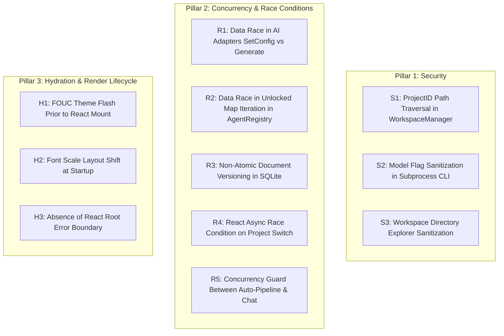

# Comprehensive Audit Plan: Security, Race Conditions, Hydration/FOUC, & E2E Stability

## 1. Executive Summary & Audit Objectives
Based on the user request:
> *"/plan audit security di sourcecodenya, audit race condition, audit hydration jika ada cek keseluruhan code e2e"*

We conducted a deep audit across the entire codebase (Go 1.27 backend, ModernC SQLite WAL, OS Keyring, Wails v3 bindings, and React 19 TypeScript frontend). This audit focuses on 4 foundational pillars:
1. **Security Audit**: Workspace path traversal, CLI/subprocess argument sanitization, credential storage & redactor, and SQL injection prevention.
2. **Race Condition Audit**: Mutex synchronization on Go shared memory, SQLite transaction atomicity, and React async state race conditions during rapid project switching or pipeline execution.
3. **Hydration & Render Lifecycle Audit**: React 19 Client SPA characteristics, elimination of Flash of Unstyled Content (FOUC) on themes and font scaling, and prevention of layout shifts.
4. **End-to-End Resilience**: Error boundaries, stale response cancellation, and UI status synchronization.

---

## 2. Audit Findings



### Specific Findings Detail:

| ID | Category | Risk Level | File Location | Issue Description |
| :--- | :--- | :--- | :--- | :--- |
| **S1** | Security | **High** | `internal/storage/workspace.go` | `ProjectDir(projectID)` joined raw strings without `filepath.Base` / root directory boundary verification. Manipulated `projectID` values could cause path traversal. |
| **S2** | Security | **Medium** | `internal/ai/adapters/...` | `targetModel` passed to CLI flags without whitespace/newline sanitization. |
| **R1** | Concurrency | **High** | `internal/ai/adapters/{antigravity,opencode,gemini}` | Fields `model`, `baseURL`, `apiKey` mutated via `SetConfig()` without `sync.RWMutex` while other goroutines read them in `Generate()` / `ListModels()`. |
| **R2** | Concurrency | **Critical** | `internal/ai/agent_registry.go` | In `SaveSkill` (L293) and `DeleteSkill` (L313), map `r.skills` was iterated *after* `r.mu.Unlock()`. Concurrent read/write could trigger fatal Go panic (`concurrent map iteration and map write`). |
| **R3** | Concurrency | **Medium** | `internal/storage/document_repo.go` | `AddVersion` calculated `SELECT MAX(version_number) + 1` and performed `INSERT` without an explicit SQL transaction (`BeginTx`), risking duplicate version numbers under concurrency. |
| **R4** | Concurrency | **Medium** | `frontend/src/App.tsx` | Rapid project switching in `useEffect([activeProject])` did not cancel previous asynchronous requests, risking stale out-of-order responses overwriting new project state. |
| **R5** | Concurrency | **Low** | `frontend/src/App.tsx` | Chat input submit button was not disabled during `autoPipelineRunning`, risking prompt collisions. |
| **H1** | Hydration/UX | **Medium** | `frontend/index.html` & `App.tsx` | Dark theme applied inside `useEffect` after DOM load, creating a millisecond white flash (FOUC) before dark mode activated. |
| **H2** | Hydration/UX | **Low** | `frontend/index.html` | HiDPI font scaling applied via JS runtime after mount, triggering layout shift. |
| **H3** | Stability | **Medium** | `frontend/src/main.tsx` | Absence of root `<ErrorBoundary>` caused unhandled JS exceptions to render a white screen of death. |

---

## 3. Phased Remediation Plan

### Part 1: Security Hardening
1. **Remediate `internal/storage/workspace.go`**:
   - Enforce strict sanitization in `ProjectDir(projectID)`:
     ```go
     func (wm *WorkspaceManager) ProjectDir(projectID string) string {
         cleanID := filepath.Base(filepath.Clean(projectID))
         if cleanID == "." || cleanID == "/" || cleanID == "\\" {
             cleanID = "default"
         }
         return filepath.Join(wm.rootDir, "projects", cleanID)
     }
     ```
   - Validate all file operations (`SaveAttachment`, `WriteDocument`, `ReadDocument`) verify path confinement against the target directory using `filepath.Rel`.
2. **CLI Parameter Sanitization**:
   - Strip whitespace, newlines, and flag prefix patterns (`--`) from `targetModel` before forwarding to subprocesses.

### Part 2: Concurrency Hardening (Race Condition Elimination)
1. **Thread-Safe AI Adapters**:
   - Add `sync.RWMutex` to `antigravity.Adapter`, `opencode.Adapter`, and `gemini.Adapter`.
   - Protect `SetConfig()`, `GetModel()`, `ListModels()`, and `Generate()` with `mu.Lock()` / `mu.RLock()`.
2. **Mutex Protection in `AgentRegistry` (`internal/ai/agent_registry.go`)**:
   - In `SaveSkill` and `DeleteSkill`, aggregate `customList` inside `r.mu.Lock()` (or `r.mu.RLock()`) prior to unmarshaling and persisting.
3. **Atomic SQLite Transactions (`internal/storage/document_repo.go`)**:
   - Wrap `AddVersion` in database transactions:
     ```go
     tx, err := r.db.BeginTx(ctx, nil)
     if err != nil { return nil, err }
     defer tx.Rollback()
     // SELECT MAX ...
     // INSERT version ...
     // UPDATE document ...
     if err := tx.Commit(); err != nil { return nil, err }
     ```
4. **Stale Response Cancellation in Frontend (`frontend/src/App.tsx`)**:
   - Add monotonic request tokens (`activeProjectReqToken.current++`) inside `useEffect([activeProject])`.
   - Ignore stale callbacks when active project IDs differ from current selection.
5. **Pipeline Concurrency Guard**:
   - Guard `handleSendMessage` with `if (isSending || autoPipelineRunning) return;`.

### Part 3: Hydration Mismatch & FOUC Elimination
1. **Inline Pre-render Script in `frontend/index.html`**:
   - Insert lightweight pre-hydration script in `<head>` before `<body>`:
     ```html
     <script>
       (function() {
         try {
           const theme = localStorage.getItem('theme_mode') || 'system';
           const isDark = theme === 'dark' || (theme === 'system' && window.matchMedia('(prefers-color-scheme: dark)').matches);
           if (isDark) document.documentElement.classList.add('dark');
           const scale = localStorage.getItem('font_scale');
           if (scale && scale !== 'auto' && scale !== '100%') {
             const zoomMap = { '85%': '0.85', '90%': '0.90', '100%': '1.0', '110%': '1.10', '115%': '1.15' };
             if (zoomMap[scale]) document.documentElement.style.zoom = zoomMap[scale];
           }
         } catch(e) {}
       })();
     </script>
     ```
   - Ensures WebView2 / WebKit immediately paints dark backgrounds and correct scales prior to React mount, eliminating FOUC.
2. **Root Error Boundary (`frontend/src/components/ErrorBoundary.tsx` & `main.tsx`)**:
   - Build accessible `ErrorBoundary` styled with Warm Stone tokens, providing a "Reload Studio" action and stack trace copy.

---

## 4. Verification & Testing Plan

1. **Security & Path Traversal Tests**:
   - Unit tests supplying `../../exploit` project IDs to verify directory confinement enforcement.
2. **Concurrency Verification**:
   - Stress tests simulating concurrent goroutines calling `SaveSkill` and `DeleteSkill` simultaneously.
   - Concurrent `AddVersion` transaction tests.
3. **Visual Hydration & FOUC Inspection**:
   - Refresh app in Dark Mode; verify smooth instant rendering without light flash.
4. **Build & Test Commands**:
   - `go test -v ./internal/...`
   - `npm --prefix frontend run build`
