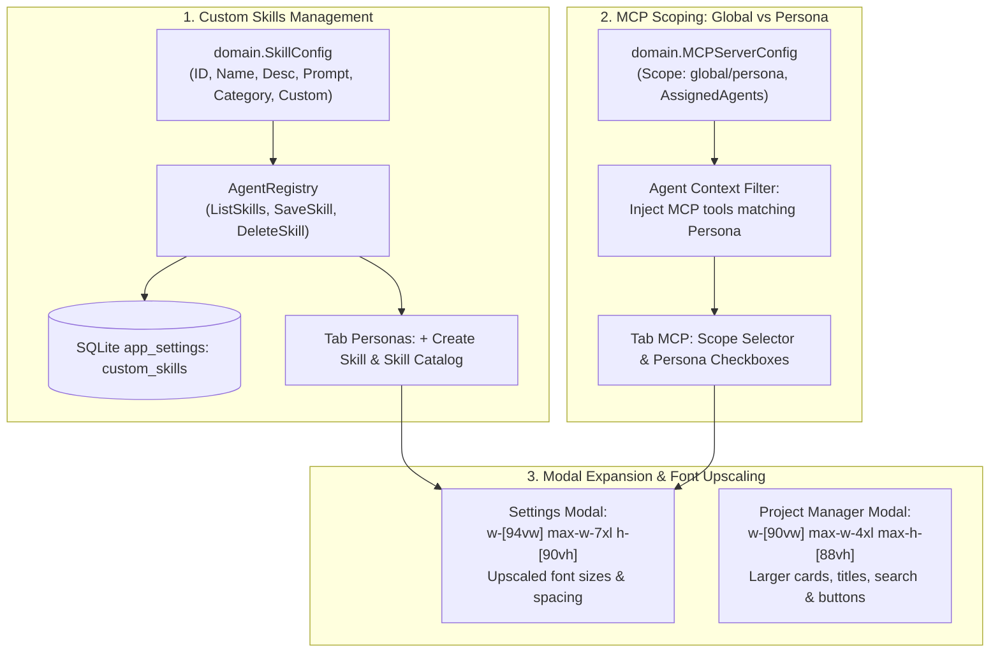

# Plan: Custom Skills Management, MCP Scoping & Modal Expansion

Implementation plan for:
1. **Custom Skills Management:** Interfaces and backend services to create custom skills (+ Add Custom Skill) with name, description, and custom prompts, plus the capability to assign skills to specific specialist personas.
2. **MCP Scoping (Global vs Persona Assignment):** Controls to configure each MCP Server as either **Global (All Personas)** or **Scoped to Specific Personas** (e.g. Figma MCP strictly for UI/UX, Database MCP for Architect/System Analyst).
3. **Modal Expansion & Typography Scaling:**
   - **Studio Settings Modal:** Expanded from `max-w-5xl` to **`w-[94vw] max-w-7xl h-[90vh]`** with upscaled typography across headings, tabs, form controls, and descriptions.
   - **Project Manager / Open Project Modal:** Expanded from `max-w-2xl` to **`w-[90vw] max-w-4xl max-h-[88vh]`** with larger cards, prominent search inputs, and enhanced contrast.

---

## 1. Goal Description

Addressing user requests:
- *"Where can I add skills?"* ➔ Previously skills were static toggles per persona. Users require a **Skill Catalog & Custom Skill Creator** to add new capabilities (e.g. FinTech Compliance, Microservice Event-Driven, Atomic Design System) with custom prompt directives, bound to selected personas.
- *"Can I assign MCP to specific personas or set it global?"* ➔ Evolving MCP Server architecture with a `scope: "global" | "persona"` attribute. If global, all 4 agents have access; if persona, users select authorized personas via checkboxes.
- *"Widen the settings modal and enlarge the fonts, also for open project modal"* ➔ Expanding container widths and typography across desktop modals to utilize widescreen monitors ergonomically.

---

## 2. User Review Required

> [!IMPORTANT]
> **Custom Skill Workflow:**
> In the *Specialist Personas & Skills* tab, two primary actions are provided:
> 1. **"+ Add Existing Skill to Persona"**: Select from existing built-in or custom catalogs.
> 2. **"+ Create New Custom Skill"**: Opens a form to define new skills:
>    - **Skill Name** (e.g. *OJK & BI Payment Gateway Compliance*)
>    - **Skill ID** (e.g. *ojk-payment-compliance*)
>    - **Category** (Product, System, Architecture, UI/UX, General)
>    - **Skill Prompt Directive** (Instructions injected into the LLM when active)
> Custom skills persist in SQLite `app_settings` across projects.

> [!IMPORTANT]
> **MCP Scope Choices (Global vs Persona):**
> On MCP Server registration/editing:
> - **🌐 Global (All Personas):** Available for Product Analyst, System Analyst, Software Architect, and UI/UX Agent.
> - **🎯 Specific Personas:** Checkbox selection for specific specialist personas.

---

## 3. Architecture



---

## 4. Proposed Changes

### Component 1: Backend Domain & Agent Registry (Go)

#### [MODIFY] [`internal/domain/models.go`](file:///E:/dev-agent-assistant/internal/domain/models.go)
1. Add `SkillConfig` struct:
   ```go
   type SkillConfig struct {
       ID          string `json:"id"`
       Name        string `json:"name"`
       Description string `json:"description"`
       Prompt      string `json:"prompt"`
       Category    string `json:"category"` // "product" | "system" | "architecture" | "uiux" | "general"
       Custom      bool   `json:"custom"`
   }
   ```
2. Update `MCPServerConfig` struct with `Scope` and `AssignedAgents`:
   ```go
   type MCPServerConfig struct {
       ID             string            `json:"id"`
       Name           string            `json:"name"`
       Transport      string            `json:"transport"` // "stdio" or "sse"
       Endpoint       string            `json:"endpoint"`  // command path or SSE url
       Enabled        bool              `json:"enabled"`
       Scope          string            `json:"scope"`     // "global" | "persona"
       AssignedAgents []string          `json:"assigned_agents,omitempty"`
       Env            map[string]string `json:"env,omitempty"`
   }
   ```

#### [MODIFY] [`internal/ai/agent_registry.go`](file:///E:/dev-agent-assistant/internal/ai/agent_registry.go)
- Manage `skills map[string]domain.SkillConfig` with built-in defaults.
- Provide methods:
  - `ListSkills() []domain.SkillConfig`
  - `SaveSkill(skill domain.SkillConfig) error`
  - `DeleteSkill(id string) error`
  - `GetSkillsForAgent(agentID string) []domain.SkillConfig`
  - `GetMCPServersForAgent(agentID string) []domain.MCPServerConfig` (returns global MCPs + persona-assigned MCPs).

#### [MODIFY] [`internal/services/provider_service.go`](file:///E:/dev-agent-assistant/internal/services/provider_service.go)
- Expose methods to Wails:
  - `ListSkills() []domain.SkillConfig`
  - `SaveSkill(skill domain.SkillConfig) error`
  - `DeleteSkill(id string) error`

#### [MODIFY] [`internal/services/conversation_service.go`](file:///E:/dev-agent-assistant/internal/services/conversation_service.go)
- Inject active skill prompts and authorized MCP tool descriptions into agent system prompts during execution.

---

### Component 2: Frontend UI & Modals (`frontend/src/App.tsx`)

#### [MODIFY] [`frontend/src/App.tsx`](file:///E:/dev-agent-assistant/frontend/src/App.tsx)

1. **Settings Modal Expansion & Typography:**
   - Update container to:
     ```tsx
     <div className="bg-surface border border-border rounded-[14px] p-7 w-[94vw] max-w-7xl h-[90vh] shadow-2xl flex flex-col overflow-hidden animate-in fade-in zoom-in-95 duration-100">
     ```
   - Headers: `text-base font-bold`.
   - Tabs: `text-sm font-semibold px-4 py-2`.
   - Labels: `text-xs font-bold text-fg` (13px), inputs: `text-sm px-3.5 py-2`.

2. **Custom Skills UI in Personas & Skills Tab:**
   - Add **"Skill Library & Custom Skills"**:
     - **"+ Create New Skill"** modal form.
     - Skill assignment selector per active persona.
     - Toggle switches for active/inactive state.
     - `Custom` badge and deletion option for user-authored skills.

3. **MCP Scoping UI in MCP Connections Tab:**
   - Scope radio selection: **🌐 Global (All Personas)** vs **🎯 Specific Personas**.
   - If specific, render checkboxes for 4 specialist personas.
   - Display scope badges on registered servers.
   - Show authorized MCP tools under each persona tab.

4. **Project Manager / Open Project Modal Expansion:**
   - Update container to:
     ```tsx
     <div className="bg-surface border border-border rounded-[14px] w-[90vw] max-w-4xl shadow-2xl overflow-hidden flex flex-col max-h-[88vh] animate-in fade-in zoom-in-95 duration-100">
     ```
   - Larger search bar, card padding, and legible project descriptions.

---

## 5. Verification Plan

### Automated Tests
1. **Backend Go Unit Tests:**
   ```powershell
   go test -v ./internal/...
   ```
   *Success criteria:* 100% PASS, including Custom Skill CRUD and MCP scoping filters.
2. **Wails Bindings Generation:**
   ```powershell
   wails3 generate bindings -ts -i
   ```
3. **Frontend Production Build:**
   ```powershell
   npm --prefix frontend run build
   ```
   *Success criteria:* Vite compiles cleanly with 0 errors.

### Manual Verification
1. Inspect Open Project modal for expanded dimensions (`max-w-4xl`) and legibility.
2. Inspect Settings modal for spacious `max-w-7xl` layout.
3. Test creating a custom skill and assigning it to an agent persona.
4. Verify scoped MCP servers only appear for assigned personas.
