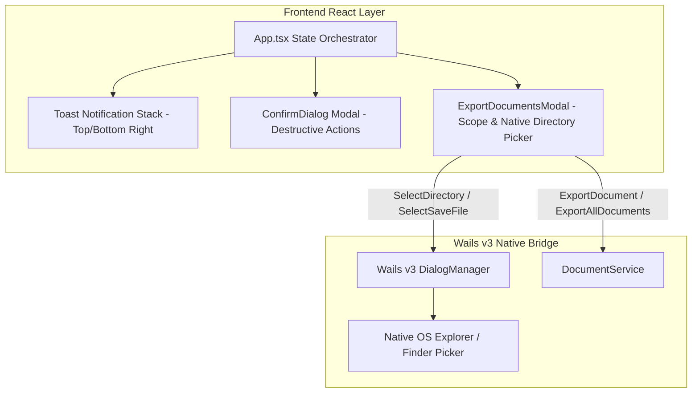

# Implementation Plan: In-App Toast System, Confirmation Dialogs & Native File Export Modal

## 1. Goal Description
Addressing user feedback regarding browser dialogs:
> *"Don't use default browser dialog alerts, provide proper in-app UI, and for export all use native file dialogs..."*

Previously, the app used default browser dialogs (`window.alert`, `window.confirm`, `window.prompt`):
1. **`alert(...)` (40+ invocations)**: Froze WebView rendering and displayed unstyled browser popups.
2. **`confirm(...)` (3 invocations for deleting projects, skills, and MCP servers)**: Unstyled modal popups risking accidental clicks.
3. **`prompt(...)` (2 invocations for document export)**: Required users to manually type destination paths into a basic browser input.

This plan reconstructs all dialogs into native, elegant desktop components adhering to the MQ-Studio Token System.

---

## 2. User Review Required
> [!IMPORTANT]
> 1. All `alert()` calls are replaced by a **Toast Notification System** with 3.5s auto-dismiss and manual dismiss controls.
> 2. Destructive `confirm()` popups are replaced by a **Backdrop Blur Confirmation Modal** featuring distinct red/primary action buttons.
> 3. Document export `prompt()` inputs are replaced by a **Dedicated Export Modal** with a **"Browse..."** button launching the native Windows Explorer / macOS Finder directory picker via Wails v3.

---

## 3. Architecture



---

## 4. Proposed Changes

### A. Backend Layer (Wails v3 Dialog Manager)
#### [MODIFY] `internal/services/document_service.go`
- Integrate `application.Get().Dialog` to launch native OS directory and file pickers:
  ```go
  func (s *DocumentService) SelectDirectory(title string) (string, error) {
      app := application.Get()
      if app == nil || app.Dialog == nil {
          return "", fmt.Errorf("dialog manager unavailable")
      }
      dlg := app.Dialog.OpenFile().
          CanChooseDirectories(true).
          CanChooseFiles(false).
          CanCreateDirectories(true)
      if title != "" {
          dlg.SetTitle(title)
      }
      return dlg.PromptForSingleSelection()
  }

  func (s *DocumentService) SelectSaveFile(title string, defaultFilename string) (string, error) {
      app := application.Get()
      if app == nil || app.Dialog == nil {
          return "", fmt.Errorf("dialog manager unavailable")
      }
      dlg := app.Dialog.SaveFile()
      if title != "" {
          dlg.SetTitle(title)
      }
      if defaultFilename != "" {
          dlg.SetFilename(defaultFilename)
      }
      return dlg.PromptForSingleSelection()
  }
  ```

#### [MODIFY] `frontend/bindings/ai-requirements-studio/internal/services/documentservice.ts`
- TypeScript bindings with method hashes:
  - `SelectDirectory(title: string): $CancellablePromise<string>` (`ID: 4043236185`)
  - `SelectSaveFile(title: string, defaultFilename: string): $CancellablePromise<string>` (`ID: 2175121209`)

---

### B. Frontend Layer (React 19 & Tailwind CSS)

#### [NEW] `frontend/src/components/Toast.tsx`
- Toast Notification Stack:
  - Types: `success`, `error`, `info`, `warn`.
  - Type-specific icons (`CheckCircle2`, `AlertTriangle`, `XCircle`, `Info`).
  - Fade-in and slide-in animations with a progress timer bar.
  - Manual dismiss button (`[✕]`).

#### [NEW] `frontend/src/components/ConfirmModal.tsx`
- Modal dialog for destructive actions:
  - Title, description, and impact warnings.
  - Destructive red action button or primary confirmation button, plus cancel action.

#### [NEW] `frontend/src/components/ExportModal.tsx`
- Dedicated Specification Document Export Modal:
  - Scope options:
    - **Active Document** (PRD / SRS / Architecture / Design System).
    - **All Specification Documents** (PRD 20 Sec, SRS 22 Sec, Arch 16 Sec, Design 16 Sec).
  - Target path input with **"Browse..."** action invoking native OS directory picker.
  - Preview checklist of available specification documents with readiness status.
  - **"Export Now"** execution button with loading feedback.

#### [MODIFY] `frontend/src/App.tsx`
- Replace `alert(...)` with helper methods:
  - `notifySuccess(title, message)`
  - `notifyError(title, message)`
  - `notifyWarn(title, message)`
  - `notifyInfo(title, message)`
- Replace `confirm(...)` with `confirmDialog` state.
- Replace `prompt(...)` with `isExportModalOpen` state.

---

## 5. Verification Plan

### Automated Tests
1. **Backend Go Tests**:
   ```powershell
   go test -v ./internal/services -run TestRequirementService
   go test -v ./internal/...
   ```
2. **Frontend TypeScript Strict & Vite Build**:
   ```powershell
   npm --prefix frontend run build
   ```

### Manual Verification
1. **Toast Verification**:
   - Perform actions (e.g. generate PRD, approve PRD, save settings).
   - Verify green/blue toast renders in bottom-right corner and auto-dismisses after 3.5s.
2. **Confirm Modal Verification**:
   - Trigger project deletion or custom skill deletion.
   - Verify custom modal appears with "Cancel" and "Delete" actions.
3. **Export Modal & Native File Dialog**:
   - Click document Export action.
   - Verify Export modal opens; click "Browse..." to verify native Windows Explorer / macOS Finder opens.
   - Click "Export Now" and verify toast notification appears on completion.
