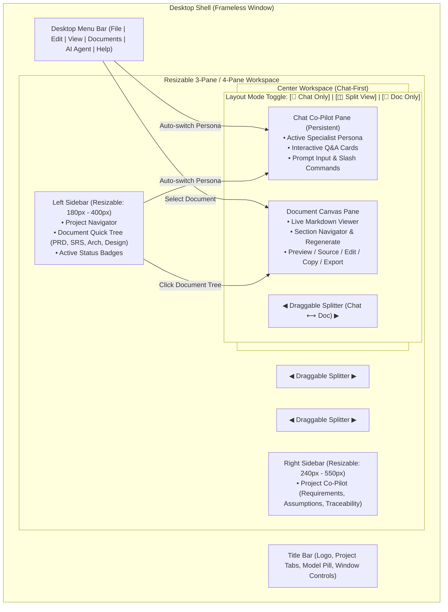

# Implementation Plan: Desktop Menu Bar, Chat-First Architecture, Side-by-Side Document Split, & Resizable Panels

UX architectural transformation of **Specra (AI Requirements Studio)** from a page-swapping paradigm into a **Chat-First** desktop architecture:
1. Native-style **Desktop Application Menu Bar** (`File`, `Edit`, `View`, `Documents`, `AI Agent`, `Help`).
2. Removal of legacy horizontal top steppers (`Discovery > PRD > SRS > Architecture > Design`).
3. Establishing **Chat as an always-accessible primary stage** alongside a **Side-by-Side Split View** (Chat Co-Pilot + Document Canvas), allowing ongoing conversation while reviewing specifications (PRD, SRS, Architecture, Design System).
4. Refining **Context-Aware Persona Auto-Switching** upon opening documents in the Split Canvas.
5. Implementing **Resizable Columns** with drag splitters for the Left Navigator, Center Split (Chat vs Document), and Right Inspector (Project Co-Pilot) with `localStorage` persistence.

---

## 1. Problem Analysis & UX Architecture

### Core Issues Identified:
1. **Chat Occlusion on Document Navigation**:
   Opening PRD, SRS, Architecture, or Design System previously replaced the entire center stage with `MarkdownViewer`. Users could not chat while inspecting specifications, breaking the core conversational feedback loop.
2. **Vertical Space Lost to Redundant Steppers**:
   The top breadcrumb stepper duplicated sidebar navigation and consumed valuable vertical screen space.
3. **Rigid Static Column Widths**:
   Left and right sidebars were fixed-width without user-adjustable resize handles.
4. **Absence of Standard Desktop Menu Hierarchy**:
   File actions, exports, view options, and persona selections were scattered without desktop menu organization.

---

## 2. Proposed Architecture & Solution Design



### A. Desktop Application Menu Bar
Located cleanly below the title bar:
- **`File`**: New Project, Open Project Manager, Open Workspace Folder, Export Active Document, Export All Specifications (.md), Quit.
- **`Edit`**: Copy Full Document, Clear Active Chat History, General Settings.
- **`View`**: 
  - Toggle Left Sidebar (`Ctrl+B`)
  - Toggle Right Co-Pilot (`Ctrl+J`)
  - Toggle Document Canvas (`Ctrl+D`)
  - Layout Mode: `Chat Only` | `Split View (Chat + Doc)` | `Document Only`
  - Color Theme: `Light (Warm Stone)` | `Dark (Obsidian Slate)` | `System Auto`
  - HiDPI Zoom: `Reset (100%)`, `Zoom In (+)`, `Zoom Out (-)`
- **`Documents`** (Specifications):
  - **PRD** (20 sections) ➔ Open Canvas & Select *Product Analyst*
  - **SRS** (22 sections) ➔ Open Canvas & Select *System Analyst*
  - **Architecture** (16 sections) ➔ Open Canvas & Select *Software Architect*
  - **Design System** (16 sections) ➔ Open Canvas & Select *UI/UX Agent*
- **`AI Agent`**:
  - Switch Active Persona: `Product Analyst`, `System Analyst`, `Software Architect`, `UI/UX Agent`
  - Run Autonomous Pipeline (`/plan`, `/discovery`, `/exec`)
  - Force Clarifications (`/clarify`)
  - Run Quality Validation (`/validate`)
- **`Help`**: Run Diagnostics, Keyboard Shortcuts, About Specra.

### B. Legacy Stepper Removal
- Remove redundant horizontal breadcrumbs to maximize canvas reading area.
- Document status badges (*Approved*, *Draft*, *Outdated*, *Gated*) consolidate neatly in Document Headers and Left Navigator.

### C. Chat-First Primary Stage & Split View
- Chat remains active continuously while reading or editing specifications.
- 3 Layout Modes in Header:
  1. **`Split View` (Default on document open)**: Side-by-side chat and specification canvas with resizable splitter.
  2. **`Chat Only`**: Full-width view for brainstorming and discovery.
  3. **`Document Only`**: Focused view for deep specification review and editing.
- **Context-Aware Persona Auto-Switching**:
  - Opening **PRD** automatically sets active persona to **Product Analyst**.
  - Opening **SRS** automatically sets active persona to **System Analyst**.
  - Opening **Architecture** automatically sets active persona to **Software Architect**.
  - Opening **Design System** automatically sets active persona to **UI/UX Agent**.

### D. Resizable Panels with LocalStorage Persistence
- Drag splitters with `cursor-col-resize` and hover highlights.
- Persist dimensions to `localStorage`:
  - `left_panel_width`: default `220px` (min `160px`, max `400px`).
  - `right_panel_width`: default `320px` (min `240px`, max `550px`).
  - `chat_split_ratio`: default `45%` (min `25%`, max `75%`).
- Drag overlays preventing mouse drift across text and code blocks.

---

## 3. Proposed Code Changes

### Component 1: Desktop Menu Bar (`frontend/src/components/DesktopMenuBar.tsx`) [NEW]
Desktop menu bar with dropdowns, keyboard shortcut hints, active checkmarks, and accessible popover focus traps.

### Component 2: Resizable Splitter Hook (`frontend/src/hooks/useResizablePanel.ts`) [NEW]
Reusable hook managing column drag gestures, boundary clamping, and `localStorage` persistence.

### Component 3: Document Canvas Pane (`frontend/src/components/DocumentCanvasPane.tsx`) [NEW]
Modular canvas rendering active specifications:
- Document header (Status badge, Version pill, Section selector, Regenerate button, Copy, Export, Edit/Save).
- Markdown Viewer with interactive Mermaid diagrams.
- Manual editor mode (monospaced textarea).
- Quick layout toggles (`Chat Only`, `Split`, `Doc Only`).

### Component 4: App Integration (`frontend/src/App.tsx`) [MODIFY]
- Integrate `<DesktopMenuBar />`.
- Replace static widths with resizable 3-pane split view.
- Remove legacy horizontal stepper.
- Synchronize active persona with document selection.

---

## 4. Verification Plan

### Automated Tests:
```bash
npm --prefix frontend run build
go test -v ./internal/...
```

### Manual Verification:
1. **Desktop Menu Bar**:
   - `Documents > PRD` opens Document Canvas in Split View with Product Analyst selected; chat remains active on left.
   - `Documents > SRS` switches canvas to SRS and selects System Analyst.
   - `View > Layout Mode` switches between Chat Only, Split View, and Document Only.
2. **Resizable Columns**:
   - Drag splitters for Left Sidebar, Center Split, and Right Inspector; verify smooth dragging and dimension persistence upon reload.
3. **Chat-First Workflow**:
   - Send chat messages while PRD is open in Split View; verify AI responds directly without closing the document.
