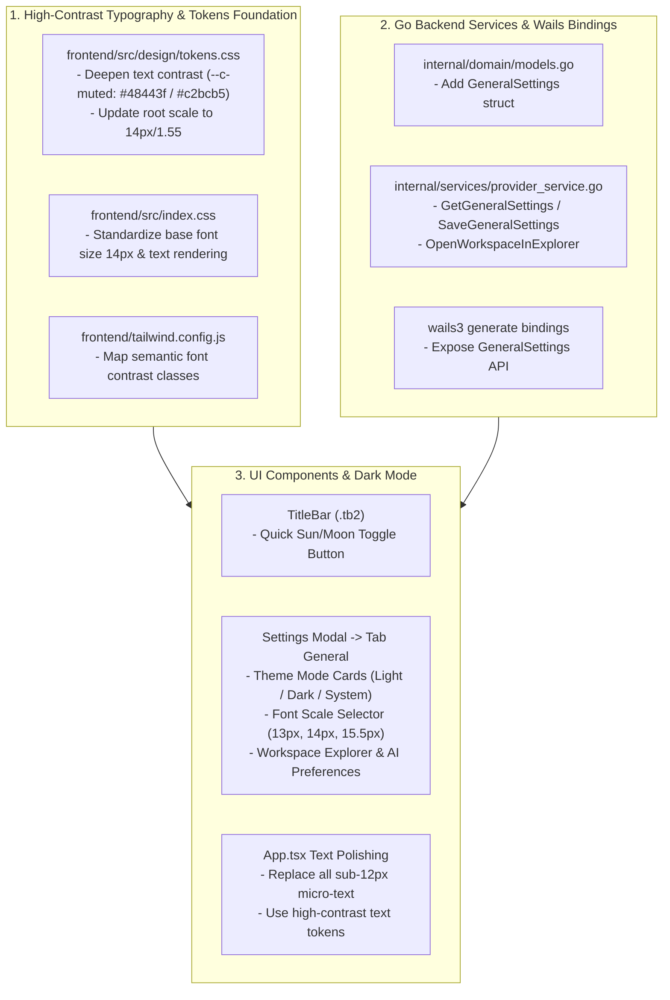

# Plan: General Settings, Full Dark Mode Version & High-Contrast Typography System

Implementation plan addressing:
1. **Font Scale Up** from a 13px baseline to 14px application-wide, eliminating micro-fonts (10px/11px) that impair legibility.
2. **High-Contrast Text Color System (Anti-Washed Out)**: Elevate contrast for primary text (`--c-fg`), secondary text (`--c-fg-2`), and muted text (`--c-muted`) across light and dark modes to ensure robust, clear visibility.
3. **General Settings Tab**: Comprehensive settings page with theme switcher, font scale controls (Compact 13px, Standard 14px, Comfort 15.5px), file manager workspace integration, and AI preferences.
4. **Quick Theme Toggle (Sun/Moon)** in the TitleBar for 1-click access.

---

## 1. Goal Description

Resolving font readability issues through:
- **Baseline Typography Scale Upgrade:**
  - Standardize base font to **`14px/1.55`**.
  - Eliminate micro-text below 12px; enforce minimum **`12px` (medium/semibold)** for badges and metadata.
  - Form labels, inputs, textareas, and buttons elevated to **`13.5px - 14px`**.
  - Panel titles and modal headings elevated to **`15px - 18px`**.
- **High-Contrast Text Color Tokens (`tokens.css`):**
  - **Light Mode:**
    - `--c-fg` (primary text): `#171513` (sharp contrast).
    - `--c-fg-2` (secondary text): elevated to `#2e2a26`.
    - `--c-muted` (labels/hints): elevated to `#48443f` (passes WCAG AA 4.5:1+ against `--c-bg` `#faf6f0`).
    - `--c-muted-2`: elevated to `#635e58`.
  - **Dark Mode:**
    - `--c-fg` (primary text): `#f7f5f3`.
    - `--c-fg-2` (secondary text): elevated to `#e8e4e0`.
    - `--c-muted` (labels/hints): elevated to `#c2bcb5` (distinctly legible against dark backgrounds `#1a1816` and `#171513`).
- **General Settings Tab:**
  - Positioned as the first tab in Studio Settings Modal.
  - Covers Appearance (Theme cards with mini-app previews, Font Scale Picker, Motion toggle), Workspace (Open File Explorer, Auto-save), AI Preferences (Language, template depth, clarification proactivity), and Notifications.
- **Quick Theme Toggle:**
  - 1-click Sun/Moon toggle in the TitleBar.

---

## 2. Architecture



---

## 3. Proposed Changes

### Component 1: Typography & Color System Refinement

#### [MODIFY] [`frontend/src/design/tokens.css`](file:///E:/dev-agent-assistant/frontend/src/design/tokens.css)
- Baseline `.m3`:
  ```css
  font: 14px/1.55 var(--app-ui-font, -apple-system, BlinkMacSystemFont, 'Segoe UI', Roboto, sans-serif);
  ```
- Contrast enhancement in `:root` (Light Mode):
  ```css
  --c-fg: #171513;
  --c-fg-2: #2e2a26;
  --c-muted: #48443f;
  --c-muted-2: #635e58;
  ```
- Contrast enhancement in `:root.dark, .dark` (Dark Mode):
  ```css
  --c-fg: #f7f5f3;
  --c-fg-2: #e8e4e0;
  --c-muted: #c2bcb5;
  --c-muted-2: #948e87;
  ```

#### [MODIFY] [`frontend/src/index.css`](file:///E:/dev-agent-assistant/frontend/src/index.css)
- Enforce base typography:
  ```css
  body {
    font-size: 14px;
    line-height: 1.55;
    text-rendering: optimizeLegibility;
    -webkit-font-smoothing: antialiased;
  }
  ```

---

### Component 2: Backend Domain & General Settings API

#### [MODIFY] [`internal/domain/models.go`](file:///E:/dev-agent-assistant/internal/domain/models.go)
Add struct `GeneralSettings`:
```go
type GeneralSettings struct {
	Theme                  string `json:"theme"`                   // "system" | "light" | "dark"
	FontSize               string `json:"font_size"`               // "compact" (13px), "standard" (14px), "comfort" (15.5px)
	Animations             bool   `json:"animations"`              // true / false
	Language               string `json:"language"`                // "id" | "en"
	AutoSaveDraft          bool   `json:"auto_save_draft"`         // true / false
	AutoSaveIntervalMs     int    `json:"auto_save_interval_ms"`   // 1000
	DefaultDocDepth        string `json:"default_doc_depth"`       // "standard" | "compact"
	ProactiveClarification bool   `json:"proactive_clarification"` // true / false
	DesktopNotifications   bool   `json:"desktop_notifications"`   // true / false
	WorkspacePath          string `json:"workspace_path"`          // Workspace folder path
}
```

#### [MODIFY] [`internal/services/provider_service.go`](file:///E:/dev-agent-assistant/internal/services/provider_service.go)
- `GetGeneralSettings() (domain.GeneralSettings, error)`: Read general settings from `app_settings`.
- `SaveGeneralSettings(settings domain.GeneralSettings) error`: Persist general settings to `app_settings`.
- `OpenWorkspaceInExplorer() error`: Open workspace folder in native OS file manager.

---

### Component 3: Frontend UI, TitleBar Quick Toggle & Settings Modal

#### [MODIFY] [`frontend/src/App.tsx`](file:///E:/dev-agent-assistant/frontend/src/App.tsx)
1. **Dynamic Font Scaling**:
   - Manage font scales: `'compact'` (13px), `'standard'` (14px default), `'comfort'` (15.5px).
2. **TitleBar Quick Theme Toggle**:
   - Sun/Moon icon button in TitleBar next to settings.
3. **General Settings Tab**:
   - Theme options: *Light*, *Dark*, *System* with mini mockup preview cards.
   - Font scale selector: *Compact (13px)*, *Standard (14px)*, *Comfort (15.5px)*.
   - Workspace directory path with *"Open in Explorer"* button.
   - Output language and AI proactivity preferences.
4. **Typography Polish**:
   - Replace sub-12px micro-text with minimum 12px semibold styling.
   - Apply high-contrast text classes `text-fg` and `text-fg-2`.

---

## 4. Verification Plan

### Automated Tests
1. **Go Backend Tests**:
   ```powershell
   go test -v ./internal/...
   ```
   *Expectation:* 100% PASS across all suites.
2. **TypeScript & Vite Build**:
   ```powershell
   npm --prefix frontend run build
   ```
3. **Wails Native Build**:
   ```powershell
   wails3 task build
   ```

### Manual Verification
1. Inspect UI text rendering: Verify contrast and elimination of faint grey micro-text.
2. Click Sun/Moon icon in TitleBar: Verify instant dark mode switch with cream-white secondary text (`#c2bcb5`).
3. Open General Settings: Switch font scale and click *"Open in Explorer"*; verify native file explorer launches.
