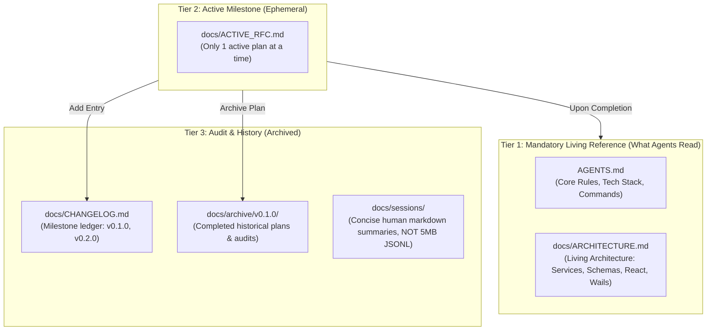

# Implementation Plan: Lean Living Architecture & Streamlined Documentation Workflow

## Goal Description
Transform the repository's documentation from an uncontrolled graveyard of 43+ ephemeral planning files and 4.6MB of raw JSONL transcripts into a **Lean Living Architecture Workflow**. This ensures that any AI coding agent or human engineer can immediately understand the codebase by reading a single consolidated document (`docs/ARCHITECTURE.md`), eliminating context bloat and token waste, while maintaining a clean, auditable milestone history.

---

## The Problem with the Current Approach

1. **Context Pollution & Token Waste**:
   - `docs/artifacts/` currently contains **43 markdown files** (752 KB) describing intermediate drafts, speculative ideas, and superseded decisions from Phases 1–12.
   - When a new coding agent joins a session, scanning `docs/` consumes tens of thousands of unnecessary tokens and risks the agent adopting obsolete design patterns from early phases.
2. **Git Bloat from Raw Machine Transcripts**:
   - `docs/context_history/` contains `transcript_01_windows.jsonl` (2.8 MB) and `transcript_02_macos.jsonl` (1.8 MB) = **4.6 MB of raw machine step logs** committed directly to Git.
   - As sessions continue, this directory will balloon to 50MB–100MB+, slowing down git clones/pulls. Antigravity CLI already persists complete transcripts locally in `~/.gemini/antigravity-cli/brain/`.
3. **No Single Living Source of Truth**:
   - Knowledge of how Specra works *today* is fragmented across 43 different plan files instead of being documented in a single, authoritative living architecture file.

---

## Proposed Solution: The 3-Tier Living Documentation Workflow



### Tier 1: Living Reference (What coding agents MUST read)
1. **`AGENTS.md`** (~100 lines):
   - Fast rules: Mission, Tech stack, Zero-Mock policy, Coding standards, Test & dev commands.
2. **`docs/ARCHITECTURE.md`** (NEW, ~300 lines):
   - The authoritative single source of truth describing the codebase **as it exists right now**:
     - Backend Service Architecture (`internal/services`, `internal/domain`)
     - SQLite Schema & WAL Storage (`internal/storage`)
     - Frontend Architecture & State Management (React 19, Wails bindings, Design Tokens)
     - AI Provider Integrations (`agy`, `opencode`, Gemini REST) & Sandboxing
     - Document Lifecycle & Approval Gating (PRD ➔ SRS ➔ Arch ➔ Design)
   - When a feature is completed, the agent simply updates the relevant section in `ARCHITECTURE.md`.

### Tier 2: Active Working Plan (`docs/ACTIVE_RFC.md`)
- There is only **one active plan file** at any given time.
- When the user asks for a new feature or `/plan`, the agent writes `docs/ACTIVE_RFC.md`.
- Once the milestone is implemented and verified:
  1. Key architectural changes are merged into `docs/ARCHITECTURE.md`.
  2. A 3-line summary is added to `docs/CHANGELOG.md`.
  3. `ACTIVE_RFC.md` is reset or moved to `docs/archive/v0.1.0/`.

### Tier 3: Historical History & Log Hygiene
- **`docs/CHANGELOG.md`**: Clean, human-readable list of releases and feature milestones.
- **`docs/archive/`**: All 43 historical plans from Phases 1–12 are moved here so the active `docs/` root stays clean.
- **Gitignore Machine Transcripts**:
  - Add `docs/context_history/*.jsonl` to `.gitignore`.
  - Instead of multi-megabyte machine JSONL logs, maintain compact markdown summaries in `docs/sessions/session_summary.md` (if desired).

---

## Token & Efficiency Comparison

| Metric | Current Workflow | Proposed Lean Workflow | Improvement |
| :--- | :--- | :--- | :--- |
| **Files in `docs/` Root** | 43+ markdown files | 4 core files (`ARCHITECTURE.md`, `CHANGELOG.md`, `INSTALLATION.md`, `ACTIVE_RFC.md`) | **90% reduction** |
| **Git Repository Weight** | 4.6 MB JSONL (growing indefinitely) | Clean repository, JSONL ignored | **Instant ~5MB+ saved** |
| **Agent Ingestion Tokens** | ~50,000 – 100,000 tokens | **~6,500 tokens** (`AGENTS.md` + `ARCHITECTURE.md`) | **85%–90% faster & cheaper** |
| **Accuracy of Context** | Fragmented across obsolete drafts | 100% current state of truth | **Zero hallucinations** |

---

## Proposed Changes

### Component 1: Living Architecture Reference

#### [NEW] `docs/ARCHITECTURE.md`
Create the comprehensive single source of truth documenting:
- System overview and modular domain structure.
- SQLite schemas (Projects, Documents, Conversations, Requirements, Assumptions, Questions).
- 4 Specialist personas and upstream-to-downstream approval gating.
- Frontend architecture (React 19, custom SplitPane, MermaidBlock preview, Settings modal, MQ-Studio tokens).
- Pure Real AI execution (Zero-Mock policy, dynamic CLI agent discovery, stdin pipeline).

#### [NEW] `docs/CHANGELOG.md`
Create a clean version history documenting major releases:
- `v0.1.0 (2026-11-15)`: Initial release — 4 Specialist Personas, Zero-Mock AI pipeline, Desktop menu bar, Split view, Interactive Mermaid preview, macOS DMG & Windows EXE distribution.

---

### Component 2: Archiving Historical Artifacts & Cleaning Transcripts

#### [NEW] `docs/archive/v0.1.0/`
- Move existing 43 historical plan and walkthrough files from `docs/artifacts/` into `docs/archive/v0.1.0/`.
- Preserves complete historical audit trail without polluting the active directory.

#### [MODIFY] `.gitignore`
- Add `docs/context_history/*.jsonl` so raw LLM machine logs are not committed to Git.
- Keep `docs/context_history/README.md` explaining how local transcripts are stored in `~/.gemini/antigravity-cli/brain/`.

---

### Component 3: Updating Guidelines & Catalog

#### [MODIFY] `AGENTS.md`
- Revise **Rule 2 (Documentation Protocol)** to mandate the new 3-tier workflow:
  1. Read `AGENTS.md` and `docs/ARCHITECTURE.md` before coding.
  2. Use `docs/ACTIVE_RFC.md` during active tasks.
  3. Update `docs/ARCHITECTURE.md` and append to `docs/CHANGELOG.md` upon completion.
  4. Never commit multi-megabyte raw JSONL logs to Git.

#### [MODIFY] `docs/README.md`
- Replace the 100-line catalog of 43 individual plan files with a sleek, structured table of contents pointing to `docs/ARCHITECTURE.md`, `docs/CHANGELOG.md`, `docs/INSTALLATION.md`, and `docs/archive/`.

---

## Verification Plan

### Automated Verification
```bash
# Verify repo cleanliness
ls -la docs/
ls -la docs/archive/v0.1.0/

# Verify tests still pass 100%
export PATH=$PATH:/opt/homebrew/bin:~/go/bin
go test -v ./internal/...

# Verify frontend build
cd frontend && npm run build
```

### Manual Verification
1. Review `docs/ARCHITECTURE.md` to ensure all key components (Backend, Frontend, AI providers, SQLite) are accurately represented.
2. Check `git status` to ensure repository size is reduced and no unnecessary files are tracked.
