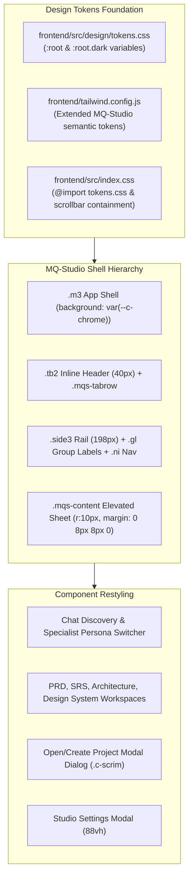

# Plan: MQ-Studio 0.4.2 Design System & Color Tokens Adaptation

Specification and implementation plan aligning the **Specra (AI Requirements Studio)** interface with the **Design System, Color Tokens, and Shell Architecture** adapted from `_ref_ui/mq-studio-0.4.2`.

---

## 1. Goal Description

Aligning visual architecture and styling tokens with MQ-Studio 0.4.2 desktop ergonomics:
- **Layering & Chrome Concept (`.m3` & `.mqs-content`):**
  - Shift from flat layouts to a layered *desktop chrome* model: window background rendered via `--c-chrome` (Warm Stone `#eeece8` in light mode, Obsidian Slate `#121110` in dark mode).
  - Main workspaces (Chat Discovery, PRD, SRS, Architecture, Design System) render as an **elevated sheet** (`.mqs-content`) with an 8px gutter margin, `border-radius: 10px`, fine hairline border `1px solid var(--c-border)`, and subtle elevation shadow `box-shadow: 0 1px 2px rgba(28, 25, 23, 0.04)`.
- **Palette & Semantic Color Tokens:**
  - Adopt CSS token variables in `:root` and `:root.dark`: `--c-bg`, `--c-chrome`, `--c-panel`, `--c-fill`, `--c-border`, `--c-primary` (Cobalt `#2f6bf0` / `#5b8cff`), tone colors (`--c-tone-blue`, `--c-tone-violet`, `--c-tone-teal`, `--c-tone-orange`), and status indicators (`--c-ok`, `--c-warn`, `--c-err`).
- **Title Bar & Project Tabs (`.tb2` & `.mqs-tabrow`):**
  - 40px title bar with horizontal project tabs (`140px`), elevated active tab, hover states with close action `×`, and right-aligned window actions.
- **Sidebar (`.side3`):**
  - 198px precision rail positioned directly on `--c-chrome` without rigid border separators, featuring group headers `.gl` and navigation buttons `.ni` with cobalt hover tints.
- **Typography Ramp:**
  - Standard base font at `13px/1.5` with system sans-serif and monospace stacks, labels at `12.5px`, and metadata/badges at `11px`.

---

## 2. Architecture



---

## 3. Proposed Changes

### Component 1: Design Tokens Foundation

#### [NEW] `frontend/src/design/tokens.css`
Adapted token scale:
- **Surfaces:** `--c-bg`, `--c-chrome`, `--c-panel`, `--c-bar`, `--c-fill`, `--c-fill-soft`, `--c-fill-mute`, `--c-rule`.
- **Borders:** `--c-border`, `--c-border-soft`, `--c-border-dash`, `--c-border-strong`.
- **Foreground:** `--c-fg`, `--c-fg-2`, `--c-mono-dim`, `--c-muted`, `--c-muted-2`, `--c-disabled`.
- **Brand & Action:** `--c-primary` (`#2f6bf0`), `--c-primary-hover` (`#2459d6`), `--c-primary-soft` (`#ebf1ff`), `--c-primary-text` (`#2155cc`).
- **Tones:** Blue, Violet, Teal, Orange, Pink, Slate.
- **Feedback:** `--c-ok`, `--c-warn`, `--c-err`.
- **Motion:** `--mo-fast` (0.12s), `--mo-base` (0.18s), `--mo-slow` (0.28s), `--mo-ease`.

#### [MODIFY] `frontend/src/index.css`
- Add `@import './design/tokens.css';`.
- Enforce typography defaults:
  ```css
  font-family: var(--app-ui-font, -apple-system, system-ui, sans-serif);
  font-size: 13px;
  line-height: 1.5;
  ```

#### [MODIFY] `frontend/tailwind.config.js`
- Map Tailwind colors to semantic tokens:
  ```js
  theme: {
    extend: {
      colors: {
        chrome: 'var(--c-chrome)',
        surface: 'var(--c-bg)',
        panel: 'var(--c-panel)',
        fill: 'var(--c-fill)',
        border: 'var(--c-border)',
        fg: 'var(--c-fg)',
        muted: 'var(--c-muted)',
        primary: {
          DEFAULT: 'var(--c-primary)',
          hover: 'var(--c-primary-hover)',
          soft: 'var(--c-primary-soft)',
          text: 'var(--c-primary-text)',
        },
        tone: {
          blue: 'var(--c-tone-blue)',
          violet: 'var(--c-tone-violet)',
          teal: 'var(--c-tone-teal)',
          orange: 'var(--c-tone-orange)',
        },
        ok: 'var(--c-ok)',
        warn: 'var(--c-warn)',
        err: 'var(--c-err)',
      }
    }
  }
  ```

---

### Component 2: Shell Layout & Navigation

#### [MODIFY] `frontend/src/App.tsx`
- **Root Shell Container:** Outer wrapper `.m3` with `background: var(--c-chrome)`.
- **Top Title Bar (`.tb2`):** 40px height with `.mqs-tabrow` and `.mqs-tab` tabs.
- **Sidebar (`.side3`):** 198px width with `.gl` group headers and `.ni` items.
- **Central Workspace (`.mqs-content`):** Elevated sheet with 8px margin, 10px radius, and hairline borders.

---

### Component 3: Chat Discovery, Documents & Modals

#### [MODIFY] `frontend/src/App.tsx`
- **Specialist Agent Switcher in Chat:**
  - Product Analyst: Blue Tone (`--c-tone-blue`)
  - System Analyst: Teal Tone (`--c-tone-teal`)
  - Software Architect: Violet Tone (`--c-tone-violet`)
  - UI/UX Agent: Orange Tone (`--c-tone-orange`)
- **Chat Bubbles & Controls:**
  - User bubbles: `--c-primary-soft` with `--c-primary` borders.
  - Assistant bubbles: `--c-panel` with semantic tone badges.
- **Document Workspaces:** Clean headers, status badges (`--c-ok`, `--c-warn`, `--c-err`), and structured markdown presentation.
- **Modals:** Backdrop `--c-scrim` with rounded 12px surface panels.

---

## 4. Verification Plan

### Automated Tests
1. Frontend build: `npm --prefix frontend run build` (0 errors).
2. Go tests: `go test -v ./internal/...` (100% PASS).
3. Native build: `wails3 task build`.

### Manual Verification
1. Inspect light and dark palettes for Warm Stone and Obsidian Slate aesthetics.
2. Confirm elevated central sheet geometry (8px margin, 10px corner radius).
3. Verify Cobalt blue focus rings and button hover states.
