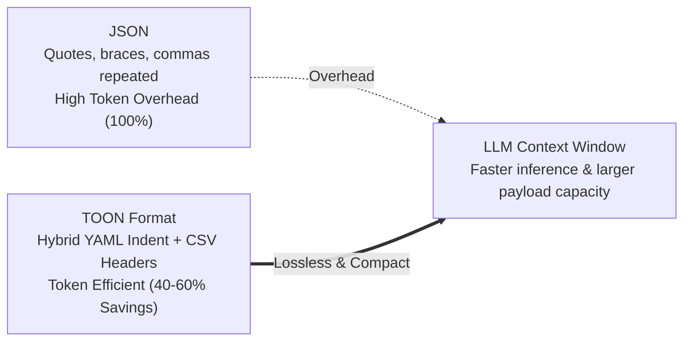

# Implementation Plan: OpenCode CLI JSON Response Fix & Token Savings via TOON Format

Comprehensive technical analysis and implementation plan addressing:
1. **Root Cause & Resolution:** Why chat responses rendered raw JSON under **OpenCode CLI**.
2. **TOON Format Exploration ([toonformat.dev](https://toonformat.dev)):** Architectural analysis, token efficiency calculation (30%–60% savings), syntax comparison against JSON/YAML, and Go prototype design.

---

## 1. Goal Description

- **Issue 1 (OpenCode Raw JSON in Chat):** Upgrade `internal/ai/discovery.go` with robust boundary extraction capable of isolating valid JSON objects even when OpenCode CLI models prepend preambles, append conversational sign-offs, or emit non-standard code fences.
- **Issue 2 (Token Optimization via TOON):** Evaluate Token-Oriented Object Notation (TOON) to minimize token consumption in repetitive requirements arrays by up to 50% via a lightweight Go encoder/decoder.

---

## 2. Root Cause: Why OpenCode Responses Rendered Raw JSON

### Current Workflow:
1. **Prompt Construction ([`internal/ai/discovery.go`](file:///E:/dev-agent-assistant/internal/ai/discovery.go)):**
   Directs AI to respond in structured JSON:
   ```json
   {
     "reply": "Conversational message for user...",
     "role": "Product Analyst",
     "requirements": [...],
     "clarifications": [...],
     "assumptions": [...]
   }
   ```
2. **Output Characteristics: OpenCode CLI vs Antigravity:**
   - **Antigravity CLI:** Strict JSON mode compliance, outputting pure JSON bounded by `{` and `}` without extra text.
   - **OpenCode CLI:** Frequently wraps JSON in conversational conversational preambles:
     ```text
     Certainly! Here is the system requirement analysis:
     ```json
     {
       "reply": "I analyzed the inventory requirements...",
       "requirements": [...]
     }
     ```
     Hope this helps!
     ```
3. **Flaw in Naive Parser:**
   ```go
   if strings.HasPrefix(clean, "```") { ... }
   ```
   - Preambles cause `strings.HasPrefix(clean, "```")` to evaluate to **FALSE**.
   - `json.Unmarshal([]byte(clean), &res)` fails due to leading text.
   - Fallback logic:
     ```go
     if err := json.Unmarshal([]byte(clean), &res); err != nil {
         return &DiscoveryResult{
             Reply: clean, // <-- Dumps raw JSON into chat!
         }, nil
     }
     ```

### Robust Boundary Extraction Solution:
1. Detect ` ```json ... ``` ` or ` ``` ... ``` ` anywhere in the string via regex.
2. Locate the first `{` and last `}` matching outermost JSON object bounds.
3. Perform unmarshal strictly on the extracted substring.
4. If `res.Reply` is empty but a preamble exists, promote the preamble to the chat message.

---

## 3. TOON Format Exploration ([toonformat.dev](https://toonformat.dev))

### A. What is TOON (Token-Oriented Object Notation)?
**TOON** is a compact data serialization format engineered specifically for **LLM Tokenizers (Byte-Pair Encoding)**.



### B. Why JSON Wastes Tokens on Requirements Arrays

#### JSON for 3 Requirements (~165 tokens):
```json
{
  "requirements": [
    {
      "key": "REQ-001",
      "category": "functional",
      "title": "User Authentication",
      "priority": "Must Have",
      "confidence": "high"
    },
    {
      "key": "REQ-002",
      "category": "functional",
      "title": "Google OAuth Integration",
      "priority": "Should Have",
      "confidence": "high"
    },
    {
      "key": "REQ-003",
      "category": "non-functional",
      "title": "Response Time < 200ms",
      "priority": "Must Have",
      "confidence": "high"
    }
  ]
}
```

#### Equivalent TOON Representation (~78 tokens — ~53% Savings!):
```yaml
requirements[3]{key,category,title,priority,confidence}:
  REQ-001,functional,User Authentication,Must Have,high
  REQ-002,functional,Google OAuth Integration,Should Have,high
  REQ-003,non-functional,Response Time < 200ms,Must Have,high
```
**TOON Advantages:**
- Field keys declared **once** in the schema header: `{key,category,title,priority,confidence}`.
- Tabular row structure avoids repeated quotes and braces.
- 100% lossless two-way mapping to JSON object graphs.

---

## 4. Proposed Changes

### Component 1: Robust JSON Boundary Extraction
#### [MODIFY] [`internal/ai/discovery.go`](file:///E:/dev-agent-assistant/internal/ai/discovery.go)
- Refactor `ParseDiscoveryOutput` with regex and bracket matching.
- Extract `res.Reply` cleanly for chat bubbles while populating requirements into SQLite.

### Component 2: Micro-TOON Parser & Formatter Prototype
#### [NEW] [`internal/ai/toon.go`](file:///E:/dev-agent-assistant/internal/ai/toon.go)
- `EncodeRequirementsToTOON(reqs []domain.Requirement) string`
- `DecodeTOONToRequirements(toonStr string) ([]domain.Requirement, error)`

#### [NEW] [`internal/ai/toon_test.go`](file:///E:/dev-agent-assistant/internal/ai/toon_test.go)
- Unit tests verifying serialization fidelity and token savings.

---

## 5. Verification Plan

### Automated Tests
```powershell
go test -v ./internal/ai -run "TestDiscoveryPromptAndParse|TestTOON"
go test -v ./internal/...
npm --prefix frontend run build
```

### Manual Verification
- Send brief while OpenCode CLI is active; confirm clean conversational reply appears in chat without JSON syntax wrappers.
- Verify requirements populate properly in Right Inspector.
