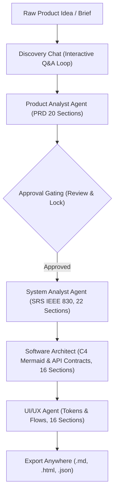

# Implementation Plan: App-Focused Root README & Public Repo Security Audit

## 1. Executive Summary & Objective

The user requested:
> **"oya readmenya lebih fokus ke appnya ya bukan development, sekalian audit karena ini akan gw public reponya apakah ada security atau key yang terekspose atau credential yang terekspose ? untuk readmenya ini bisa jadi referensi https://github.com/maddada/ghostex bahasa inggris aja"**

This task has two core components:
1. **Public Repository Security & Credential Audit**:
   - Perform an exhaustive security scan across all 220 tracked files, git commit diff history (all 17 commits), and conversation logs in `docs/context_history/` to guarantee **zero exposed API keys, credentials, or sensitive data** before making the repository public.
   - Harden `.gitignore` with comprehensive protection against accidental credential leaks (e.g., `.env`, `.env.*`, `*.pem`, `*.key`, IDE settings, local scratch scripts).
2. **Product-Focused Root `README.md` (Ghostex-Inspired)**:
   - Create a modern, world-class, product-centric `README.md` at the repository root in English, modeled after the clean, developer-focused aesthetic of **[Ghostex](https://github.com/maddada/Ghostex)**.
   - Shift the narrative from internal developer notes to the application itself: value proposition, 4 specialist personas, end-to-end specification pipeline (PRD 20-sections, SRS 22-sections, Architecture 16-sections, Design System 16-sections), chat-first split view UI, zero-mock execution, TOON token compression, OS keyring security, installation/quickstart, and keyboard shortcuts.

---

## 2. Security Audit Findings & Verification

We conducted an automated multi-vector security scan on the repository prior to drafting this plan:

| Audit Vector | Scan Scope | Result | Status |
|---|---|---|---|
| **1. Tracked Files (220 files)** | Regex scan for Gemini (`AIza...`), OpenAI (`sk-...`), Anthropic (`sk-ant-...`), GitHub tokens (`ghp_...`), AWS keys, private keys | **0 real keys found** | ✅ Safe |
| **2. Git Commit History (`git log -p`)** | Full diff audit across all 17 commits | **0 real keys found**. Only unit test dummy strings found in `internal/security/redactor_test.go` (`AIzaSyD987...`, `sk-abc...`) | ✅ Safe |
| **3. Context History Transcripts** | `transcript_01_windows.jsonl` (2.82 MB) and `transcript_02_macos.jsonl` (1.41 MB) | **0 real API keys, tokens, or credentials found** | ✅ Safe |
| **4. Git Author Metadata** | Commits author list | `lufti <lufti@mediawave.co.id>`, `luftinurfahmi@gmail.com` | ℹ️ Standard public git authoring |
| **5. Database & Local Workspaces** | Local SQLite files (`*.db`, `*.db-wal`) and `workspaces/` | Already ignored by `.gitignore` | ✅ Safe |

### Recommended Security Hardening in `.gitignore`:
To ensure future commits by any developer or agent never accidentally leak secrets, we will append the following rules to `.gitignore`:
```gitignore
# Environment & Secret files
.env
.env.*
*.env
*.key
*.pem
*.cert
*.p12
*.pfx

# IDE & Editor caches
.vscode/
.idea/
*.sublime-project
*.sublime-workspace

# Build test coverage
coverage.out
coverage.html
```

---

## 3. Product-Focused Root `README.md` Structure (Ghostex Style)

The new root `README.md` will be written in concise, punchy English featuring:



### Planned Content Sections:

1. **Header & Badges**:
   - Wordmark & Logo centered: `# Specra — AI Requirements Studio`
   - Tagline: *The Local-First AI Requirements Engineering Studio for Desktop.*
   - Shield badges: `Go 1.24+`, `React 19`, `Wails v3`, `Platforms (macOS & Windows)`, `Zero-Mock Policy`, `License (MIT)`.
2. **What is Specra?**:
   - High-level pitch: Specra is a desktop application that transforms raw product briefs into production-grade software specifications.
   - Eliminates specification drift and hallucinated requirements through an interconnected 4-persona pipeline.
3. **Core Highlights**:
   - **4 Specialist AI Personas**: Product Analyst, System Analyst, Software Architect, and UI/UX Designer.
   - **Interconnected Specification Pipeline**: Upstream-to-downstream context inheritance with approval gating.
   - **Chat-First Split View**: Resizable dual panels combining natural conversational discovery with a live formatted document canvas.
   - **Interactive Clarification Q&A Loop**: Proactive gap detection prompting users with targeted questions to clarify scope.
   - **TOON Token Compression**: Built-in TOON tokenization reducing prompt token overhead by 30%–60%.
   - **Real AI Execution (Zero-Mock Policy)**: Direct integration with Antigravity CLI (`agy`), OpenCode CLI (`opencode`), and Google Gemini REST API.
   - **Local-First & OS Keyring Security**: Local SQLite with WAL mode, file-based project sandboxing, and hardware/OS-level encrypted API key storage.
   - **Mermaid Interactive Blocks**: Visual SVG preview, zoom/pan, source toggle, and one-click copy for C4 diagrams and flowcharts.
4. **Specification Document Standards**:
   - Table detailing the 4 core documents:
     - **PRD** (20 Sections): Vision, Personas, MoSCoW, User Stories, Metrics.
     - **SRS** (22 Sections, IEEE 830): Functional Specs (FR-xxx), Data Schema, Non-Functional Requirements, Traceability Matrix.
     - **Architecture** (16 Sections): C4 Context/Container/Component, REST/gRPC API Contracts, STRIDE Threat Model.
     - **Design System** (16 Sections): Semantic Tokens, Screen Flows, Component Anatomy, WCAG 2.2 AA.
5. **Quickstart & Installation**:
   - Prerequisites: Go 1.24+, Node.js 20+, Wails v3 CLI.
   - Clone and run:
     ```bash
     git clone https://github.com/luftinur/Specra.git
     cd Specra
     wails3 dev
     ```
   - Building native release binaries: `wails3 task build`.
6. **AI Provider Configuration**:
   - How to configure Antigravity CLI, OpenCode CLI, or direct Gemini API Key.
7. **Keyboard Shortcuts Cheatsheet**:
   - `Ctrl+1` / `Cmd+1`: Discovery Chat Only
   - `Ctrl+2` / `Cmd+2`: Side-by-Side Split View
   - `Ctrl+3` / `Cmd+3`: Full Document Canvas
   - `Ctrl+B` / `Cmd+B`: Toggle Left Navigator
   - `Ctrl+J` / `Cmd+J`: Toggle Right Co-Pilot
   - Slash commands table: `/discovery`, `/plan`, `/prd`, `/srs`, `/arch`, `/design`, `/validate`, `/clear`.
8. **Privacy, Security & Enterprise Readiness**:
   - Zero telemetry, local storage only, OS credential manager.
9. **License & Community**:
   - MIT License, links to documentation catalog (`docs/README.md`).

---

## 4. Proposed Changes

| Action | File | Description |
|---|---|---|
| **[NEW]** | `README.md` | Primary product-focused public repository README in English (Ghostex-inspired). |
| **[MODIFY]** | `.gitignore` | Harden secret/credential protection rules (`.env*`, `*.key`, `*.pem`, `.vscode`, etc.). |
| **[MODIFY]** | `docs/README.md` | Add entry #23 for this plan and #24 for the forthcoming walkthrough. |

---

## 5. Verification Plan

1. **Security Scan Verification**:
   - Confirm all git history and tracked files are verified clean of real credentials.
   - Run `git status` and test `.gitignore` rules against test dummy secret filenames.
2. **Markdown Lint & Formatting**:
   - Verify proper rendering of badges, GitHub alerts, code fences, and Mermaid diagrams.
   - Ensure all internal links (e.g. `docs/README.md`, `AGENTS.md`) resolve accurately.
3. **Build & Test Verification**:
   - Run `go test -v ./internal/...` to verify all Go test suites pass.
   - Run `npm --prefix frontend run build` to verify frontend builds cleanly.

---

## 6. User Feedback & Next Steps

Please review this plan. Upon your confirmation (**`proceed`** or **`lanjut`**), execution will begin immediately.
