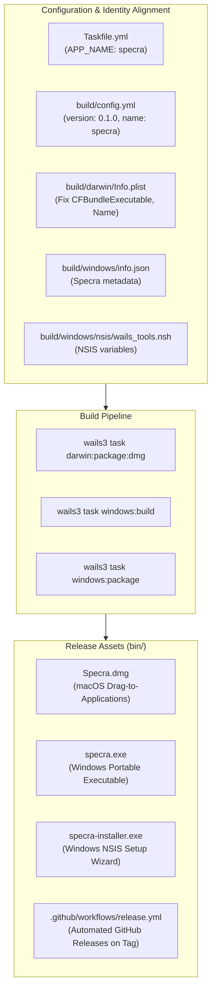

# Implementation Plan: Specra Release Packaging & Cross-Platform Distribution (macOS DMG & Windows EXE)

## Goal Description
Enable production release builds and effortless installation of **Specra** across both macOS (`.dmg` & `.app`) and Windows (`.exe` portable & NSIS installer). This includes fixing a critical macOS bundle execution bug in `Info.plist`, aligning project naming from legacy `ai-requirements-studio` to `specra`, generating verified release assets, providing installation instructions for end-users, and creating a GitHub Actions CI/CD workflow for automated releases.

---

## User Review Required

> [!IMPORTANT]
> **Critical Discovery in `Info.plist`**:
> The template file `build/darwin/Info.plist` currently defines `<key>CFBundleExecutable</key><string>ai-requirements-studio.exe</string>`. On macOS, LaunchServices searches strictly for the executable name specified in `CFBundleExecutable`. Because it pointed to a `.exe` suffix, any `.app` or `.dmg` installed on macOS would fail to launch. We will correct this to `specra`.

> [!NOTE]
> **macOS Gatekeeper / Unsigned Binary Note**:
> Because Specra is not yet signed with a paid Apple Developer ID certificate ($99/year), macOS Gatekeeper will show an "unidentified developer" prompt on first launch.
> The standard macOS workaround is:
> 1. Right-click (or Control-click) `Specra.app` > Click **Open** > Click **Open**, OR
> 2. Run `xattr -cr /Applications/Specra.app` in Terminal once.
> We will add clean user documentation and release notes for this.

> [!TIP]
> **Windows Distribution Options**:
> 1. **Standalone Portable (`specra.exe`)**: Single self-contained 21MB executable including React frontend and pure-Go backend with modernc SQLite. Works immediately with zero installation required!
> 2. **NSIS Installer (`specra-amd64-installer.exe`)**: Standard Windows setup wizard creating desktop/start menu shortcuts and uninstaller.

---

## Open Questions
- None. The project already uses pure Go SQLite (`modernc.org/sqlite`) without CGO dependencies on Windows, allowing instant cross-compilation.

---

## Proposed Changes



---

### Component 1: Build Configuration & Packaging Identity

Align all build configurations, bundle identifiers, executable targets, and metadata from the legacy scaffold `ai-requirements-studio` / `My Product` to `specra` / `Specra`.

#### [MODIFY] `Taskfile.yml`
- Update `APP_NAME` from `"ai-requirements-studio"` to `"specra"`.
- Set release version defaults and output paths.

#### [MODIFY] `build/config.yml`
- Ensure `info.companyName: "specra"`
- Ensure `info.productName: "specra"`
- Set `info.version: "0.1.0"`
- Ensure `info.productIdentifier: "com.specra.app"`

#### [MODIFY] `build/darwin/Info.plist` & `build/darwin/Info.dev.plist`
- Fix `<key>CFBundleExecutable</key>` to `<string>specra</string>` (remove `.exe`).
- Set `<key>CFBundleName</key>` to `<string>Specra</string>`.
- Set `<key>CFBundleIdentifier</key>` to `<string>com.specra.app</string>`.
- Set `<key>CFBundleShortVersionString</key>` and `CFBundleVersion` to `<string>0.1.0</string>`.
- Set `<key>NSHumanReadableCopyright</key>` to `<string>© 2026, specra</string>`.

#### [MODIFY] `build/windows/info.json`
- Update Windows resource metadata:
  - `ProductName`: `"Specra"`
  - `CompanyName`: `"specra"`
  - `FileDescription`: `"Specra - AI Requirements Studio"`
  - `LegalCopyright`: `"© 2026, specra"`
  - `ProductVersion`: `"0.1.0"`

#### [MODIFY] `build/windows/nsis/wails_tools.nsh` & `build/windows/nsis/project.nsi`
- Update default project definitions to `specra`.

---

### Component 2: Packaging Tasks & Local Verification

#### [MODIFY] `build/darwin/Taskfile.yml`
- Ensure the bundle folder name is `Specra.app` (capitalized for standard macOS app conventions) and the output DMG is `Specra.dmg` (or `specra.dmg`).

#### Local Execution & Generation:
1. Run `wails3 task darwin:package:dmg`:
   - Compiles production Go backend with stripped symbols (`-w -s`).
   - Builds production Vite client.
   - Codesigns ad-hoc for local execution (`codesign --force --deep --sign -`).
   - Creates disk image `bin/Specra.dmg` with volume icon and drag-to-Applications symlink.
2. Run `wails3 task windows:build`:
   - Generates Windows `.syso` resource with Specra icon and version manifest.
   - Compiles pure-Go Windows binary with `-H windowsgui` flag (`bin/specra.exe`).

---

### Component 3: Automated GitHub Actions CI/CD Release Workflow

#### [NEW] `.github/workflows/release.yml`
Create a multi-platform release workflow that triggers whenever a version tag is pushed (e.g., `git push origin v0.1.0`):
- **Matrix Build**:
  - `macos-latest`: Installs Go 1.24, Node.js 22, Wails v3 CLI (`go install github.com/wailsapp/wails/v3/cmd/wails3@latest`), runs `wails3 task darwin:package:dmg` (universal or ARM64), outputs `Specra-macos.dmg`.
  - `windows-latest`: Installs Go 1.24, Node.js 22, NSIS, Wails v3 CLI, runs `wails3 task windows:package`, outputs `Specra-windows-amd64-installer.exe` and `specra-windows-amd64.exe`.
- **Publish Step**:
  - Uses `softprops/action-gh-release@v2` to upload all artifacts to the GitHub Release page with auto-generated release notes.

---

### Component 4: Documentation & User Installation Guide

#### [NEW] `docs/INSTALLATION.md`
Clear, bilingual (or English) installation instructions covering:
- **macOS**: Opening DMG, dragging `Specra.app` to `/Applications`, handling the Gatekeeper ad-hoc prompt (Right-click > Open, or `xattr -cr`).
- **Windows**: Running `specra.exe` directly or running the NSIS installer.
- **Prerequisites for AI Execution**: Installing or configuring AI providers (`agy`, `opencode`, or Gemini API key).

---

## Verification Plan

### Automated Verification
```bash
# 1. Verify Go backend tests pass
export PATH=$PATH:/opt/homebrew/bin:~/go/bin
go test -v ./internal/...

# 2. Build and package macOS DMG
wails3 task darwin:package:dmg

# 3. Verify .app bundle contents & executable name
ls -l bin/Specra.app/Contents/MacOS/
plutil -p bin/Specra.app/Contents/Info.plist | grep CFBundleExecutable

# 4. Verify DMG mounts cleanly
hdiutil attach bin/Specra.dmg -mountpoint /tmp/specra_mount_test
ls -la /tmp/specra_mount_test
hdiutil detach /tmp/specra_mount_test

# 5. Build Windows Executable
wails3 task windows:build
ls -lh bin/specra.exe
```

### Manual Verification
1. Open `bin/Specra.dmg` in Finder and verify the disk image window opens with the Specra icon and Applications folder.
2. Launch `bin/Specra.app` to confirm it opens without any "missing executable" errors.
3. Test `bin/specra.exe` on Windows (or verify PE binary headers on macOS via `file bin/specra.exe`).
