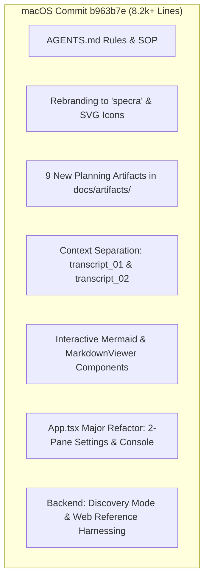

# Implementation Plan: Review & Synchronization of Multi-Device Updates (macOS Commit `b963b7e`)

Comprehensive audit of updates committed on macOS, analysis of new planning artifacts, verification of `AGENTS.md` rules continuity, and minor remediation on the Windows environment to guarantee clean builds.

---

## 1. Goal Description

Conduct a comparative verification between local Git history and upstream remote commit `b963b7e`, inventorying 9 new artifacts and features (Specra rebranding, interactive Mermaid blocks, Markdown viewer, unified console), while resolving an unused TypeScript import to return Windows desktop builds to 100% green.

---

## 2. Multi-Device Update Audit (Commit `b963b7e`)

Commit `b963b7e` ("Update") by `luftinur <luftinurfahmi@gmail.com>` spans **31 files (+8,229 lines, -1,111 lines)**:



### Component Details:

### A. Authoritative Guidelines & Agent Protocol (`AGENTS.md`)
- Added [`AGENTS.md`](file:///E:/dev-agent-assistant/AGENTS.md) as Primary Source of Truth.
- Mandatory protocols:
  1. Synchronize internal planning artifacts to [`docs/artifacts/`](file:///E:/dev-agent-assistant/docs/artifacts/).
  2. Serialize session transcripts in [`docs/context_history/`](file:///E:/dev-agent-assistant/docs/context_history/) (`transcript_01_windows.jsonl`, `transcript_02_macos.jsonl`, etc.). Overwrites strictly prohibited.
  3. Maintain documentation catalog in [`docs/README.md`](file:///E:/dev-agent-assistant/docs/README.md).
  4. Enforce Zero-Mock Policy, Strict TypeScript, and MQ-Studio token scales.

### B. "Specra" Rebranding & Visual Identity
- Application rebranded from "AI Requirements Studio" to **`specra`**.
- Branding component: [`frontend/src/components/SpecraBrand.tsx`](file:///E:/dev-agent-assistant/frontend/src/components/SpecraBrand.tsx) (`SpecraLogo`, `SpecraIcon`, `SpecraWordmark`).
- Native app icons updated:
  - `build/appicon.svg` (512x512 squircle icon).
  - `build/appicon.png`, `build/darwin/icons.icns`, `build/windows/icon.ico`, and `frontend/public/favicon.svg`.
- `main.go` and `build/config.yml` updated to reflect `specra`.

### C. 9 New Artifacts in `docs/artifacts/`
1. **[`plan_specra_logo_and_icon.md`](file:///E:/dev-agent-assistant/docs/artifacts/plan_specra_logo_and_icon.md)**: Specra visual brand identity and squircle SVG.
2. **[`plan_mermaid_blocks_and_preview_mode.md`](file:///E:/dev-agent-assistant/docs/artifacts/plan_mermaid_blocks_and_preview_mode.md)**: Interactive Mermaid diagrams (Visual vs Code, Zoom/Pan, Copy).
3. **[`plan_agentic_pipeline_and_unified_console.md`](file:///E:/dev-agent-assistant/docs/artifacts/plan_agentic_pipeline_and_unified_console.md)**: Unified Prompt Console, Pipeline Stepper, and Q&A loop.
4. **[`plan_agentic_modes_and_slash_commands.md`](file:///E:/dev-agent-assistant/docs/artifacts/plan_agentic_modes_and_slash_commands.md)**: Slash Commands (`/plan`, `/discovery`, `/exec`, `/prd`) and interaction modes.
5. **[`plan_skills_ux_and_right_inspector_wiring.md`](file:///E:/dev-agent-assistant/docs/artifacts/plan_skills_ux_and_right_inspector_wiring.md)**: Skills UX persona dropdowns & Right Inspector interactivity.
6. **[`plan_workspace_and_canvas_experience_refactor.md`](file:///E:/dev-agent-assistant/docs/artifacts/plan_workspace_and_canvas_experience_refactor.md)**: Empty state canvas, 3-pane elevation, and elevated chat input.
7. **[`plan_settings_modal_two_pane_refactor.md`](file:///E:/dev-agent-assistant/docs/artifacts/plan_settings_modal_two_pane_refactor.md)**: Two-Pane Master-Detail settings modal.
8. **[`plan_sidebar_two_lines_and_typography_refinement.md`](file:///E:/dev-agent-assistant/docs/artifacts/plan_sidebar_two_lines_and_typography_refinement.md)**: 256px sidebar expansion and typography polish.
9. **[`plan_agents_rules_and_environment_continuity.md`](file:///E:/dev-agent-assistant/docs/artifacts/plan_agents_rules_and_environment_continuity.md)**: Formalization of `AGENTS.md` and transcript separation.

### D. New Frontend Components
- **`<MermaidBlock />`**: Dynamic SVG rendering, zoom/pan controls, copy button, and theme awareness.
- **`<MarkdownViewer />`**: Powered by `react-markdown` and `remark-gfm` with embedded Mermaid diagram routing.
- **Auto-Detect Coding Agents**: Initial startup detection via `handleDetectAgents(true)`.
- **Adaptive Upward Dropdowns**: `bottom-full mb-2` orientation preventing bottom-edge clipping.

### E. Backend Enhancement (`internal/ai/discovery.go`)
- Detection of `[MODE: EXECUTION]`: AI bypasses clarifying questions and synthesizes specifications directly.
- URL Detection: Prompts include instructions to extract design tokens and aesthetics from supplied web URLs.

---

## 3. Windows Issue & Remediation

> [!WARNING]
> **TypeScript Strict Mode Build Error:**
> Running `npm run build` triggered:
> `src/App.tsx(58,34): error TS6133: 'SpecraWordmark' is declared but its value is never read.`

### Remediation:
- Remove unused `SpecraWordmark` from import list in [`frontend/src/App.tsx`](file:///E:/dev-agent-assistant/frontend/src/App.tsx).
- Run `npm --prefix frontend run build` to verify 0 errors.
- Run `go test -v ./internal/...` to verify all 13 test suites pass.

---

## 4. Verification Plan

### Automated Tests
```powershell
cd frontend; npm run build
go test -v ./internal/...
wails3 task build
```

### Manual Verification
- Launch application binary; verify Specra logo, upward adaptive dropdowns, and interactive Mermaid diagrams across PRD, SRS, Architecture, and Design System specifications.
