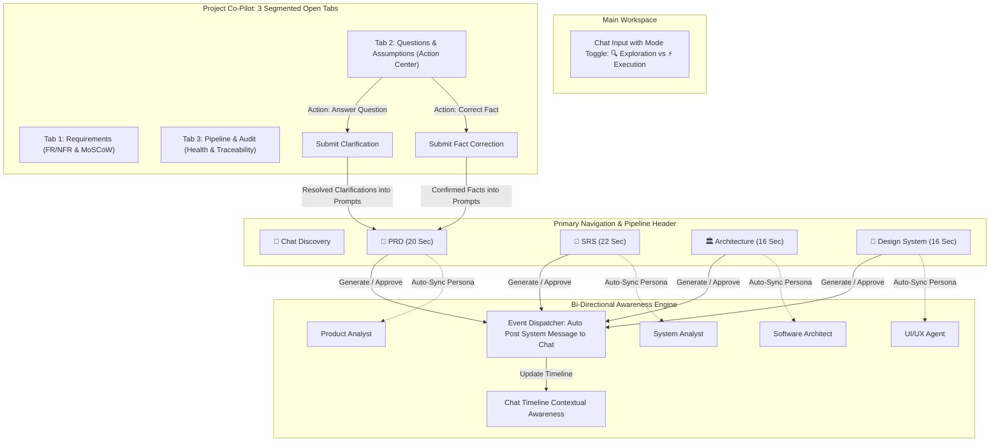

# Comprehensive Implementation Plan: UX Reconstruction & Workflow Integration

Comprehensive plan mapping the end-to-end integration of **Chat Discovery**, **Right Sidebar (Project Co-Pilot)**, **Multi-Agent Pipeline**, and **Document Canvas (PRD/SRS/Arch/Design)** into a cohesive, transparent desktop ecosystem.

---

## 1. Critical UX Analysis & Feedback

Addressing core user evaluations:
1. **Assumptions Cannot Be Answered or Corrected**:
   - Previously only offered `Confirm` and `Reject`. If an AI assumption was inaccurate (e.g. assuming Stripe when the team uses Midtrans/QRIS), users lacked an input to provide the correct fact.
2. **Disconnection Between Document Canvas and Chat Discovery**:
   - Clicking **"Generate PRD"** created the document in SQLite and on disk, but **Chat Discovery remained unaware of the milestone**.
   - Returning to Chat showed no progress indicators, giving the false impression that Chat and Canvas were disconnected worlds.
3. **Persona Selector & Interaction Mode Ambiguity**:
   - The user asked: *"Do the persona and interaction mode dropdowns actually do anything or are they redundant?"*
   - Reality: While highly functional in the backend, the UX was isolated. Navigating to SRS should automatically align the System Analyst without requiring manual dropdown clicks.
4. **Hidden Inspector Navigation**:
   - The 3-dot menu (`MoreVertical`) obscured 5 vital sub-views (Requirements, Validation, Traceability, Assumptions, Clarifications).

---

## 2. Solution Architecture & End-to-End Map



---

## 3. Four Core Pillars

### Pillar 1: Interactive Assumptions (Confirm, Correct, Reject)
1. **✓ Correct (Confirm Direct)**: Accepts the assumption as an official project fact (status `confirmed`).
2. **✎ Edit (Inline Input Box)**:
   - Opens an inline input:
     > *"Enter the correct fact or preference (e.g. 'Not Stripe, we use Midtrans QRIS'):"*
   - Updates assumption description with the user's fact, sets status to `confirmed`, and injects it into downstream prompts.
3. **✕ Reject**: Marks the assumption as `rejected`, omitting it from specifications.

### Pillar 2: Bi-Directional Canvas-to-Chat Synchronization
1. **Auto-Post System Milestone Events to Chat**:
   - Clicking **Generate PRD**:
     > 📄 **[MILESTONE] PRD Draft v1 (20 Sections) Generated**  
     > *Executed by Product Analyst Agent.*  
     > - Requirements identified: **8 Functional**, **3 Non-Functional**  
     > - Assumptions detected: **4 items** (pending confirmation in Co-Pilot)
   - Clicking **Approve PRD**:
     > ✅ **[STATUS] PRD Officially Approved**  
     > *Downstream gateway unlocked: SRS (IEEE 830) ready for generation by System Analyst.*
2. **Document Status Injected into Chat Context**:
   - The AI assistant accurately understands document readiness across the conversation.

### Pillar 3: Specialist Persona Alignment & Mode Toggles
1. **Context-Aware Persona Auto-Switching**:
   - Opening **PRD** ➔ Automatically selects **Product Analyst**.
   - Opening **SRS** ➔ Automatically selects **System Analyst**.
   - Opening **Architecture** ➔ Automatically selects **Software Architect**.
   - Opening **Design System** ➔ Automatically selects **UI/UX Agent**.
2. **Segmented Mode Toggle Pill**:
   - Horizontal toggle pill above the chat prompt input:
     - **`🔍 Exploration Mode` (Default)**: Proactive gap detection, clarification questions, assumption probing.
     - **`⚡ Execution Mode`**: Direct structured outputs without probing questions.

### Pillar 4: Workspace Co-Pilot (Right Sidebar)
Replaces "Inspector" with 3 permanent open tabs:
1. **`Requirements (N)`**: Backlog of FR/NFR requirements with MoSCoW prioritization.
2. **`Questions & Assumptions (N)`**: Centralized action center:
   - AI Questions with inline answer inputs.
   - System Assumptions with Confirm / Edit / Reject buttons.
   - Yellow pulsing badge counter for open items.
3. **`Pipeline & Audit`**: Visual 5-stage document stepper, Traceability Matrix, and validation audits.
4. **Smart Auto-Focusing**: Focuses automatically on Questions & Assumptions when new items emerge.

---

## 4. Technical Implementation Details

### Phase 1: Backend Layer (Go & SQLite)
1. **Update Assumption Query (`internal/storage/conversation_repo.go`)**:
   - `UpdateAssumption(ctx, id, description, status)`.
2. **Requirement Service Method (`internal/services/requirement_service.go`)**:
   - `CorrectAssumption(id string, correctedText string) error`.
3. **Conversation Milestone Logging (`internal/services/conversation_service.go`)**:
   - `PostSystemEvent(conversationID, projectID, title, message string) (*domain.Message, error)`.
4. **Document Status in Prompt Builder (`internal/ai/discovery.go`)**:
   - Include active document summary in discovery system prompts.

### Phase 2: Frontend Layer (`frontend/src/App.tsx`)
1. **Interactive Assumption Cards**:
   - `editingAssumptionId`, `editedAssumptionText` state.
   - Inline textarea with Save and Cancel actions.
2. **Permanent Segmented Tabs in Right Sidebar**:
   - Remove 3-dot dropdown; render 3 horizontal tab buttons.
3. **Context-Aware Auto-Switching**:
   - Synchronize `activeChatAgent` when document view changes.
4. **Mode Toggle Pill**:
   - Render `[ 🔍 Exploration | ⚡ Execution ]` above prompt bar.
5. **Milestone Dispatch**:
   - Call `PostSystemEvent` upon generating and approving documents.

---

## 5. Verification Plan

1. **Interactive Assumptions**: Edit an assumption; verify fact persists to SQLite with status `confirmed` and updates downstream PRD generation.
2. **Bi-Directional Event Sync**: Click Generate PRD in Canvas; switch to Chat and confirm milestone event appears in the timeline.
3. **Auto-Sync Persona**: Switch between PRD, SRS, Architecture, and Design views; confirm chat persona aligns automatically.
4. **Build Verification**:
   ```bash
   go test -v ./internal/...
   npm --prefix frontend run build
   ```
