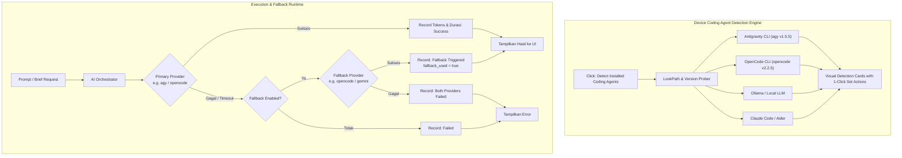

# Rencana Implementasi: Coding Agent Detection, Advanced AI Providers, Fallback Chaining, Token Usage Audit Log & Global Scrollbar Hiding

Dokumen perencanaan teknis terpadu untuk:
1. **Coding Agent Auto-Detection pada Device:** Tombol pemindai otomatis (*Detect Installed Coding Agents*) untuk mendeteksi CLI AI coding agent yang terpasang di perangkat pengguna (misal: **Google Antigravity CLI `agy`**, **OpenCode `opencode` v2.2.5**, **Claude Code**, **Aider**, **Ollama**, **Cursor**, dll.), menampilkan versi, path biner, serta tombol 1-klik **[Set as Primary]** dan **[Set as Fallback]**.
2. **Advanced Pluggable AI Adapters:**
   - **Antigravity CLI Adapter:** Subprocess non-interaktif `agy -p` (v1.5.5).
   - **OpenCode Adapter:** Subprocess non-interaktif `opencode run --format json` dan/atau endpoint server `opencode serve`.
   - **OpenAI-Compatible / Ollama / LocalLLM Adapter:** Endpoint HTTP `/v1/chat/completions`.
   - **Google Gemini Direct API Adapter:** Endpoint HTTP direct `generateContent`.
3. **Automatic Failover & Fallback Chaining:** Mekanisme failover cerdas di mana jika Provider Utama gagal/timeout, sistem otomatis mengeksekusi Fallback Provider tanpa crash dan mencatat status `fallback_success`.
4. **Token Usage Tracking & Audit Logs:** Menghitung, mencatat ke database SQLite, dan menyajikan metrik penggunaan token (Input Tokens, Output Tokens, Total Tokens, durasi, fallback count) dalam tabel riwayat audit interaktif.
5. **Universal Scrollbar Hiding:** Menghilangkan track scrollbar vertikal & horizontal di seluruh penjuru aplikasi tanpa merusak fungsi scrolling (*mouse wheel & touchpad*).
6. **Advanced Settings Modal:** Antarmuka dialog pengaturan multi-tab (*Coding Agents & Providers*, *Token Usage & Logs*, *Diagnostics & Keyring*).

---

## 1. Goal & Architecture Overview

### Diagram Arsitektur Deteksi & Failover AI Provider


---

## 2. Proposed Changes

### Component 1: Global Scrollbar Removal (`frontend/src/index.css`)
- **[MODIFY] [index.css](file:///E:/dev-agent-assistant/frontend/src/index.css):**
  Terapkan aturan CSS universal (`*` dan `*::-webkit-scrollbar`) agar semua komponen visual scrollbar di seluruh aplikasi (chat, document editor, inspector, modals, settings) tidak terlihat, namun fungsi scroll dengan mouse wheel atau touchpad tetap 100% responsif:
  ```css
  /* Universal scrollbar hiding across all containers */
  *::-webkit-scrollbar {
    display: none !important;
    width: 0 !important;
    height: 0 !important;
  }
  * {
    -ms-overflow-style: none !important; /* IE and Edge */
    scrollbar-width: none !important;    /* Firefox */
  }
  ```

---

### Component 2: Coding Agent Detection Engine (`internal/ai/detector.go`)
- **[NEW] [detector.go](file:///E:/dev-agent-assistant/internal/ai/detector.go):**
  Implementasikan pendeteksi agen cerdas yang memindai biner terpasang di sistem operasi Windows menggunakan `exec.LookPath`:
  - Daftar agen yang dipindai:
    1. **Google Antigravity CLI:** Executable `agy` (memverifikasi `agy -v`).
    2. **OpenCode CLI:** Executable `opencode` (memverifikasi `opencode -v`, ditemukan `opencode v2.2.5`).
    3. **Claude Code:** Executable `claude` (memverifikasi `claude --version`).
    4. **Aider:** Executable `aider` (memverifikasi `aider --version`).
    5. **Ollama:** Executable `ollama` (memverifikasi `ollama --version`).
    6. **Cursor CLI:** Executable `cursor`.
    7. **Goose:** Executable `goose`.
  - Mengembalikan daftar `domain.DetectedAgent`:
    - `ID string` (`antigravity-cli`, `opencode`, `claude`, `aider`, `ollama`, dll.)
    - `Name string`
    - `Executable string`
    - `Installed bool`
    - `Version string`
    - `Path string` (Path absolut file `.exe`)
    - `SuggestedType string` (`cli` atau `http`)

---

### Component 3: Domain Models & SQLite Storage (`internal/domain` & `internal/storage`)
- **[MODIFY] [models.go](file:///E:/dev-agent-assistant/internal/domain/models.go):**
  - Buat struct `DetectedAgent`:
    ```go
    type DetectedAgent struct {
        ID          string `json:"id"`
        Name        string `json:"name"`
        Executable  string `json:"executable"`
        Installed   bool   `json:"installed"`
        Version     string `json:"version"`
        Path        string `json:"path"`
        Description string `json:"description"`
    }
    ```
  - Perbarui struct `ProviderExecution` dengan field token usage:
    - `DurationMs int64`
    - `PromptTokens int`
    - `CompletionTokens int`
    - `TotalTokens int`
    - `FallbackUsed bool`
  - Buat struct `TokenUsageSummary`:
    ```go
    type TokenUsageSummary struct {
        TotalRequests    int   `json:"total_requests"`
        TotalPrompt      int   `json:"total_prompt_tokens"`
        TotalCompletion  int   `json:"total_completion_tokens"`
        TotalTokens      int   `json:"total_tokens"`
        AverageDuration  int64 `json:"average_duration_ms"`
        FallbackCount    int   `json:"fallback_count"`
    }
    ```
- **[MODIFY] [migrations.go](file:///E:/dev-agent-assistant/internal/storage/migrations.go):**
  - Tambahkan tabel `app_settings` untuk persistensi konfigurasi provider & fallback:
    ```sql
    CREATE TABLE IF NOT EXISTS app_settings (
        key TEXT PRIMARY KEY,
        value TEXT NOT NULL,
        updated_at DATETIME NOT NULL
    );
    ```
  - Lakukan alter tabel yang aman untuk menambahkan kolom `duration_ms`, `prompt_tokens`, `completion_tokens`, `total_tokens`, dan `fallback_used` pada tabel `provider_executions`.
- **[MODIFY] [provider_repo.go](file:///E:/dev-agent-assistant/internal/storage/provider_repo.go):**
  - Implementasikan query `ListExecutions(ctx, projectID string, limit int) ([]domain.ProviderExecution, error)`
  - Implementasikan agregasi `GetTokenUsageSummary(ctx, projectID string) (*domain.TokenUsageSummary, error)`
  - Implementasikan `GetSetting(key)` dan `SetSetting(key, value)`.

---

### Component 4: Multi-Provider Adapters & Orchestrator Failover (`internal/ai/`)
- **[NEW] [opencode/adapter.go](file:///E:/dev-agent-assistant/internal/ai/adapters/opencode/adapter.go):**
  - Adapter untuk **OpenCode CLI / Server**:
    - Mode Subprocess CLI: Memanggil `opencode run --format json "<prompt>"` dengan timeout terkelola.
    - Mode Server HTTP: Mendukung koneksi ke `opencode serve` atau endpoint OpenAI-compatible (`/v1/chat/completions`).
    - Mengekstrak token usage dan durasi eksekusi.
- **[NEW] [gemini/adapter.go](file:///E:/dev-agent-assistant/internal/ai/adapters/gemini/adapter.go):**
  - Adapter untuk **Google Gemini Direct API**:
    - Memanggil REST API `generateContent` dengan API Key dari secure keyring.
    - Mengekstrak `promptTokenCount` dan `candidatesTokenCount`.
- **[MODIFY] [orchestrator.go](file:///E:/dev-agent-assistant/internal/ai/orchestrator.go):**
  - Menampung `primaryProviderID`, `fallbackProviderID`, dan `fallbackEnabled`.
  - Pada `Execute(ctx, req)`:
    1. Jalankan provider primer.
    2. Jika error atau timeout dan `fallbackEnabled == true`, lakukan failover otomatis ke provider cadangan.
    3. Catat status riil (`success`, `fallback_success`, `failed`), metrik token usage, serta durasi ke database.

---

### Component 5: Backend Service Layer (`internal/services/provider_service.go`)
- **[MODIFY] [provider_service.go](file:///E:/dev-agent-assistant/internal/services/provider_service.go):**
  - Tambahkan method yang diekspos ke antarmuka Wails v3:
    - `DetectInstalledCodingAgents() ([]domain.DetectedAgent, error)`
    - `ConfigureProviders(primaryID, fallbackID string, fallbackEnabled bool) error`
    - `GetProviderConfiguration() (map[string]any, error)`
    - `ConfigureOpenCode(mode, baseURL, model, apiKey string) error`
    - `ConfigureGemini(model, apiKey string) error`
    - `GetTokenUsageSummary(projectID string) (*domain.TokenUsageSummary, error)`
    - `ListExecutionLogs(projectID string, limit int) ([]domain.ProviderExecution, error)`

---

### Component 6: Advanced Settings & Detection UI (`frontend/src/App.tsx`)
- **[MODIFY] [App.tsx](file:///E:/dev-agent-assistant/frontend/src/App.tsx):**
  - Rancang ulang modal Settings menjadi dialog tab studio profesional:
    - **Tab 1: Coding Agents & Providers:**
      - Tombol **[Detect Installed Coding Agents]** dengan indikator loading.
      - Grid kartu agen yang terdeteksi di perangkat (Antigravity CLI v1.5.5, OpenCode v2.2.5, Claude, Ollama, dll.) dengan status badge warna hijau (*Installed*) / abu-abu (*Not Found*).
      - Tombol 1-klik **[Set as Primary]** dan **[Set as Fallback]** langsung pada kartu agen yang terdeteksi!
      - Pengaturan manual: Primary Provider dropdown, Toggle "Enable Automatic Fallback", Fallback Provider dropdown.
      - Kartu konfigurasi OpenCode (pilihan CLI subprocess atau HTTP endpoint, Model, Base URL).
      - Kartu konfigurasi Google Gemini Direct (Model, API Key ke Windows Keyring).
    - **Tab 2: Token Usage & Audit Logs:**
      - Kartu ringkasan metrik: *Total AI Calls*, *Prompt Tokens*, *Completion Tokens*, *Grand Total Tokens*, *Fallback Events*.
      - Tabel audit log interaktif yang menampilkan riwayat setiap eksekusi prompt (Waktu, Provider & Model, Task, Durasi ms, Tokens, Status `Success` / `Fallback Triggered` / `Failed`).
      - Tombol **[Refresh Logs]**.
    - **Tab 3: Diagnostics & Keyring:**
      - Tombol **[Jalankan Diagnostik]** untuk memeriksa latensi provider, status database SQLite WAL, dan integritas Windows Credential Manager.
  - Tampilkan total token yang terpakai pada sidebar footer secara informatif dan elegan.

---

## 3. Verification Plan

### Automated Tests
```powershell
# 1. Jalankan unit test Go (mencakup detection, multi-provider, fallback logic, dan token usage)
$env:PATH = "C:\Program Files\Go\bin;$env:USERPROFILE\go\bin;$env:PATH"; go test -v ./...

# 2. Re-generate Wails v3 bindings TypeScript
$env:PATH = "C:\Program Files\Go\bin;$env:USERPROFILE\go\bin;$env:PATH"; wails3 generate bindings -ts -i

# 3. Frontend compilation (Dev & Prod)
cd frontend; npm run build:dev; npm run build; cd ..

# 4. Wails v3 production native build
$env:PATH = "C:\Program Files\Go\bin;$env:USERPROFILE\go\bin;$env:PATH"; wails3 task build
```

### Manual Verification
1. **Verifikasi Deteksi Coding Agent:**
   - Klik **Settings** di pojok kiri bawah, pilih tab **Coding Agents & Providers**, klik **[Detect Installed Coding Agents]**.
   - Sistem menampilkan kartu biner yang terpasang di komputer pengguna: `Google Antigravity CLI (agy v1.5.5)` dan `OpenCode CLI (opencode v2.2.5)`.
   - Klik **[Set as Fallback]** pada OpenCode: OpenCode otomatis terpilih sebagai Fallback Provider.
2. **Verifikasi Global Scrollbar:**
   - Buka dokumen PRD/SRS yang panjang dan tabel audit log token usage; lakukan scroll dengan mouse wheel. Pastikan tidak ada satupun scrollbar fisik yang muncul di layar.
3. **Verifikasi Token Usage Log:**
   - Buka tab **Token Usage & Audit Logs** di Settings; verifikasi bahwa seluruh panggilan ke AI tercatat dengan rincian token prompt, completion, total, durasi, dan status.
