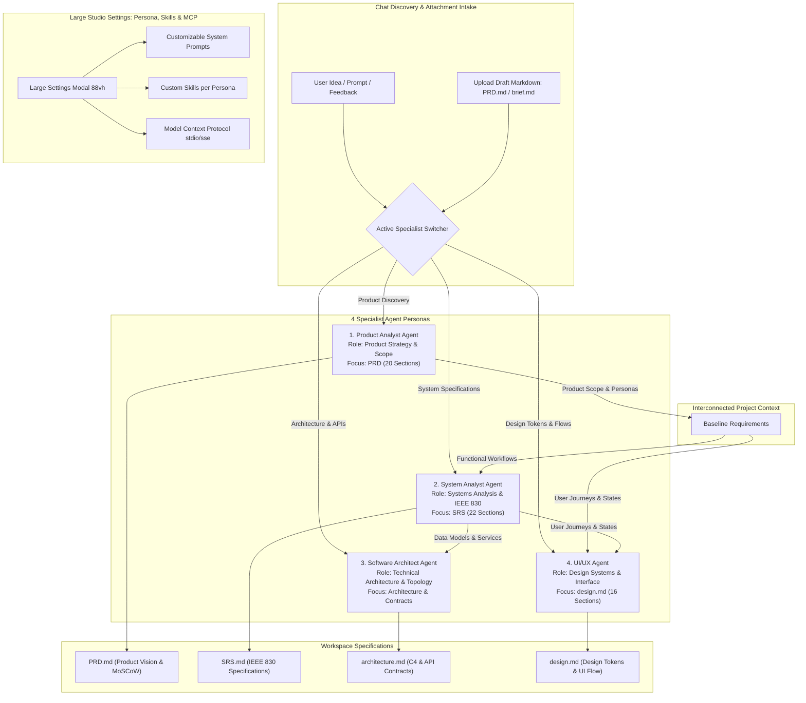

# Elaborasi Arsitektur 4 Specialist Agent Personas

Dokumen rencana dan spesifikasi rinci untuk memecah arsitektur agen spesialis menjadi **4 Persona Ahli yang Saling Berkaitan**:

---

## 1. Rincian 4 Specialist Personas, Skills, dan MCP

### Persona 1: Product Analyst Agent (Fokus: PRD - Product Requirements Document)
- **ID Agen:** `product-analyst`
- **Role Title:** `Product Analyst & Business Strategist`
- **Tanggung Jawab Utama:**
  - Menganalisis ide mentah pengguna, visi bisnis, dan problem statement.
  - Merumuskan User Personas, Target Audience, dan User Journey Maps.
  - Melakukan kategorisasi kebutuhan dan prioritas MoSCoW (*Must Have, Should Have, Could Have, Won't Have*).
  - Menyusun dan mengelola dokumen **`PRD.md` (20 sections)**.
- **Daftar Skills Bawaan:**
  - `product-discovery` (Ekstraksi kebutuhan implisit dari percakapan)
  - `user-story-mapping` (Pemetaan cerita pengguna dan kriteria penerimaan)
  - `moscow-prioritization` (Klasifikasi prioritas fitur objektif)
  - `business-kpi-definition` (Perumusan metrik keberhasilan produk)
- **Rekomendasi MCP Tool Integrations:**
  - *Jira / Linear MCP* (Sinkronisasi epics dan user stories)
  - *Notion / Confluence MCP* (Sinkronisasi product brief awal)

---

### Persona 2: System Analyst Agent (Fokus: SRS - Software Requirements Specification)
- **ID Agen:** `system-analyst`
- **Role Title:** `Lead System Analyst & IEEE 830 Specialist`
- **Tanggung Jawab Utama:**
  - Menerjemahkan kebutuhan bisnis dari PRD menjadi spesifikasi teknis fungsional dan non-fungsional.
  - Memetakan pemodelan data konseptual, kamus data (*data dictionary*), dan aturan bisnis (*business rules*).
  - Memastikan *Traceability Matrix* antara PRD Requirement ID (`REQ-XXX`) dan System Specification.
  - Menyusun dan mengelola dokumen **`SRS.md` (22 sections)**.
- **Daftar Skills Bawaan:**
  - `ieee-830-specification` (Standar dokumentasi rekayasa perangkat lunak internasional)
  - `functional-flow-modeling` (Pemodelan alur sistem dan status transisi)
  - `traceability-verification` (Deteksi orphan requirements dan inkonsistensi)
  - `non-functional-sla-definition` (Kriteria latency, throughput, reliability, dan disaster recovery)
- **Rekomendasi MCP Tool Integrations:**
  - *PostgreSQL / SQLite Schema MCP* (Ekstraksi dan validasi skema tabel)
  - *OpenAPI / Swagger MCP* (Validasi kontrak data)

---

### Persona 3: Software Architect Agent (Fokus: Architecture & Technical Topology)
- **ID Agen:** `software-architect`
- **Role Title:** `Principal Software Architect`
- **Tanggung Jawab Utama:**
  - Merumuskan arsitektur sistem level tinggi (C4 Model: Context, Containers, Components, Code).
  - Menentukan pola arsitektur (Modular Monolith, Event-Driven, Microservices, Local-First WAL).
  - Mendefinisikan kontrak antarmuka API (REST endpoints, gRPC protos, GraphQL schemas).
  - Menetapkan strategi keamanan (OAuth2, JWT, RBAC, Data Encryption at Rest & in Transit).
  - Menyusun dan mengelola dokumen **`architecture.md`** serta diagram topologi sistem Mermaid.
- **Daftar Skills Bawaan:**
  - `c4-architecture-modeling` (Diagram C4 Mermaid: System Context & Container diagrams)
  - `api-contract-engineering` (Spesifikasi skema request/response dan payload validation)
  - `security-threat-modeling` (STRIDE threat analysis dan enkripsi data)
  - `scalability-fault-tolerance` (Caching strategy, circuit breakers, rate limiting)
- **Rekomendasi MCP Tool Integrations:**
  - *Git / GitHub MCP* (Audit struktur repositori dan arsitektur kode)
  - *Docker / Kubernetes MCP* (Inspeksi container topologies dan manifests)

---

### Persona 4: UI/UX Agent (Fokus: Design System & Interface)
- **ID Agen:** `ui-ux-agent`
- **Role Title:** `UI/UX Architect & Design System Specialist`
- **Tanggung Jawab Utama:**
  - Merumuskan arah visual, estetika, dan tema antarmuka (*Light & Dark mode*).
  - Menyusun Semantic Design Tokens: palet warna (hex/hsl), skala tipografi, grid layout, dan elevation shadows.
  - Merancang arsitektur komponen atomik (Buttons, Form Controls, Dialogs, Cards, Badges, Navbars).
  - Membuat diagram Mermaid untuk alur layar pengguna (*User Screen Navigation Flows*).
  - Menyusun dan mengelola dokumen **`design.md` (16 sections)** dan mapping utility class Tailwind CSS.
- **Daftar Skills Bawaan:**
  - `semantic-design-tokens` (Penyusunan token CSS Variables dan Tailwind configuration)
  - `atomic-component-hierarchy` (Pola komponen Atoms, Molecules, Organisms)
  - `mermaid-screen-flows` (Diagram interaksi layar visual Mermaid)
  - `wcag-accessibility-audit` (Kepatuhan rasio kontras warna dan keyboard navigation WCAG 2.1 AA)
- **Rekomendasi MCP Tool Integrations:**
  - *Figma MCP* (Impor tokens warna, font hierarchy, dan wireframe layouts)
  - *Iconify / Lucide MCP* (Pencarian dan penataan aset visual)

---

## 2. Hubungan Keterkaitan Antar-Agen (*Interconnected Intelligence*)

Ketika pengguna berkonsultasi di **Chat Discovery**:
1. **Product Analyst** mengekstrak kebutuhan awal menjadi requirement (`REQ-001`, `REQ-002`, dst.) dengan prioritas MoSCoW.
2. Ketika beralih ke **System Analyst**, percakapan langsung menyertakan rangkuman PRD yang telah disetujui, sehingga System Analyst tidak mengulang pertanyaan dasar melainkan fokus pada validasi logika sistem dan penanganan error.
3. Ketika beralih ke **Software Architect**, sistem menyertakan konteks PRD + SRS, sehingga Software Architect dapat langsung merekomendasikan database engine, struktur microservices/monolith, dan kontrak API yang presisi.
4. Ketika beralih ke **UI/UX Agent**, agen ini membaca persona pengguna dari PRD dan alur sistem dari SRS untuk menyusun hierarchy komponen, state feedback (*loading/empty/error*), dan palet warna yang tepat.

---

## 3. Rencana Implementasi di Fase 3

### Langkah 1: Registrasi 4 Agen di Backend (`internal/ai/agent_registry.go`)
- Memperbarui `initDefaults()` agar mendaftarkan ke-4 agen:
  - `product-analyst`
  - `system-analyst`
  - `software-architect`
  - `ui-ux-agent`
- Menyesuaikan method `ListAgents()`, `SaveAgent()`, dan penyimpanan di database SQLite `app_settings`.
- Menambahkan dokumen `architecture.md` (`DocTypeArchitecture = "architecture"`) pada domain model jika diperlukan, atau menjadikannya bagian dari SRS/Design.

### Langkah 2: Selector Persona di Chat Header (`frontend/src/App.tsx`)
- Di bagian atas Chat Discovery, sediakan **Specialist Selector Tab**:
  - `[Product Analyst]` `[System Analyst]` `[Software Architect]` `[UI/UX Agent]`
- Setiap pesan pengguna dikirim dengan menyertakan `agentID` aktif.
- Balasan asisten menampilkan badge persona, icon khusus, dan nama peran agen yang menjawab.

### Langkah 3: Attachment Paperclip di Chat Bar (`frontend/src/App.tsx`)
- Tombol paperclip (<kbd><Paperclip size={16} /></kbd>) di chat bar:
  - Menerima file draft `.md`, `.txt`, `.json`.
  - Preview nama file dan ukuran sebelum dikirim.
  - Memanggil `ConversationService.SubmitAttachment(..., agentID)`.

### Langkah 4: Large Studio Settings Modal (`max-w-5xl h-[88vh]`)
- Tampilan modal Settings luas dengan 4 Tab:
  1. **Specialist Agents & Personas:**
     - Pemilih 4 agen spesialis.
     - Textarea editor System Prompt kustom (dapat diedit langsung oleh pengguna).
     - Checkbox toggle skills bawaan per agen.
     - Asosiasi MCP servers yang aktif untuk agen tersebut.
  2. **MCP Connection Manager:**
     - Daftar MCP Server yang terhubung (`stdio` / `sse`).
     - Tambah/Edit endpoint MCP baru (misal: Figma MCP, Database MCP).
  3. **Coding Agents & Providers:**
     - Deteksi coding agent lokal (`agy`, `opencode`, `claude`, `aider`).
     - Pilihan primary & fallback provider.
  4. **Token Usage & Logs:**
     - Statistik live penggunaan token dan duration per eksekusi.
