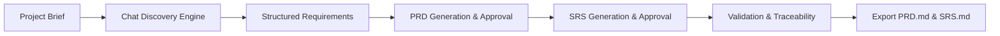
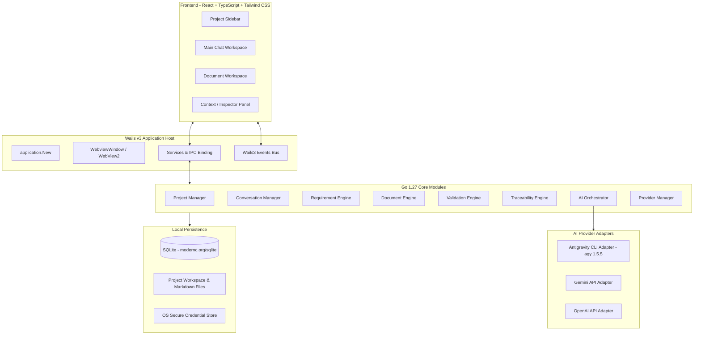

# AI Requirements Studio — Phased Implementation Plan

Dokumen perencanaan teknis bertahap (*phased implementation plan*) untuk membangun **AI Requirements Studio** berdasarkan dokumen spesifikasi:
- [PRD.md](file:///E:/dev-agent-assistant/prd.md) (v1.2 Final)
- [SRS.md](file:///E:/dev-agent-assistant/srs.md) (v1.0 Final)
- [design_system.md](file:///E:/dev-agent-assistant/design_system.md) (v1.0)

**Technology Baseline:**
- **Go Runtime:** Go latest (`1.27.x` via [go.dev/dl](https://go.dev/dl/))
- **Desktop Framework:** **Wails v3** (`github.com/wailsapp/wails/v3`, CLI: `wails3`)
- **Frontend:** React + TypeScript + Vite + Tailwind CSS
- **Local Persistence:** SQLite (Pure-Go `modernc.org/sqlite`) + Markdown files
- **AI Integration:** Pluggable Adapters (Antigravity CLI `agy` v1.5.5 + Gemini/OpenAI API)

---

## 1. Goal Description

Membangun aplikasi desktop *local-first*, *chat-first* berbasis **Go 1.27.x + Wails v3 + React + Tailwind CSS** dengan penyimpanan lokal **SQLite & Markdown**. Aplikasi mengintegrasikan AI provider pluggable (khususnya **Antigravity CLI** dan API adapters) untuk mengubah *project brief* menjadi dokumen **PRD** dan **SRS** yang terstruktur, tervalidasi, terverifikasi (*human-in-the-loop*), serta memiliki *full requirement traceability*.



---

## 2. User Review & Toolchain Decisions

> [!IMPORTANT]
> **Go Runtime (Latest 1.27.x dari go.dev/dl):**
> Sesuai arahan pengguna, kita mengunci versi Go ke versi terbaru dari [https://go.dev/dl/](https://go.dev/dl/) (`go1.27.x`). Karena `go` belum terpasang di PATH Windows saat ini, installer MSI `go1.27.x.windows-amd64.msi` akan diunduh dan dipasang pada awal Phase 0.

> [!IMPORTANT]
> **Wails Framework (Versi 3 / `wails3`):**
> Sesuai arahan pengguna, framework desktop menggunakan **Wails v3** (`github.com/wailsapp/wails/v3`).
> - Wails v3 mensyaratkan Go versi modern (Go 1.26+) dan menyediakan CLI baru `wails3`.
> - Keunggulan Wails v3: Arsitektur event & IPC yang lebih efisien, native windowing yang lebih modular, sistem build berbasis task runner terintegrasi, dan dukungan pure-Go rendering yang lebih seamless di Windows (WebView2).
> - Instalasi CLI: `go install github.com/wailsapp/wails/v3/cmd/wails3@v3.0.0` (atau `@latest`).

> [!NOTE]
> **SQLite Driver (Pure Go):**
> Menggunakan driver pure-Go `modernc.org/sqlite` agar kompilasi Wails v3 di Windows bebas dari dependensi GCC/MinGW (CGO-free build).

> [!TIP]
> **Antigravity CLI Integration (`agy` v1.5.5):**
> CLI `agy` sudah terverifikasi di mesin (`v1.5.5`) dan siap digunakan langsung melalui adapter non-interaktif `agy -p "<prompt>" --output-format json --json-schema "<schema>"`.

---

## 3. High-Level Architecture (Wails v3)



---

## 4. Phased Implementation Plan

### Phase 0: Technical Spike & Toolchain Setup (Go 1.27 + Wails v3)
**Fokus:** Menyiapkan lingkungan pengembangan Go 1.27.x dan Wails v3, memvalidasi dependensi Windows (WebView2), serta melakukan uji komunikasi dasar subprocess `agy`.

#### Tasks:
1. **Go 1.27.x Installation & Verification:**
   - Unduh installer resmi Go `1.27.x` dari [https://go.dev/dl/](https://go.dev/dl/) (atau via winget).
   - Pastikan `%USERPROFILE%\go\bin` dan direktori binary Go terdaftar di system `PATH`.
   - Verifikasi dengan `go version`.
2. **Wails v3 CLI Installation:**
   - Jalankan instalasi CLI: `go install github.com/wailsapp/wails/v3/cmd/wails3@v3.0.0` (atau `@latest`).
   - Jalankan `wails3 setup` untuk verifikasi dependensi platform Windows (WebView2 runtime).
   - Verifikasi kesiapan dengan `wails3 doctor`.
3. **Scaffold Wails v3 Application:**
   - Inisialisasi template Wails v3 React + TypeScript (`wails3 init -n ai-requirements-studio -t react-ts`).
   - Konfigurasi Tailwind CSS v3/v4 dan Lucide Icons sesuai token pada [design_system.md](file:///E:/dev-agent-assistant/design_system.md).
   - Jalankan dev server Wails v3 untuk memastikan window desktop tampil sempurna.
4. **Technical Spikes:**
   - **Antigravity CLI Subprocess:** Eksekusi `agy -p "ping" --output-format json` melalui package Go `os/exec` untuk memvalidasi tangkapan stdout/stderr dan penanganan exit code.
   - **SQLite Spike:** Buat database test menggunakan `modernc.org/sqlite` untuk memastikan kompilasi CGO-free berjalan lancar di Windows.
   - **Credential Spike:** Uji coba penyimpanan dummy key di Windows Credential Manager menggunakan `zalando/go-keyring`.

**Deliverables Phase 0:**
- Environment Go 1.27.x dan `wails3` aktif dan lolos diagnosa `wails3 doctor`.
- Template project Wails v3 terkonfigurasi dengan React, Tailwind, dan modul Go.

---

### Phase 1: Core Application, Storage Foundation & Desktop Shell
**Fokus:** Membangun *storage layer*, skema SQLite baseline, isolasi workspace lokal, registrasi provider adapter, dan UI layout desktop native.

#### Tasks:
1. **Local Storage & Database Setup (SRS Section 9 & 10):**
   - Buat skema SQLite baseline (`projects`, `conversations`, `messages`, `requirements`, `requirement_sources`, `clarifications`, `assumptions`, `decisions`, `documents`, `document_versions`, `traceability_links`, `validation_runs`, `validation_findings`, `ai_providers`, `provider_executions`).
   - Implementasikan *migration runner* Go agar skema otomatis terinisialisasi saat aplikasi pertama kali dijalankan.
   - Struktur direktori lokal:
     ```text
     AI-Requirements-Studio/
     ├── app.db
     └── projects/{project-id}/
         ├── brief.md
         ├── PRD.md
         ├── SRS.md
         ├── documents/
         └── exports/
     ```
2. **Go Domain Services:**
   - `ProjectManager`: Create, Read, Update, Archive, Delete (dengan konfirmasi).
   - `ConversationManager`: Buat sesi percakapan per project, simpan riwayat user & AI.
   - `ProviderManager`: Registrasi adapter, deteksi `agy.exe`, simpan konfigurasi model & non-secret settings.
3. **AI Adapter Foundation:**
   - Definisikan interface `AIProvider`, tipe `GenerateRequest`, dan `GenerateResponse` (SRS Section 5.2).
   - Buat `AntigravityCLIAdapter`:
     - Deteksi executable `agy.exe` dari PATH.
     - Periksa versi `agy --version`.
     - Jalankan subprocess dengan argumen terkontrol, timeout, dan buffer output.
   - Buat `GeminiAPIAdapter` sebagai contoh implementasi API provider.
   - Implementasikan *response normalization* (menangani success, malformed JSON, timeout, exit code errors).
4. **Desktop UI Shell (Wails v3 + React + Tailwind):**
   - Terapkan **Three-Pane Layout** ([design_system.md Section 4](file:///E:/dev-agent-assistant/design_system.md#L65)):
     - **Left Pane (`w-64`):** Project Sidebar & Settings button.
     - **Center Pane (`flex-1`):** Main Chat Workspace & Message Input.
     - **Right Pane (`w-96` collapsible):** Context/Inspector & Document Panel.
   - Terapkan color palette tokens (`bg-app`, `bg-panel`, `border-subtle`, `primary`, `success`, `warning`, `danger`).
   - Komponen tombol, input auto-resize, badge status provider (hijau/merah/abu-abu).
   - Bind Go service methods ke frontend melalui sistem service Wails v3.

**Deliverables Phase 1:**
- Aplikasi desktop Wails v3 berjalan dengan UI native yang responsif.
- Pengguna dapat membuat dan berganti project secara lokal.
- Deteksi status Antigravity CLI muncul di UI.

---

### Phase 2: Chat-First Discovery Engine & Requirement Management
**Fokus:** Mengolah ide/project brief melalui dialog interaktif, mengekstrak requirement terstruktur, dan human-in-the-loop review.

#### Tasks:
1. **AI Prompts & Logical Roles (PRD Section 6):**
   - Buat prompt templates terpisah untuk:
     - `Product Analyst`: identifikasi visi, target user, problem statement, core scope.
     - `Business Analyst`: identifikasi business rules, gap, ambiguitas, konflik, constraints.
     - `System Analyst`: identifikasi non-functional reqs, integrasi, data requirements.
2. **Discovery Pipeline (SRS Section 7.1):**
   - Pemrosesan project brief dari chat input.
   - Ekstraksi gap & ambiguitas: generate klarifikasi pertanyaan (simpan di tabel `clarifications`).
   - Penyimpanan jawaban klarifikasi pengguna dan penggabungan ke dalam konteks proyek.
3. **Requirement Extraction & Management (SYS-REQ-001..010):**
   - Generator ID unik: `REQ-001`, `REQ-002`, `NFR-001`, dsb.
   - Kategorisasi requirement (Functional, Non-Functional, Business Rule, UI/UX).
   - Prioritasi default menggunakan **MoSCoW** (Must, Should, Could, Won't) disertai alasan AI.
   - Tracking Asumsi (`assumptions`) dan Keputusan (`decisions`).
4. **Chat UI & Action Cards ([design_system.md Section 5.3](file:///E:/dev-agent-assistant/design_system.md#L97)):**
   - Tampilan bubble user vs AI (AI style: border kiri tebal `border-l-2 border-indigo-500`).
   - Tampilan kartu requirement interaktif (*Action Cards*) di dalam stream chat:
     - Badge prioritas MoSCoW.
     - Tombol **[Approve]** dan **[Reject]**.
     - Form inline untuk revisi cepat.
   - Inspector Panel menampilkan tab *Clarification Questions*, *Assumptions*, dan *Confirmed Requirements*.

**Deliverables Phase 2:**
- Alur discovery lengkap: input brief -> klarifikasi interaktif -> daftar requirement terstruktur.
- Requirement tersimpan di SQLite dengan status approval pengguna.

---

### Phase 3: PRD & SRS Generation Engine & Document Workspace
**Fokus:** Menyusun dokumen PRD lengkap (20 section) dan SRS (22 section), sistem versioning, preview Markdown, dan export file.

#### Tasks:
1. **Template & Document Generator (SRS Section 8):**
   - Implementasikan template PRD 20 section (Executive Summary s/d Open Questions).
   - Implementasikan template SRS 22 section (Introduction s/d Constraints & Assumptions).
   - Pipeline PRD: generate draft dari requirement yang telah disetujui pengguna.
   - Pipeline SRS: **Gated by PRD Approval** (SRS hanya dapat dibuat jika PRD berstatus `Approved`).
2. **Section-Level Regeneration:**
   - Memungkinkan user memilih section spesifik (misal: "Section 9: Features" atau "Section 6: Functional Requirements") untuk digenerate ulang tanpa merusak section lain.
3. **Document Versioning & Storage:**
   - Tabel `documents` & `document_versions`: pencatatan `version_number`, `content_hash`, `source_version_id`, `status` (`Draft`, `In Review`, `Approved`, `Superseded`, `Outdated`).
   - Sinkronisasi aman ke file lokal: `projects/{id}/PRD.md` dan `projects/{id}/SRS.md` dengan *atomic file write*.
4. **Document Workspace UI ([design_system.md Section 5.4](file:///E:/dev-agent-assistant/design_system.md#L104)):**
   - Markdown viewer terintegrasi (CommonMark compliant) dengan styling yang rapi (`max-w-prose`).
   - Mode edit langsung (Markdown editor dengan syntax highlighting).
   - Tab navigasi versi dokumen dan tombol **[Approve Document]**.
   - Fitur **Export Markdown** ke lokasi folder pilihan pengguna menggunakan native dialog Wails v3 (`dialog.SaveFileDialog`).

**Deliverables Phase 3:**
- Dokumen PRD dan SRS dapat di-generate, di-review, diedit, dan disetujui.
- File `PRD.md` dan `SRS.md` tersimpan dan dapat diekspor secara lokal.

---

### Phase 4: Validation Engine, Traceability & Change Impact
**Fokus:** Memeriksa kelengkapan, mendeteksi konflik, membangun traceability matrix, dan melacak dampak perubahan PRD terhadap SRS.

#### Tasks:
1. **Validation Engine (SYS-VAL-001..008):**
   - Validasi kelengkapan struktural (memastikan 20 section PRD dan 22 section SRS terisi atau ditandai N/A).
   - Rule-based checks:
     - Deteksi requirement tanpa acceptance criteria.
     - Deteksi asumsi yang belum dikonfirmasi (*unsupported assumptions*).
   - AI-assisted checks:
     - Deteksi ambiguitas istilah.
     - Deteksi requirement yang bertentangan (*conflicting requirements*).
   - Pencatatan hasil temuan pada tabel `validation_findings` dengan tingkat keparahan (`Warning`, `Conflict`, `Info`).
2. **Traceability Engine (SYS-TRACE-001..005):**
   - Pemetaan hubungan PRD Requirement ID <-> SRS Requirement ID pada tabel `traceability_links`.
   - Deteksi *Orphan PRD Requirements* (kebutuhan produk yang belum di-cover di SRS).
   - Deteksi *Unlinked SRS Requirements* (spesifikasi teknis tanpa justifikasi kebutuhan produk).
   - Tampilan visual **Traceability Matrix** di UI Inspector.
3. **Change Impact Detection (SYS-SRS-008 & SYS-TRACE-005):**
   - Jika suatu PRD requirement diubah setelah SRS di-*approve*, sistem otomatis mendeteksi SRS requirements yang terhubung.
   - Status dokumen SRS otomatis ditandai sebagai `Outdated`.
   - Memberikan notifikasi dan rekomendasi bagian SRS yang perlu diperbarui.

**Deliverables Phase 4:**
- Panel validasi interaktif dengan color-coded findings (amber/rose).
- Visualisasi Traceability Matrix.
- Notifikasi otomatis saat terjadi inkonsistensi PRD dan SRS.

---

### Phase 5: Security Hardening, Diagnostics, Testing & Packaging
**Fokus:** Pengamanan credential, isolasi CLI, uji menyeluruh (unit, integration, E2E), dan build binary installer desktop via Wails v3.

#### Tasks:
1. **Security & Sandboxing (SRS Section 12):**
   - Integrasi `go-keyring` untuk menyimpan API key di Windows Credential Manager / macOS Keychain.
   - CLI execution hardening: isolasi working directory ke folder project, larang eksekusi arbitrary script yang disarankan AI.
   - Redaksi otomatis terhadap data sensitif/kredensial pada logging aplikasi.
2. **Provider Diagnostics & Resilience:**
   - Health check button di UI Settings untuk memeriksa ketersediaan dan autentikasi Antigravity CLI serta API provider.
   - Timeout and cancellation handling: pembatalan permintaan AI via `context.Context` tanpa mengorbankan integritas database.
3. **Automated Testing Suite (SRS Section 15):**
   - **Unit Tests:** Requirement ID generator, MoSCoW prioritization, document versioning, validation rules, response normalization.
   - **Integration Tests:** SQLite transactions, project isolation, CLI adapter subprocess execution, export file atomic writes.
   - **End-to-End Scenarios:**
     - *Scenario A:* Project -> Chat Brief -> Discovery -> PRD Generate -> PRD Approve -> Export.
     - *Scenario B:* Approved PRD -> SRS Generate -> Traceability Check -> SRS Approve -> Export.
     - *Scenario C:* Provider Switching (tanpa kehilangan state).
     - *Scenario D:* PRD Change Impact -> SRS Outdated Trigger.
4. **Desktop Packaging & Distribution (Wails v3):**
   - Konfigurasi `wails3.json` atau task build runner untuk kompilasi production binary Windows `.exe` dan installer NSIS.
   - Verifikasi performa startup, memori, dan responsivitas UI desktop.

**Deliverables Phase 5:**
- Binary desktop application Wails v3 yang siap digunakan, aman, dan teruji penuh sesuai acceptance criteria MVP.

---

## 5. Verification Plan

### Automated Tests
```powershell
# 1. Run all Go unit and integration tests
go test -v -race ./internal/...

# 2. Run frontend lint and type-checking
cd frontend; npm run lint; npm run typecheck; npm test; cd ..

# 3. Verify Wails v3 build compilation
wails3 task build
```

### Manual Verification Scenarios (End-to-End Acceptance)
1. **Project Setup & Brief Discovery:**
   - Buat project baru bernama "Sample E-Commerce".
   - Masukkan brief produk via chat.
   - Pastikan AI memberikan pertanyaan klarifikasi dan kartu requirement terstruktur muncul.
2. **Approval & PRD Generation:**
   - Klik **Approve** pada kartu requirement.
   - Generate draft PRD, periksa 20 section, lakukan review lalu klik **Approve PRD**.
3. **SRS Generation & Traceability:**
   - Generate SRS dari PRD yang disetujui.
   - Buka panel Traceability Matrix dan pastikan semua SRS requirement terpetakan ke PRD ID.
4. **Validation & Change Impact:**
   - Ubah salah satu requirement pada PRD.
   - Verifikasi apakah SRS otomatis berubah status menjadi `Outdated`.
   - Jalankan validation check dan periksa daftar temuan.
5. **Export & Offline Check:**
   - Ekspor `PRD.md` dan `SRS.md` ke disk lokal.
   - Putuskan koneksi internet / disable provider: pastikan project, chat history, dan dokumen Markdown tetap dapat dibaca dan diedit secara offline.
