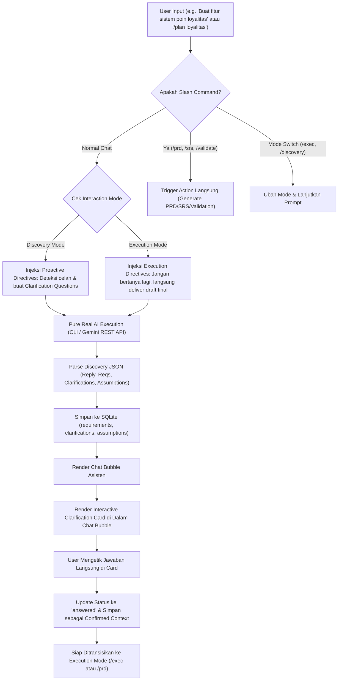

# Implementation Plan: Agentic AI Interaction, Slash Commands & Interactive Clarification UX

Dokumen rencana teknis ini merancang transformasi antarmuka chat workspace menjadi **Agentic AI Workspace** modern setara standar tool coding/agentic AI (Cursor, Windsurf, Claude Artifacts, Antigravity).

---

## 1. Goal Description
Transformasi chat discovery menjadi lingkungan agen yang interaktif dengan 3 pilar utama:
1. **Interactive Clarification Cards (The Q&A Loop)**:
   - AI mendeteksi celah konteks (*Gap & Ambiguity Detection*) dan menghasilkan pertanyaan klarifikasi terstruktur.
   - Pertanyaan AI **dirender langsung di dalam chat bubble asisten** sebagai form/kartu interaktif (bukan teks polos).
   - Pengguna dapat mengetik jawaban langsung pada kartu di chat bubble, yang otomatis tersimpan ke SQLite dan memperbarui konteks discovery secara terstruktur.
2. **Slash Commands System (`/` commands)**:
   - Menghadirkan command bar autocomplete saat pengguna mengetik `/` pada prompt input.
   - Perintah cepat untuk mengubah mode, meminta rencana, mengekstraksi requirements, atau men-trigger generasi dokumen:
     - `/discovery` atau `/explore` — Aktifkan Discovery Mode (proaktif bertanya, gali asumsi & blindspots).
     - `/plan [fitur]` — Minta agen menyusun rencana bertahap sebelum dokumen dibuat.
     - `/exec` atau `/generate` — Beralih ke Execution Mode (berhenti bertanya, langsung eksekusi).
     - `/clarify` — Paksa AI mengevaluasi celah konteks dan ajukan pertanyaan terarah.
     - `/prd` — Eksekusi pembuatan `PRD.md` (20 sections).
     - `/srs` — Eksekusi pembuatan `SRS.md` (22 sections, IEEE 830).
     - `/arch` — Eksekusi pembuatan `architecture.md` (16 sections).
     - `/design` — Eksekusi pembuatan `design.md` (16 sections).
     - `/validate` — Jalankan validasi kelengkapan & audit ambiguitas dokumen.
     - `/clear` — Bersihkan histori percakapan sesi aktif.
3. **Agentic Interaction Modes**:
   - Toggle/Dropdown mode interaksi di atas prompt bar:
     - 🔍 **Discovery Mode (Default)**: Proaktif, eksploratif, deteksi celah logika, ajukan 1–3 pertanyaan terstruktur.
     - 📋 **Product Analyst Mode**: Fokus nilai bisnis, persona, user journey, MoSCoW prioritization.
     - ⚙️ **System Analyst Mode**: Fokus arsitektur teknis, data model, business logic, NFRs, traceability.
     - ⚡ **Execution / Generation Mode**: Pasif, no probing questions, langsung gunakan seluruh confirmed requirements untuk generate dokumen.

---

## 2. Arsitektur Alur & State Transition



---

## 3. Rincian Desain & Komponen

### A. Slash Commands Menu (`SlashCommandPopover`)
*   **Trigger**: Terbuka otomatis saat karakter pertama yang diketik pengguna adalah `/`.
*   **Navigasi**: Mendukung navigasi panah atas/bawah (`ArrowUp`, `ArrowDown`), tombol `Enter` untuk memilih, dan tombol `Escape` untuk menutup.
*   **Daftar Command**:

| Command | Icon | Label & Deskripsi | Efek / Aksi |
|---|---|---|---|
| `/discovery` | `Search` | **Discovery Mode** — Gali ide, temukan celah, & ajukan pertanyaan | Mengubah `interactionMode` ke `discovery` |
| `/exec` | `Zap` | **Execution Mode** — Eksekusi langsung tanpa probing | Mengubah `interactionMode` ke `execution` |
| `/plan` | `List` | **Create Feature Plan** — Susun rencana spesifikasi bertahap | Menulis instruksi rencana bertahap ke prompt |
| `/clarify` | `HelpCircle` | **Force Clarifications** — Ajukan pertanyaan untuk celah konteks | Meminta AI menganalisis celah dan bertanya |
| `/prd` | `FileText` | **Generate PRD** — Buat draft PRD (20 sections) | Memanggil `handleGeneratePRD()` |
| `/srs` | `FileCheck` | **Generate SRS** — Buat draft SRS (22 sections) | Memanggil `handleGenerateSRS()` |
| `/arch` | `Cpu` | **Generate Architecture** — Buat topologi sistem & API | Memanggil `handleGenerateArchitecture()` |
| `/design` | `Layers` | **Generate Design System** — Buat token & screen flows | Memanggil `handleGenerateDesign()` |
| `/validate` | `Activity` | **Run Quality Check** — Audit ambiguitas & kelengkapan | Memanggil `handleRunValidation()` |
| `/clear` | `Trash2` | **Clear Chat** — Hapus histori percakapan | Memanggil reset session chat |

### B. Interactive Clarification Card di Dalam Chat Bubble
*   Saat AI mengembalikan pesan asisten yang memuat pertanyaan klarifikasi:
    *   Di bawah teks balasan asisten, dirender kartu elegan ber-border `border border-amber-200/60 dark:border-amber-900/40 bg-amber-50/20 dark:bg-amber-950/20 rounded-xl p-3 space-y-2`.
    *   Terdapat badge status: `Clarification Needed (Q&A Loop)` berwarna amber.
    *   Teks pertanyaan spesifik (misal: *"Berapa rasio konversi poin ke rupiah?"*).
    *   **Form Jawaban Inline**:
        - Input teks berfokus nyaman: `Ketik jawaban Anda di sini...`
        - Tombol aksi `Simpan Jawaban` (`bg-primary hover:bg-primary-hover text-white rounded-lg px-3 py-1 text-xs`).
    *   Saat disimpan:
        - Kartu otomatis berubah menjadi ber-border hijau `border-ok/40 bg-ok-tint/20`.
        - Menampilkan badge `Confirmed Answer` dan menampilkan teks jawaban pengguna.
        - Memanggil `RequirementService.AnswerClarification` ke SQLite dan me-refresh context project.

### C. Mode Selector Switcher (Discovery vs Execution)
*   Diletakkan tepat di atas prompt bar (atau di samping pill agent switcher) sebagai Segmented Control ringkas:
    *   🔘 **Discovery (Q&A Proaktif)**: Ikon `Search`, warna biru aksen.
    *   ⚡ **Execution (Direct)**: Ikon `Zap`, warna amber/ungu aksen.
*   Dapat diubah secara instan dengan 1 klik atau melalui slash command `/discovery` dan `/exec`.
*   Direktif prompt:
    - **Discovery**: AI diperintahkan aktif mendeteksi gap dan selalu menghasilkan 1–3 clarification questions terstruktur.
    - **Execution**: AI dilarang mengajukan pertanyaan balik, mengasumsikan standar industri, dan langsung meng-generate spesifikasi konkret.

---

## 4. Proposed Changes

### Component 1: Frontend Chat Workspace (`frontend/src/App.tsx`)
#### [MODIFY] `frontend/src/App.tsx`
1. **Tambah State**:
   - `interactionMode: 'discovery' | 'execution'` (default: `'discovery'`).
   - `slashQuery: string`, `showSlashMenu: boolean`, `selectedSlashIndex: number`.
2. **Tambah Komponen Autocomplete Popover**:
   - Muncul saat `inputMessage.startsWith('/')`.
   - Menampilkan daftar 10 perintah dengan icon dan deskripsi.
   - Mendukung pemilihan via keyboard (`Enter`, `ArrowDown`, `ArrowUp`, `Escape`).
3. **Render Interactive Clarification Cards di Bubble Asisten**:
   - Untuk setiap message asisten, periksa apakah ada clarification items yang berelasi atau open.
   - Render form inline jawaban klarifikasi langsung di dalam bubble.
4. **Kirim Mode Directive pada Chat Request**:
   - Di `handleSendMessage`, sisipkan header directive:
     `[MODE: DISCOVERY - PROACTIVE Q&A & GAP DETECTION]` atau
     `[MODE: EXECUTION - DIRECT OUTPUT, NO PROBING QUESTIONS]`.

### Component 2: Backend AI Discovery Engine (`internal/ai/discovery.go`)
#### [MODIFY] `internal/ai/discovery.go`
- Tambahkan parameter `mode string` pada `BuildDiscoveryPrompt`.
- Jika mode adalah `execution`:
  - Perintahkan AI untuk **tidak mengajukan clarification questions** (`clarifications: []`).
  - Fokus 100% pada ekstraksi requirement terstruktur dan conversational reply yang siap eksekusi.
- Jika mode adalah `discovery`:
  - Perintahkan AI untuk secara agresif mendeteksi celah dan menyertakan 1–3 pertanyaan klarifikasi berkualitas tinggi.

---

## 5. Verification Plan

### Automated Tests
1. **Frontend Compilation**:
   ```bash
   cd frontend && npm run build
   ```
   *Ekspektasi: 0 TypeScript errors.*
2. **Backend Tests**:
   ```bash
   export PATH=$PATH:/opt/homebrew/bin:~/go/bin; go test -v ./internal/...
   ```
   *Ekspektasi: Seluruh 13 unit test suites lulus (100% PASS).*
3. **Wails Native Compilation**:
   ```bash
   export PATH=$PATH:/opt/homebrew/bin:~/go/bin; wails3 task darwin:build:native
   ```

### Manual Verification
1. **Slash Commands Autocomplete**:
   - Buka chat workspace, ketik `/` di prompt bar.
   - Pastikan menu popover muncul dengan daftar perintah (`/discovery`, `/exec`, `/prd`, `/plan`, dll.).
   - Tekan panah bawah dan `Enter` pada `/exec` &rarr; Mode berganti ke Execution Mode.
   - Ketik `/prd` &rarr; Memulai eksekusi pembuatan PRD secara langsung.
2. **Interactive Clarification Q&A Loop**:
   - Berikan prompt singkat di Discovery Mode: *"Buat sistem voucher diskon."*
   - AI merespons dan menampilkan kartu pertanyaan klarifikasi interaktif di dalam chat bubble (misal *"Berapa diskon maksimum?"*).
   - Ketik jawaban langsung pada input kartu di chat bubble dan klik `Kirim Jawaban`.
   - Kartu berubah menjadi hijau bertanda `Confirmed Answer` dan data tersimpan di SQLite.
3. **Execution Mode Generation**:
   - Alihkan mode ke `Execution Mode` via tombol toggle atau `/exec`.
   - Ketik: *"Tuliskan requirement voucher ini."*
   - AI langsung menghasilkan requirement lengkap tanpa mengajukan pertanyaan klarifikasi lagi.

---

## User Review Required
> [!IMPORTANT]
> **Keputusan Desain**:
> 1. Apakah daftar 10 slash commands di atas (`/discovery`, `/exec`, `/plan`, `/clarify`, `/prd`, `/srs`, `/arch`, `/design`, `/validate`, `/clear`) sudah sesuai dengan ekspektasi Anda?
> 2. Apakah Anda setuju kartu klarifikasi interaktif muncul langsung di dalam chat bubble asisten dan otomatis berubah hijau saat dijawab?

Mohon konfirmasi atau berikan masukan Anda untuk memulai implementasi.
