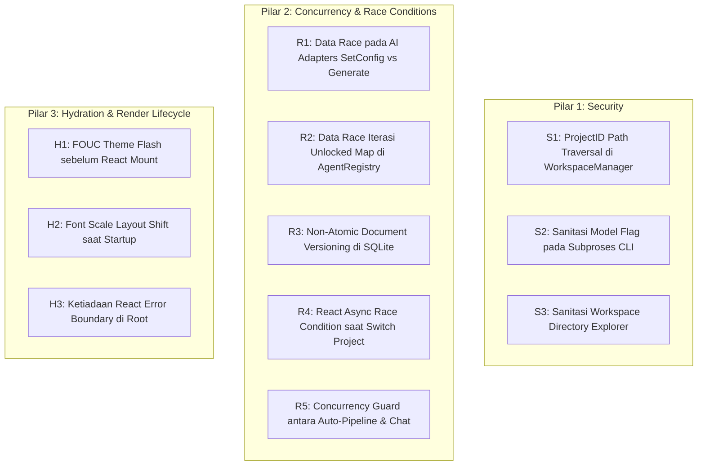

# Rencana Audit Komprehensif: Security, Race Conditions, Hydration/FOUC, & E2E Stability

## 1. Ringkasan Eksekutif & Tujuan Audit
Berdasarkan permintaan pengguna:
> *"/plan audit security di sourcecodenya, audit race condition, audit hydration jika ada cek keseluruhan code e2e"*

Kami telah melakukan audit mendalam terhadap seluruh basis kode (Go 1.27 backend, ModernC SQLite WAL, OS Keyring, Wails v3 bindings, dan React 19 TypeScript frontend). Audit ini mencakup 4 pilar utama:
1. **Security Audit**: Path traversal pada workspace, sanitasi argumen CLI/subprocess, credential storage & redactor, dan SQL injection.
2. **Race Condition Audit**: Mutex synchronization pada Go shared memory, atomisitas SQLite transaction, dan async state race pada React saat perpindahan project atau eksekusi pipeline.
3. **Hydration & Render Lifecycle Audit**: Karakteristik React 19 Client SPA, eliminasi Flash of Unstyled Content (FOUC) pada theme & font scaling, dan pencegahan layout shift.
4. **End-to-End Resilience**: Error boundaries, pembatalan request usang (*stale responses*), dan sinkronisasi status UI.

---

## 2. Temuan Audit (Audit Findings)



### Detail Temuan Spesifik:

| ID | Kategori | Tingkat Risiko | Lokasi File | Deskripsi Masalah |
| :--- | :--- | :--- | :--- | :--- |
| **S1** | Security | **High** | `internal/storage/workspace.go` | `ProjectDir(projectID)` menggabungkan string tanpa `filepath.Base` / verifikasi batas direktori root. Nilai `projectID` manipulatif dapat menembus direktori (*path traversal*). |
| **S2** | Security | **Medium** | `internal/ai/adapters/...` | `targetModel` diteruskan ke flag CLI tanpa validasi karakter spasi/newline. |
| **R1** | Concurrency | **High** | `internal/ai/adapters/{antigravity,opencode,gemini}` | Field `model`, `baseURL`, `apiKey` dimutasi via `SetConfig()` tanpa proteksi `sync.RWMutex` saat goroutine lain membaca di `Generate()` / `ListModels()`. |
| **R2** | Concurrency | **Critical** | `internal/ai/agent_registry.go` | Pada `SaveSkill` (L293) dan `DeleteSkill` (L313), map `r.skills` diiterasi *setelah* `r.mu.Unlock()`. Iterasi bersamaan dengan penulisan akan memicu Go runtime fatal panic (`concurrent map iteration and map write`). |
| **R3** | Concurrency | **Medium** | `internal/storage/document_repo.go` | `AddVersion` menghitung `SELECT MAX(version_number) + 1` lalu melakukan `INSERT` tanpa SQL transaction (`BeginTx`). Operasi simultan dapat menghasilkan duplicate version number. |
| **R4** | Concurrency | **Medium** | `frontend/src/App.tsx` | Perpindahan tab project yang cepat di `useEffect([activeProject])` tidak membatalkan request asinkron sebelumnya (*out-of-order stale response*). Dokumen project lama bisa menimpa tampilan project baru. |
| **R5** | Concurrency | **Low** | `frontend/src/App.tsx` | Form chat input tidak men-disable tombol submit saat `autoPipelineRunning` aktif, berpotensi memicu tabrakan prompt AI. |
| **H1** | Hydration/UX | **Medium** | `frontend/index.html` & `App.tsx` | Tema gelap (`dark`) diterapkan di dalam `useEffect` setelah DOM selesai dimuat. Layar berkedip terang (FOUC) selama beberapa milidetik sebelum mode gelap aktif. |
| **H2** | Hydration/UX | **Low** | `frontend/index.html` | Font scale HiDPI diaplikasikan via JS runtime setelah mount, memicu pergeseran dimensi elemen UI (*layout shift*). |
| **H3** | Stability | **Medium** | `frontend/src/main.tsx` | Ketiadaan `<ErrorBoundary>` di root menyebabkan unhandled JS exception langsung membuat layar Wails menjadi putih polos (*white screen of death*). |

---

## 3. Rencana Perbaikan Bertahap (Action Plan)

### Bagian 1: Penguatan Keamanan (Security Hardening)
1. **Perbaiki `internal/storage/workspace.go`**:
   - Terapkan sanitasi ketat pada `ProjectDir(projectID)`:
     ```go
     func (wm *WorkspaceManager) ProjectDir(projectID string) string {
         cleanID := filepath.Base(filepath.Clean(projectID))
         if cleanID == "." || cleanID == "/" || cleanID == "\\" {
             cleanID = "default"
         }
         return filepath.Join(wm.rootDir, "projects", cleanID)
     }
     ```
   - Validasi bahwa seluruh operasi file (`SaveAttachment`, `WriteDocument`, `ReadDocument`) memverifikasi relasi path terhadap direktori project tujuan menggunakan `filepath.Rel`.
2. **Sanitasi Parameter Flag CLI**:
   - Di `antigravity`, `opencode`, dan `gemini` adapter, bersihkan string `targetModel` dari karakter berbahaya (spasi ganda, newline, flag prefix `--`) sebelum diteruskan ke eksekusi subproses.

### Bagian 2: Eliminasi Race Conditions (Concurrency Hardening)
1. **Thread-Safe AI Adapters**:
   - Tambahkan `sync.RWMutex` ke `antigravity.Adapter`, `opencode.Adapter`, dan `gemini.Adapter`.
   - Lindungi metode `SetConfig()`, `GetModel()`, `ListModels()`, dan `Generate()` dengan `mu.Lock()` / `mu.RLock()`.
2. **Perbaikan Mutex pada `AgentRegistry` (`internal/ai/agent_registry.go`)**:
   - Pada `SaveSkill` dan `DeleteSkill`, lakukan pengumpulan `customList` di dalam blok `r.mu.Lock()` (atau `r.mu.RLock()`) sebelum di-unmarshal dan disimpan ke repositori.
3. **Transaksi Atomik SQLite (`internal/storage/document_repo.go`)**:
   - Bungkus `AddVersion` dalam database transaction:
     ```go
     tx, err := r.db.BeginTx(ctx, nil)
     if err != nil { return nil, err }
     defer tx.Rollback()
     // SELECT MAX ...
     // INSERT version ...
     // UPDATE document ...
     if err := tx.Commit(); err != nil { return nil, err }
     ```
4. **Pembatalan Stale Response di Frontend (`frontend/src/App.tsx`)**:
   - Tambahkan token generasi request (`activeProjectReqToken.current++`) di dalam `useEffect([activeProject])`.
   - Di setiap callback `loadSessionAndData`, `loadDocumentDetails`, dan `loadValidationAndTraceability`, abaikan hasil jika token request sudah tidak sesuai dengan project yang sedang aktif.
5. **Concurrency Guard pada Pipeline**:
   - Tambahkan pengecekan `if (isSending || autoPipelineRunning) return;` di `handleSendMessage`.

### Bagian 3: Eliminasi Hydration Mismatch & FOUC (Hydration Hardening)
1. **Inline Pre-render Script di `frontend/index.html`**:
   - Sisipkan script sinkron ringan di `<head>` sebelum tag `<body>`:
     ```html
     <script>
       (function() {
         try {
           const theme = localStorage.getItem('theme_mode') || 'system';
           const isDark = theme === 'dark' || (theme === 'system' && window.matchMedia('(prefers-color-scheme: dark)').matches);
           if (isDark) document.documentElement.classList.add('dark');
           const scale = localStorage.getItem('font_scale');
           if (scale && scale !== 'auto' && scale !== '100%') {
             const zoomMap = { '85%': '0.85', '90%': '0.90', '100%': '1.0', '110%': '1.10', '115%': '1.15' };
             if (zoomMap[scale]) document.documentElement.style.zoom = zoomMap[scale];
           }
         } catch(e) {}
       })();
     </script>
     ```
   - Ini memastikan WebView2 / WebKit langsung me-render background Obsidian Slate gelap dan scaling yang tepat sebelum React memuat frame pertama, menghilangkan FOUC 100%.
2. **Root Error Boundary (`frontend/src/components/ErrorBoundary.tsx` & `main.tsx`)**:
   - Buat komponen `ErrorBoundary` dengan tampilan ramah pengguna MQ-Studio / Warm Stone, dilengkapi tombol "Reload Studio" dan salin crash stack trace jika terjadi kesalahan runtime.

---

## 4. Rencana Verifikasi & Uji Mutu

1. **Uji Keamanan & Path Traversal**:
   - Buat unit test dengan input projectID berisi `../../exploit` dan attachment traversal untuk membuktikan penolakan akses ke luar direktori workspace.
2. **Uji Konkurensi**:
   - Eksekusi test suite dengan simulasi goroutine paralel memanggil `SaveSkill` dan `DeleteSkill` secara simultan untuk memverifikasi hilangnya panic data race.
   - Uji transaksi dokumen `AddVersion` paralel.
3. **Uji Visual Hydration & FOUC**:
   - Refresh aplikasi dalam keadaan Dark Mode dan amati kelancaran rendering awal tanpa ada kedipan latar putih/abu-abu terang.
4. **Build & Automated Test Commands**:
   - `go test -v ./internal/...`
   - `npm --prefix frontend run build`

---

## 5. Pertanyaan & Konfirmasi

Apakah Anda menyetujui rencana perbaikan audit ini untuk segera kami eksekusi secara berurutan:
1. **Setujui & Eksekusi Penuh**: Terapkan seluruh perbaikan Security (S1-S3), Concurrency/Race Condition (R1-R5), dan Hydration/FOUC (H1-H3).
2. **Ada prioritas tertentu**: Jika ingin mendahulukan bagian tertentu sebelum yang lain.
