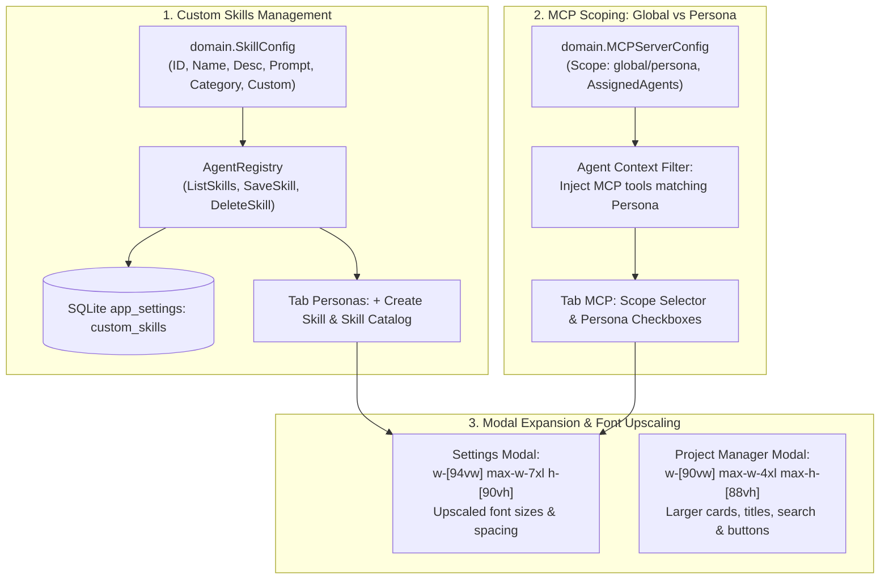

# Plan: Custom Skills Management, MCP Scoping & Modal Expansion

Dokumen rencana implementasi untuk:
1. **Custom Skills Management:** Menambahkan antarmuka & backend service untuk membuat custom skill baru (+ Add Custom Skill) dengan nama, deskripsi, dan prompt khusus, serta kemampuan menugaskan skill ke persona tertentu.
2. **MCP Scoping (Global vs Persona Assignment):** Menyediakan kontrol agar setiap MCP Server dapat disetel sebagai **Global (Semua Persona)** atau **Spesifik untuk Persona Tertentu** (misal Figma MCP hanya untuk UI/UX, Database MCP untuk Architect/System Analyst).
3. **Pelebaran Modal & Peningkatan Skala Font:**
   - **Studio Settings Modal:** Melebarkan dari `max-w-5xl` ke **`w-[94vw] max-w-7xl h-[90vh]`** dengan peningkatan ukuran font teks judul, tab, form control, dan deskripsi.
   - **Project Manager / Open Project Modal:** Melebarkan dari `max-w-2xl` ke **`w-[90vw] max-w-4xl max-h-[88vh]`** dengan font lebih besar, kartu project lebih lega, dan search bar lebih nyaman.

---

## 1. Goal Description

Menjawab pertanyaan & kebutuhan pengguna:
- *"gw bisa nambahin skill dimana?"* ➔ Selama ini skill hanya berupa badge statis yang bisa di-toggle on/off per persona. Pengguna membutuhkan **Skill Catalog & Custom Skill Creator** di mana pengguna bisa menambah skill baru (misal: FinTech OJK Compliance, Microservice Event-Driven, Atomic Design System) lengkap dengan system prompt khusus skill tersebut, lalu menautkannya ke persona yang diinginkan.
- *"mcp ini gw bisa assign ke persona tertentu atau set global juga harusnya"* ➔ Mengembangkan arsitektur MCP Server agar memiliki properti `scope: "global" | "persona"`. Jika global, ke-4 agen otomatis memiliki akses. Jika persona, pengguna dapat mencentang persona mana saja yang berhak mengakses server MCP tersebut.
- *"tambahan modal setting widthnya lebarain lagi fontnya gedein lagi, open project juga modalnya fontnya gedein lagi"* ➔ Meningkatkan ukuran container modal Settings dan Project Manager agar sangat lega pada monitor desktop serta memperbesar ukuran font judul, input, deskripsi, dan tombol.

---

## 2. User Review Required

> [!IMPORTANT]
> **Alur Pembuatan Custom Skill:**
> Di dalam Tab *Specialist Personas & Skills*, akan disediakan dua tombol aksi baru:
> 1. **"+ Add Existing Skill to Persona"**: Memilih dari katalog skill bawaan & custom yang belum aktif pada persona tersebut.
> 2. **"+ Create New Custom Skill"**: Membuka dialog formulir untuk mendefinisikan skill baru:
>    - **Skill Name** (misal: *OJK & BI Payment Gateway Compliance*)
>    - **Skill ID** (misal: *ojk-payment-compliance*)
>    - **Category** (Product, System, Architecture, UI/UX, General)
>    - **Skill Prompt Directive** (Instruksi spesifik yang diinjeksikan ke LLM saat agen menggunakan skill ini)
> Skill yang dibuat otomatis tersimpan ke database lokal SQLite dan dapat dipakai lintas proyek.

> [!IMPORTANT]
> **Pilihan Scope MCP (Global vs Persona):**
> Pada formulir pendaftaran / edit MCP Server:
> - **🌐 Global (All Personas):** Tersedia untuk Product Analyst, System Analyst, Software Architect, dan UI/UX Agent.
> - **🎯 Specific Personas:** Menampilkan 4 checkbox persona spesialis. Agen hanya akan memuat konteks MCP jika server tersebut ditugaskan kepadanya.

---

## 3. Open Questions

Tidak ada pertanyaan penghalang (*blocking*). Seluruh data custom skill dan konfigurasi scope MCP akan disimpan persisten di SQLite tabel `app_settings` sehingga tidak akan hilang saat aplikasi di-restart.

---

## 4. Proposed Changes



---

### Component 1: Backend Domain & Agent Registry (Go)

#### [MODIFY] [`internal/domain/models.go`](file:///E:/dev-agent-assistant/internal/domain/models.go)
1. Menambahkan struct `SkillConfig`:
   ```go
   type SkillConfig struct {
       ID          string `json:"id"`
       Name        string `json:"name"`
       Description string `json:"description"`
       Prompt      string `json:"prompt"`
       Category    string `json:"category"` // "product" | "system" | "architecture" | "uiux" | "general"
       Custom      bool   `json:"custom"`
   }
   ```
2. Memperbarui struct `MCPServerConfig` dengan field `Scope` dan `AssignedAgents`:
   ```go
   type MCPServerConfig struct {
       ID             string            `json:"id"`
       Name           string            `json:"name"`
       Transport      string            `json:"transport"` // "stdio" or "sse"
       Endpoint       string            `json:"endpoint"`  // command path or SSE url
       Enabled        bool              `json:"enabled"`
       Scope          string            `json:"scope"`     // "global" | "persona"
       AssignedAgents []string          `json:"assigned_agents,omitempty"`
       Env            map[string]string `json:"env,omitempty"`
   }
   ```

#### [MODIFY] [`internal/ai/agent_registry.go`](file:///E:/dev-agent-assistant/internal/ai/agent_registry.go)
- Menambahkan map `skills map[string]domain.SkillConfig` dan menginisialisasi katalog skill default.
- Menyediakan method:
  - `ListSkills() []domain.SkillConfig`
  - `SaveSkill(skill domain.SkillConfig) error`
  - `DeleteSkill(id string) error`
  - `GetSkillsForAgent(agentID string) []domain.SkillConfig`
  - `GetMCPServersForAgent(agentID string) []domain.MCPServerConfig` (mengembalikan MCP Global + MCP yang secara spesifik menugaskan `agentID`).

#### [MODIFY] [`internal/services/provider_service.go`](file:///E:/dev-agent-assistant/internal/services/provider_service.go)
- Mengekspos method baru ke Wails:
  - `ListSkills() []domain.SkillConfig`
  - `SaveSkill(skill domain.SkillConfig) error`
  - `DeleteSkill(id string) error`

#### [MODIFY] [`internal/services/conversation_service.go`](file:///E:/dev-agent-assistant/internal/services/conversation_service.go)
- Saat membangun context prompt untuk chat/generasi, injeksikan direktif prompt dari skill yang aktif serta daftar tools dari MCP yang aktif untuk persona tersebut (baik Global maupun Assigned).

---

### Component 2: Frontend UI & Modals (`frontend/src/App.tsx`)

#### [MODIFY] [`frontend/src/App.tsx`](file:///E:/dev-agent-assistant/frontend/src/App.tsx)

1. **Pelebaran & Font Upscaling Studio Settings Modal:**
   - Container dialog diubah dari `max-w-5xl h-[88vh]` menjadi:
     ```tsx
     <div className="bg-surface border border-border rounded-[14px] p-7 w-[94vw] max-w-7xl h-[90vh] shadow-2xl flex flex-col overflow-hidden animate-in fade-in zoom-in-95 duration-100">
     ```
   - Header title dinaikkan ke `text-base font-bold`.
   - Tab navigasi dinaikkan ke `text-sm font-semibold px-4 py-2`.
   - Seluruh label input diubah ke `text-xs font-bold text-fg` (13px), dan input teks ke `text-sm px-3.5 py-2`.

2. **Custom Skills UI di Tab Personas & Skills:**
   - Menambahkan bagian **"Skill Library & Custom Skills"**:
     - Tombol **"+ Create New Skill"** yang membuka modal kecil untuk mendefinisikan skill baru.
     - Dropdown / selector untuk menambahkan skill yang ada ke persona aktif.
     - Tombol toggle aktif/nonaktif pada setiap kartu skill.
     - Badge penanda `Custom` untuk skill buatan pengguna dengan tombol hapus.

3. **MCP Scoping UI di Tab MCP Connections:**
   - Pada formulir **Register New MCP Server**:
     - Pilihan Scope: Radio card **🌐 Global (Semua Persona)** vs **🎯 Spesifik Persona**.
     - Jika Spesifik Persona dipilih: Tampilkan 4 checkbox persona (*Product Analyst, System Analyst, Software Architect, UI/UX Agent*).
   - Pada daftar MCP Server yang terhubung:
     - Tampilkan badge scope: `Global` (berwarna Cobalt) atau daftar avatar/nama persona yang ditugaskan.
   - Di tab Personas:
     - Tampilkan daftar **"Connected MCP Tools"** yang dapat diakses oleh persona terpilih saat ini.

4. **Pelebaran & Font Upscaling Project Manager / Open Project Modal:**
   - Container dialog diubah dari `max-w-2xl` menjadi:
     ```tsx
     <div className="bg-surface border border-border rounded-[14px] w-[90vw] max-w-4xl shadow-2xl overflow-hidden flex flex-col max-h-[88vh] animate-in fade-in zoom-in-95 duration-100">
     ```
   - Header: `text-base font-bold` dengan icon `FolderKanban size={19}`.
   - Tabs: `text-sm font-semibold`.
   - Search bar: `text-sm py-2.5 px-3.5 pl-10`.
   - Project List Item:
     - Judul project: `text-sm font-bold text-fg`.
     - Deskripsi: `text-xs text-muted mt-1 leading-relaxed`.
     - Badges: `text-xs font-semibold px-2 py-0.5`.
     - Tombol Open: `text-xs font-semibold px-3.5 py-1.5`.

---

## 5. Verification Plan

### Automated Tests
1. **Backend Go Unit Tests:**
   ```powershell
   $env:PATH += ";C:\Program Files\Go\bin;$env:USERPROFILE\go\bin"; go test -v ./internal/...
   ```
   *Kriteria lulus:* Semua test suites lulus 100%, termasuk pengujian Custom Skill CRUD dan MCP Scoping filtering.
2. **Wails Bindings Generation:**
   ```powershell
   $env:PATH += ";C:\Program Files\Go\bin;$env:USERPROFILE\go\bin"; wails3 generate bindings -ts -i
   ```
   *Kriteria lulus:* Method `ListSkills`, `SaveSkill`, `DeleteSkill`, dan model `SkillConfig` tergenerate di frontend bindings.
3. **Frontend Production Build:**
   ```powershell
   cd frontend
   npm run build
   ```
   *Kriteria lulus:* Build Vite + TypeScript tuntas dalam 0 errors.
4. **Desktop Native App Build:**
   ```powershell
   $env:PATH += ";C:\Program Files\Go\bin;$env:USERPROFILE\go\bin"; wails3 task build
   ```
   *Kriteria lulus:* Biner `bin/ai-requirements-studio.exe` tercipta sukses.

### Manual Verification
1. Buka Project Manager modal:
   - Amati lebar modal yang kini mencapai `max-w-4xl` dan ukuran teks kartu project yang nyaman dibaca.
2. Buka Studio Settings modal:
   - Amati lebar modal yang sangat lega (`max-w-7xl`) dan tipografi yang proporsional.
3. Uji Tambah Custom Skill:
   - Buka tab *Specialist Personas & Skills*, klik *"+ Create New Skill"*.
   - Buat skill baru: Nama *"FinTech Payment Standard"*, ID *"fintech-payment"*, prompt *"Pastikan semua payment API mematuhi ISO 20022"*.
   - Simpan dan aktifkan pada persona *Software Architect*. Verifikasi skill tersimpan setelah modal ditutup dan dibuka kembali.
4. Uji MCP Scoping:
   - Buka tab *MCP Connections*, daftarkan server MCP baru (misal: *Figma Design Tokens MCP*).
   - Pilih scope *Spesifik Persona* dan centang hanya *UI/UX Agent*.
   - Buka tab *Personas*, pilih *UI/UX Agent*: MCP Figma muncul sebagai tool aktif.
   - Pilih *Product Analyst*: MCP Figma tidak muncul (karena dibatasi hanya untuk UI/UX).
