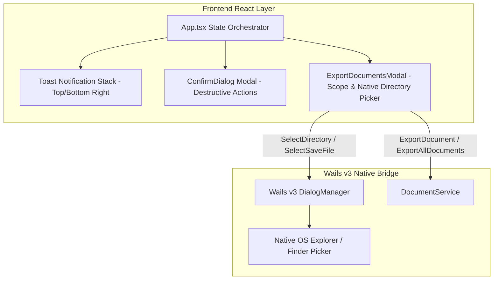

# Rencana Implementasi: In-App Toast System, Confirmation Dialogs & Native File Export Modal

## 1. Goal Description
Pengguna meminta perbaikan menyeluruh pada interaksi dialog sistem:
> *"ui alert nya jangan bawaan browser dialog gitu donk ada uinya, terus untuk export all juga mending dialog file ya, gitu kan coba cek lagi dan perbaiki uinya"*

Saat ini aplikasi masih menggunakan fungsi bawaan browser (`window.alert`, `window.confirm`, `window.prompt`):
1. **`alert(...)` (40+ pemanggilan)**: Membekukan render WebView, memblokir interaksi secara kasar, dan menampilkan dialog standar OS/browser yang tidak estetik.
2. **`confirm(...)` (3 pemanggilan untuk delete project, skill, dan MCP)**: Menggunakan popup konfirmasi bawaan browser yang monoton dan berisiko salah klik.
3. **`prompt(...)` (2 pemanggilan untuk ekspor dokumen)**: Meminta pengguna mengetikkan path file/folder secara manual via kotak teks browser biasa.

Rencana ini merekonstruksi dialog tersebut menjadi antarmuka native modern yang elegan, halus, dan terintegrasi penuh dengan styling token MQ-Studio.

---

## 2. User Review Required
> [!IMPORTANT]
> 1. Seluruh `alert()` akan digantikan oleh **Toast Notification System** yang otomatis menghilang setelah 3,5 detik dan dapat ditutup manual.
> 2. Dialog `confirm()` untuk tindakan destruktif (hapus project, custom skill, MCP server) digantikan oleh **Modal Konfirmasi Berbayang (Backdrop Blur)** dengan tombol aksi tegas merah/primer.
> 3. Fungsi `prompt()` pada ekspor dokumen digantikan oleh **Dedicated Export Modal** yang dilengkapi tombol **"Browse Folder..."** memanggil native Windows Explorer / macOS Finder directory picker via Wails v3.

---

## 3. Arsitektur Komponen Baru



---

## 4. Proposed Changes

### A. Backend Layer (Wails v3 Dialog Manager)
#### [MODIFY] `internal/services/document_service.go`
- Tambahkan integrasi `application.Get().Dialog` untuk membuka dialog pemilih folder dan file penyimpanan asli sistem operasi:
  ```go
  func (s *DocumentService) SelectDirectory(title string) (string, error) {
      app := application.Get()
      if app == nil || app.Dialog == nil {
          return "", fmt.Errorf("dialog manager unavailable")
      }
      dlg := app.Dialog.OpenFile().
          CanChooseDirectories(true).
          CanChooseFiles(false).
          CanCreateDirectories(true)
      if title != "" {
          dlg.SetTitle(title)
      }
      return dlg.PromptForSingleSelection()
  }

  func (s *DocumentService) SelectSaveFile(title string, defaultFilename string) (string, error) {
      app := application.Get()
      if app == nil || app.Dialog == nil {
          return "", fmt.Errorf("dialog manager unavailable")
      }
      dlg := app.Dialog.SaveFile()
      if title != "" {
          dlg.SetTitle(title)
      }
      if defaultFilename != "" {
          dlg.SetFilename(defaultFilename)
      }
      return dlg.PromptForSingleSelection()
  }
  ```

#### [MODIFY] `frontend/bindings/ai-requirements-studio/internal/services/documentservice.ts`
- Tambahkan TypeScript bindings dengan ID hash:
  - `SelectDirectory(title: string): $CancellablePromise<string>` (`ID: 4043236185`)
  - `SelectSaveFile(title: string, defaultFilename: string): $CancellablePromise<string>` (`ID: 2175121209`)

---

### B. Frontend Layer (React 19 & Tailwind CSS)

#### [NEW] `frontend/src/components/Toast.tsx`
- Komponen Toast Notification Stack:
  - Tipe: `success`, `error`, `info`, `warn`.
  - Icon spesifik per tipe (`CheckCircle2`, `AlertTriangle`, `XCircle`, `Info`).
  - Animasi fade-in & slide-in dengan progress timer halus.
  - Tombol tutup manual `[✕]`.

#### [NEW] `frontend/src/components/ConfirmModal.tsx`
- Modal konfirmasi tindakan destruktif:
  - Judul, pesan deskriptif, dan peringatan dampak (misal penghapusan workspace data).
  - Tombol aksi destruktif (merah) atau konfirmasi primer, serta tombol batal.

#### [NEW] `frontend/src/components/ExportModal.tsx`
- Dedicated Export Modal untuk dokumen spesifikasi:
  - Pilihan scope:
    - **Dokumen Aktif** (PRD / SRS / Architecture / Design System).
    - **Semua Dokumen Spesifikasi** (PRD 20 Sec, SRS 22 Sec, Arch 16 Sec, Design 16 Sec).
  - Target Path input dengan tombol **"Browse..."** yang memanggil dialog native Windows/macOS.
  - Pratinjau daftar dokumen yang siap diekspor beserta status ketersediaannya.
  - Tombol eksekusi **"Ekspor Sekarang"** dengan feedback loading.

#### [MODIFY] `frontend/src/App.tsx`
- Gantikan seluruh pemanggilan `alert(...)` dengan fungsi pembantu:
  - `notifySuccess(title, message)`
  - `notifyError(title, message)`
  - `notifyWarn(title, message)`
  - `notifyInfo(title, message)`
- Gantikan `confirm(...)` pada hapus project, hapus custom skill, dan hapus MCP server dengan state `confirmDialog`.
- Gantikan `prompt(...)` pada tombol ekspor dengan state `isExportModalOpen`.

---

## 5. Verification Plan

### Automated Tests
1. **Backend Go Tests**:
   ```powershell
   go test -v ./internal/services -run TestRequirementService
   go test -v ./internal/...
   ```
2. **Frontend Strict TypeScript & Vite Build**:
   ```powershell
   npm --prefix frontend run build
   ```

### Manual Verification
1. **Verifikasi Toast**:
   - Jalankan tindakan seperti generate PRD, approve PRD, simpan settings.
   - Pastikan muncul Toast hijau/biru di pojok kanan bawah yang otomatis menutup dalam 3,5 detik tanpa browser dialog.
2. **Verifikasi Confirm Modal**:
   - Buka menu hapus project atau hapus custom skill.
   - Pastikan muncul modal kustom dengan tombol "Batal" dan "Hapus" yang berfungsi dengan mulus.
3. **Verifikasi Export Modal & Native File Dialog**:
   - Klik tombol **Export** di toolbar dokumen.
   - Pastikan modal Export terbuka dengan rapi.
   - Klik tombol **"Browse..."** dan pastikan dialog native folder/file explorer Windows terbuka untuk memilih direktori.
   - Klik "Ekspor Sekarang", pastikan dokumen tersimpan dan muncul notifikasi Toast sukses.
