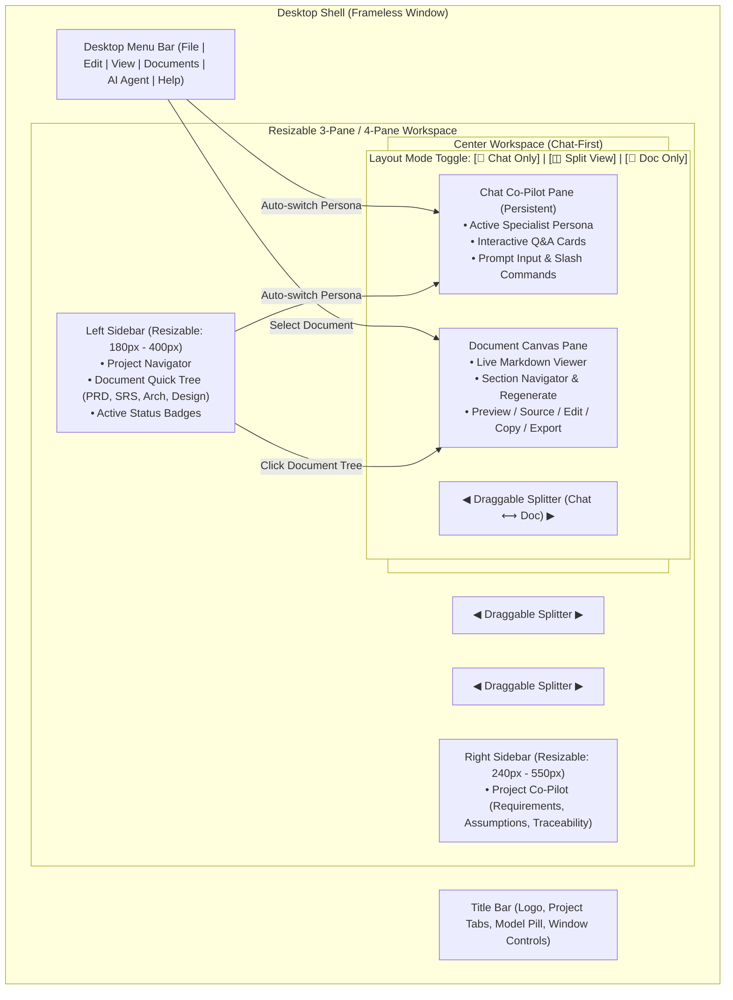

# Implementation Plan: Desktop Menu Bar, Chat-First Architecture, Side-by-Side Document Split, & Resizable Panels

Transformasi arsitektur UX desktop **AI Requirements Studio** dari paradigma *page-swapping* menjadi arsitektur desktop modern berorientasi **Chat-First**:
1. Menghadirkan **Desktop Application Menu Bar** (`File`, `Edit`, `View`, `Documents`, `AI Agent`, `Help`).
2. Menghapus top bar stepper lama (`Discovery > PRD > SRS > Architecture > Design`).
3. Menjadikan **Chat sebagai panggung utama yang selalu aktif** dan menghadirkan **Side-by-Side Split View** (Chat Co-Pilot + Document Canvas) sehingga pengguna dapat berdiskusi dengan spesialis AI tanpa pernah kehilangan konteks obrolan saat meninjau dokumen spesifikasi (PRD, SRS, Architecture, Design System).
4. Menyempurnakan **Context-Aware Persona Auto-Switching** saat membuka dokumen di Split Canvas.
5. Mengimplementasikan **Resizable Columns** dengan drag splitter untuk panel kiri, panel tengah (chat vs document), dan panel kanan (Project Co-Pilot) dengan persistensi ukuran ke `localStorage`.

---

## 1. Problem Analysis & UX Architecture

### Masalah Utama Saat Ini:
1. **Chat Terputus Saat Membuka Dokumen**:
   Saat pengguna memilih menu PRD, SRS, Architecture, atau Design System, seluruh panggung tengah berganti menjadi dokumen Markdown (`MarkdownViewer`). Pengguna tidak dapat melakukan chat sama sekali ketika berada di halaman dokumen, padahal fitur utama aplikasi adalah dialog requirements engineering dengan agen AI.
2. **Top Bar Stepper Memakan Ruang Vertikal**:
   Top bar breadcrumb (`1. Discovery > 2. PRD > 3. SRS > ...`) memakan ruang vertikal berharga dan menduplikasi navigasi sidebar.
3. **Sidebar Kaku dan Tidak Dapat Diresize**:
   Sidebar kiri (`230px`) dan sidebar kanan (`320px`) berukuran statis, tidak dapat digeser atau disesuaikan dengan resolusi layar pengguna.
4. **Ketiadaan Menu Bar Desktop Standar**:
   Operasi dokumen, ekspor, pengaturan tampilan, dan pemilihan persona tersebar tanpa hierarki menu desktop native.

---

## 2. Proposed Architecture & Solution Design



### A. Desktop Application Menu Bar
Diletakkan tepat di bawah title bar atau menyatu secara elegan:
- **`File`**: New Project, Open Project Manager, Open Workspace Folder, Export Active Document, Export All Specifications (.md), Quit.
- **`Edit`**: Copy Full Document, Clear Active Chat History, General Settings.
- **`View`**: 
  - Toggle Left Sidebar (`Ctrl+B`)
  - Toggle Right Co-Pilot (`Ctrl+J`)
  - Toggle Document Canvas (`Ctrl+D`)
  - Layout Mode: `Chat Only` | `Split View (Chat + Doc)` | `Document Only`
  - Color Theme: `Light (Warm Stone)` | `Dark (Obsidian Slate)` | `System Auto`
  - HiDPI Zoom: `Reset (100%)`, `Zoom In (+)`, `Zoom Out (-)`
- **`Documents`** (Spesifikasi):
  - **PRD** (Product Requirements Document, 20 sections) ➔ Buka di Canvas & Aktifkan *Product Analyst*
  - **SRS** (System Requirements Specification, 22 sections) ➔ Buka di Canvas & Aktifkan *System Analyst*
  - **Architecture** (C4 Architecture & API Contracts, 16 sections) ➔ Buka di Canvas & Aktifkan *Software Architect*
  - **Design System** (Design Tokens & Screen Flows, 16 sections) ➔ Buka di Canvas & Aktifkan *UI/UX Agent*
- **`AI Agent`**:
  - Switch Active Persona: `Product Analyst`, `System Analyst`, `Software Architect`, `UI/UX Agent`
  - Run Autonomous Pipeline (`/plan`, `/discovery`, `/exec`)
  - Force Clarifications (`/clarify`)
  - Run Quality Validation (`/validate`)
- **`Help`**: Run Diagnostics, Keyboard Shortcuts, About Specra.

### B. Eliminasi Top Bar Stepper Lama
- Menghapus komponen `pipelineSteps.map(...)` yang memakan ruang vertikal di atas panggung utama.
- Status dokumen (Approved, Draft, Outdated, Gated) dipindahkan langsung ke **Header Document Pane** dan **Left Document Tree**, sehingga area baca dokumen jauh lebih luas dan bersih.

### C. Chat-First Primary Stage & Side-by-Side Document Canvas
- Pengguna **tidak pernah kehilangan akses ke Chat** saat meninjau atau merevisi dokumen.
- Tersedia 3 Mode Tampilan di Toolbar Header:
  1. **`Split View` (Default saat membuka dokumen)**: Chat di sisi kiri/tengah dan Dokumen Markdown di sisi kanan/tengah dengan pembatas yang dapat digeser (resizable split).
  2. **`Chat Only`**: Layar penuh untuk ideasi, brainstorming, dan discovery awal.
  3. **`Document Only`**: Layar penuh untuk membaca atau mengedit manual dokumen spesifikasi.
- **Context-Aware Auto-Switching yang Nyata**:
  - Saat dokumen **PRD** dibuka di Document Canvas, persona chat otomatis menjadi **Product Analyst**. Pengguna dapat langsung berdialog: *"Tolong jelaskan use case untuk FR-003"* atau *"Tambahkan kriteria penerimaan di Section 4"*.
  - Saat dokumen **SRS** dibuka, chat otomatis beralih ke **System Analyst**.
  - Saat dokumen **Architecture** dibuka, chat otomatis beralih ke **Software Architect**.
  - Saat dokumen **Design System** dibuka, chat otomatis beralih ke **UI/UX Agent**.

### D. Resizable Panels dengan Drag Handle & LocalStorage Persistence
Komponen pembagi (drag splitter) fleksibel dengan kriteria:
- `cursor-col-resize` dengan garis hover highlight `--c-primary`.
- State persistensi di `localStorage`:
  - `left_panel_width`: default `220px` (min `160px`, max `400px`).
  - `right_panel_width`: default `320px` (min `240px`, max `550px`).
  - `chat_split_ratio`: default `45%` (min `25%`, max `75%`).
  - `left_panel_collapsed`: boolean.
  - `right_panel_collapsed`: boolean.
- Tidak ada gangguan drag saat mouse melewati iframe, code block, atau teks (menggunakan temporary invisible overlay saat dragging).

---

## 3. Proposed Code Changes

### Component 1: Desktop Menu Bar (`frontend/src/components/DesktopMenuBar.tsx`) [NEW]
Komponen Menu Bar desktop dengan dropdown menus, keyboard shortcuts label, active indicators, dan accessibility trap.

### Component 2: Resizable Splitter Hook / Utility (`frontend/src/hooks/useResizablePanel.ts`) [NEW]
Hook reusable untuk mengelola drag gesture pembatas kolom horizontal, kalkulasi pixel/persentase, pembatasan min/max width, dan sinkronisasi ke `localStorage`.

### Component 3: Document Canvas Pane (`frontend/src/components/DocumentCanvasPane.tsx`) [NEW]
Mengekstrak rendering dokumen Markdown (PRD, SRS, Architecture, Design) menjadi panel modular mandiri dengan:
- Header status dokumen (Status badge, Version pill, Section selector, Regenerate button, Copy, Export, Edit/Simpan).
- Markdown Viewer dengan blok Mermaid interaktif.
- Manual editor mode (monospaced textarea).
- Tombol layout toggle (`Chat Only`, `Split`, `Doc Only`).

### Component 4: App Integration (`frontend/src/App.tsx`) [MODIFY]
- Mengintegrasikan `<DesktopMenuBar />` di bawah title bar.
- Menggantikan layout statis dengan resizable 3-pane / split view layout.
- Menghapus horizontal stepper lama (`pipelineSteps`).
- Menyinkronkan active persona secara otomatis saat dokumen dibuka di split view tanpa menghilangkan panggung chat.

---

## 4. Verification Plan

### Automated Tests:
```bash
# Frontend build & TypeScript strict check
npm --prefix frontend run build

# Backend unit & integration tests
go test -v ./internal/...
```

### Manual Verification:
1. **Desktop Menu Bar**:
   - Klik `Documents > PRD` ➔ Document Canvas terbuka di sisi kanan, Persona chat otomatis beralih ke *Product Analyst*, Chat tetap terbuka dan aktif di sisi kiri.
   - Klik `Documents > SRS` ➔ Document Canvas menampilkan SRS, Persona chat otomatis beralih ke *System Analyst*.
   - Klik `View > Layout Mode` ➔ Coba berganti antara `Chat Only`, `Split View`, dan `Document Only`.
2. **Resizable Columns**:
   - Tarik garis pembatas antara Sidebar Kiri dan Workspace Tengah ➔ Ukuran sidebar berubah lancar dan tersimpan setelah refresh.
   - Tarik garis pembatas antara Chat dan Dokumen Canvas di Split View ➔ Rasio lebar chat dan dokumen dapat disesuaikan bebas.
   - Tarik garis pembatas antara Workspace dan Sidebar Kanan (Co-Pilot) ➔ Lebar Co-Pilot berubah lancar.
3. **Chat-First Workflow**:
   - Ketik pesan di Chat saat PRD terbuka di Split View ➔ Chat merespons langsung dari Product Analyst tanpa menutup tampilan PRD.
