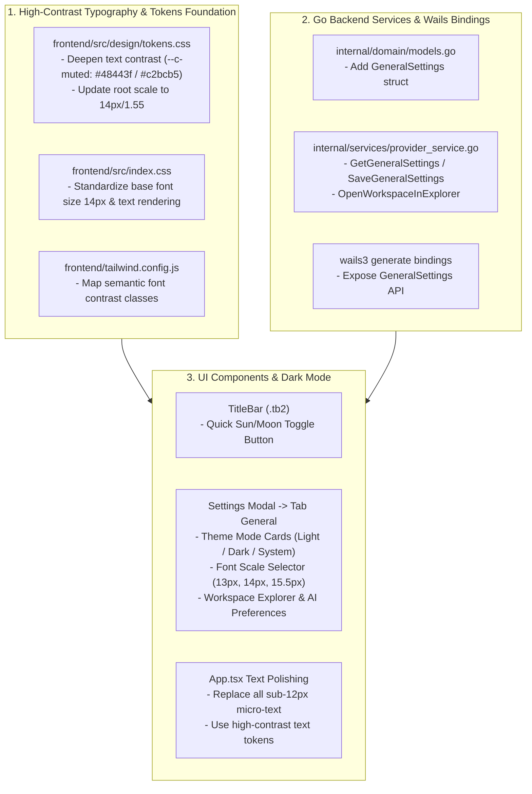

# Plan: General Settings, Full Dark Mode Version & High-Contrast Typography System

Dokumen rencana implementasi yang disesuaikan berdasarkan feedback pengguna:
1. **Peningkatan Skala Font (Font Scale Up)** dari baseline 13px ke 14px di seluruh aplikasi, menghilangkan teks mikro (10px/11px) yang sulit dibaca.
2. **Penyempurnaan Color System Teks (High-Contrast & Anti-Washed Out)**: Memperkuat kontras warna teks utama (`--c-fg`), teks sekunder (`--c-fg-2`), dan teks muted (`--c-muted`) baik di mode terang maupun gelap agar tebal, tegas, dan tidak pudar/terlalu crisp.
3. **Implementasi Halaman General Settings (Pengaturan Umum)** lengkap dengan switcher tema visual MQ-Studio, pengaturan ukuran font (Compact 13px, Standard 14px, Comfort 15.5px), integrasi Windows Explorer, dan preferensi AI/auto-save.
4. **Quick Theme Toggle Sun/Moon di TitleBar** untuk kemudahan akses 1-klik.

---

## 1. Goal Description

Menyelesaikan keluhan keterbacaan font (*"font scalenya digedein dikit dan di setting terlalu crisp jadi ga keliatan"*) dan melengkapi arsitektur aplikasi dengan:
- **Baseline Typography Scale Upgrade:**
  - Mengubah font dasar aplikasi dari `13px` ke **`14px/1.55`**.
  - Mengeliminasi teks mikro `10px` dan `11px`; menggantinya dengan skala minimum **`12px` (medium/semibold)** untuk badge dan tag meta.
  - Form labels, input form, textarea, dan tombol dinaikkan ke **`13.5px - 14px`**.
  - Judul panel dan modal dinaikkan ke **`15px - 18px`**.
- **High-Contrast Text Color Tokens (`tokens.css`):**
  - **Light Mode:**
    - `--c-fg` (teks utama): dipertegas ke `#171513` (kontras tajam).
    - `--c-fg-2` (teks sekunder): dinaikkan dari `#3f3a36` ke `#2e2a26`.
    - `--c-muted` (label/hint): dinaikkan dari `#736c66` ke `#48443f` (lolos rasio kontras WCAG AA 4.5:1+ di atas `--c-bg` `#faf6f0`).
    - `--c-muted-2`: dinaikkan dari `#9d968f` ke `#635e58`.
  - **Dark Mode:**
    - `--c-fg` (teks utama): `#f7f5f3` (terang, tidak menyilaukan).
    - `--c-fg-2` (teks sekunder): dinaikkan dari `#d8d4d0` ke `#e8e4e0`.
    - `--c-muted` (label/hint): dinaikkan dari `#979089` ke `#c2bcb5` (sangat jelas terbaca di atas background gelap `#1a1816` dan `#171513`).
- **Tab General Settings (Pengaturan Umum):**
  - Menempatkan tab General di posisi pertama pada Studio Settings Modal.
  - Memuat seksi Appearance (Tema Light/Dark/System dengan mini-app preview card, Font Scale Picker, Motion toggle), Workspace (Buka File Explorer, Auto-save), AI Preferences (Bahasa output dokumen, template depth, proaktivitas klarifikasi), dan Notifikasi.
- **Quick Theme Toggle:**
  - Tombol Sun/Moon 1-klik di TitleBar window mempermudah pergantian Light / Dark mode kapan saja.

---

## 2. User Review Required

> [!IMPORTANT]
> **Peningkatan Skala Font & Kontras Warna:**
> 1. Seluruh teks label dan hint di Settings Modal dan panel kerja tidak lagi menggunakan warna abu-abu pudar (`text-slate-400` / `text-muted` tipis). Warna teks hint dinaikkan tingkat kegelapannya di mode terang dan diterangkan di mode gelap sehingga teks berbobot nyata dan mudah dibaca tanpa menyipitkan mata.
> 2. Ukuran font standar dinaikkan ke 14px. Pengguna juga dapat memilih skala kenyamanan (**Compact 13px**, **Standard 14px**, atau **Comfort 15.5px**) langsung di General Settings.

> [!TIP]
> **Zero-Flash Dark Mode:**
> Mode tema disimpan ganda di `localStorage` (untuk eksekusi CSS seketika saat HTML me-render) dan database SQLite `app_settings` (untuk sinkronisasi preferensi backend).

---

## 3. Open Questions

Tidak ada pertanyaan penghalang. Rencana siap dieksekusi begitu mendapat instruksi persetujuan.

---

## 4. Proposed Changes



---

### Component 1: Typography & Color System Refinement

#### [MODIFY] [`frontend/src/design/tokens.css`](file:///E:/dev-agent-assistant/frontend/src/design/tokens.css)
- Menyesuaikan font dasar `.m3`:
  ```css
  font: 14px/1.55 var(--app-ui-font, -apple-system, BlinkMacSystemFont, 'Segoe UI', Roboto, sans-serif);
  ```
- Mempertebal kontras warna teks di `:root` (Light Mode):
  ```css
  --c-fg: #171513;        /* Sebelumnya #1c1917 */
  --c-fg-2: #2e2a26;      /* Sebelumnya #3f3a36 */
  --c-muted: #48443f;     /* Sebelumnya #736c66 - Naik signifikan untuk keterbacaan tinggi */
  --c-muted-2: #635e58;   /* Sebelumnya #9d968f */
  ```
- Mempertebal kontras warna teks di `:root.dark, .dark` (Dark Mode):
  ```css
  --c-fg: #f7f5f3;        /* Sebelumnya #f4f2f0 */
  --c-fg-2: #e8e4e0;      /* Sebelumnya #d8d4d0 */
  --c-muted: #c2bcb5;     /* Sebelumnya #979089 - Jauh lebih terbaca di background gelap */
  --c-muted-2: #948e87;   /* Sebelumnya #6f6964 */
  ```

#### [MODIFY] [`frontend/src/index.css`](file:///E:/dev-agent-assistant/frontend/src/index.css)
- Menetapkan base font size `14px`, line-height `1.55`, dan text rendering yang solid:
  ```css
  body {
    font-size: 14px;
    line-height: 1.55;
    text-rendering: optimizeLegibility;
    -webkit-font-smoothing: antialiased;
  }
  ```

---

### Component 2: Backend Domain & General Settings API

#### [MODIFY] [`internal/domain/models.go`](file:///E:/dev-agent-assistant/internal/domain/models.go)
Menambahkan tipe struct `GeneralSettings`:
```go
type GeneralSettings struct {
	Theme                  string `json:"theme"`                   // "system" | "light" | "dark"
	FontSize               string `json:"font_size"`               // "compact" (13px), "standard" (14px), "comfort" (15.5px)
	Animations             bool   `json:"animations"`              // true / false
	Language               string `json:"language"`                // "id" | "en"
	AutoSaveDraft          bool   `json:"auto_save_draft"`         // true / false
	AutoSaveIntervalMs     int    `json:"auto_save_interval_ms"`   // 1000
	DefaultDocDepth        string `json:"default_doc_depth"`       // "standard" | "compact"
	ProactiveClarification bool   `json:"proactive_clarification"` // true / false
	DesktopNotifications   bool   `json:"desktop_notifications"`   // true / false
	WorkspacePath          string `json:"workspace_path"`          // Path folder workspace
}
```

#### [MODIFY] [`internal/services/provider_service.go`](file:///E:/dev-agent-assistant/internal/services/provider_service.go)
- `GetGeneralSettings() (domain.GeneralSettings, error)`: Membaca pengaturan umum dari tabel `app_settings`.
- `SaveGeneralSettings(settings domain.GeneralSettings) error`: Menyimpan pengaturan umum ke tabel `app_settings`.
- `OpenWorkspaceInExplorer() error`: Membuka folder `AI-Requirements-Studio` di Windows Explorer via `exec.Command("explorer", s.workspaceDir).Start()`.

---

### Component 3: Frontend UI, TitleBar Quick Toggle & Settings Modal

#### [MODIFY] [`frontend/src/App.tsx`](file:///E:/dev-agent-assistant/frontend/src/App.tsx)
1. **Font Scale Dynamic Application:**
   - Menyediakan handler skala font: `'compact'` (13px), `'standard'` (14px default), `'comfort'` (15.5px) yang mengatur variabel `--app-font-scale` atau root font-size.
2. **TitleBar Quick Theme Toggle:**
   - Menambahkan tombol icon Sun/Moon di TitleBar `.tb2` tepat di samping tombol settings.
   - 1-klik untuk beralih instan antara mode Terang dan Gelap.
3. **Studio Settings Modal - Tab General Settings (Posisi Pertama):**
   - **Appearance & Theme:**
     - 3 kartu pilihan tema interaktif: *Light*, *Dark*, *System* dengan visual mockup header & sidebar mini aplikasi.
     - Pilihan skala font dengan tombol radio card: *Compact (13px)*, *Standard (14px)*, *Comfort (15.5px)*.
     - Toggle animasi pergerakan antarmuka.
   - **Workspace & Storage:**
     - Tampilan path direktori workspace lokal dengan tombol *"Buka Folder Workspace di Explorer"*.
     - Toggle auto-save draft dokumen.
   - **AI & Dokumen:**
     - Pilihan bahasa output (Bahasa Indonesia Formal / English).
     - Pilihan kedalaman template dokumen (Enterprise 20/22 sections / Rapid Lite).
     - Switch proaktivitas klarifikasi AI.
   - **Notifikasi:**
     - Switch notifikasi desktop saat proses generasi selesai.
4. **Perbaikan Teks di Seluruh Modal & Panel:**
   - Mengganti teks `text-[10px]` dan `text-[11px]` dengan ukuran minimal `12px` berbobot medium/semibold.
   - Mengganti warna teks abu-abu tipis `text-slate-400` dan `text-muted` pudar dengan kelas teks berkontras tinggi `text-fg` dan `text-fg-2`.

---

## 5. Verification Plan

### Automated Tests
1. **Go Backend Tests:**
   ```powershell
   $env:PATH += ";C:\Program Files\Go\bin;$env:USERPROFILE\go\bin"; go test -v ./internal/...
   ```
   *Kriteria lulus:* Semua 12 unit test suites backend 100% lulus.
2. **Wails Bindings Generation:**
   ```powershell
   $env:PATH += ";C:\Program Files\Go\bin;$env:USERPROFILE\go\bin"; wails3 generate bindings -ts -i
   ```
   *Kriteria lulus:* Bindings TypeScript tergenerate tanpa error.
3. **Frontend Production Build:**
   ```powershell
   cd frontend
   npm run build
   ```
   *Kriteria lulus:* Build Vite + TypeScript lulus dengan 0 errors.
4. **Desktop App Build:**
   ```powershell
   $env:PATH += ";C:\Program Files\Go\bin;$env:USERPROFILE\go\bin"; wails3 task build
   ```
   *Kriteria lulus:* Executable `bin/ai-requirements-studio.exe` terkompilasi sukses.

### Manual Verification
1. Buka aplikasi dan periksa ukuran teks:
   - Teks tidak lagi terlalu kecil atau tipis (*crisp/faint*). Seluruh label dan hint jelas terbaca dengan kontras memadai.
2. Klik tombol Sun/Moon di TitleBar:
   - Berpindah ke Dark Mode (Obsidian Slate `#121110` dan `#1a1816`).
   - Periksa bahwa di Dark Mode, teks sekunder dan label tetap putih-krem terang (`#c2bcb5` & `#e8e4e0`) dan tidak tenggelam.
3. Buka Studio Settings Modal -> Tab General:
   - Ganti ukuran font ke *Comfort (15.5px)* atau *Standard (14px)* dan amati seluruh UI menyesuaikan secara proporsional.
   - Klik *"Buka Folder Workspace di Explorer"*: Windows File Explorer terbuka pada folder workspace.
   - Pilih tema *Dark* atau *Light*, tutup modal, restart aplikasi: preferensi tema dan ukuran font tetap terjaga.


---

## 6. Status & Implementation Checklist

- [x] Peningkatan baseline font scale ke 14px/1.55 di `frontend/src/design/tokens.css` dan `frontend/src/index.css`
- [x] Peningkatan kontras warna teks (anti-faint/anti-crisp) di `:root` (Light) dan `:root.dark, .dark` (Dark)
- [x] Eliminasi teks mikro sub-12px di seluruh sidebar, table, card, dan modal
- [x] Penambahan struct `GeneralSettings` di `internal/domain/models.go`
- [x] Implementasi `GetGeneralSettings()`, `SaveGeneralSettings()`, dan `OpenWorkspaceInExplorer()` di `internal/services/provider_service.go`
- [x] Unit test `TestGeneralSettings_Persistence` di `internal/services/phase1_test.go` (100% PASS)
- [x] Ekspor Wails v3 TypeScript bindings (`wails3 generate bindings -ts -i`)
- [x] Implementasi tombol Quick Theme Toggle (Sun / Moon) di TitleBar `.tb2`
- [x] Implementasi Tab General Settings (Pengaturan Umum) sebagai tab pertama di Studio Settings Modal
- [x] Visual Mockup Cards Mini-App Chrome untuk pemilihan tema (Light, Dark, System)
- [x] Font Scale Selector dinamis (Compact 13px, Standard 14px, Comfort 15.5px)
- [x] Tombol "Buka di File Explorer" terintegrasi ke Windows Explorer
- [x] Verifikasi frontend build `npm run build` (0 TypeScript errors)
- [x] Verifikasi backend Go test suites `go test -v ./internal/...` (13 suites 100% PASS)
- [x] Verifikasi desktop native executable build `wails3 task build` (`bin/ai-requirements-studio.exe` - 17.1 MB)
