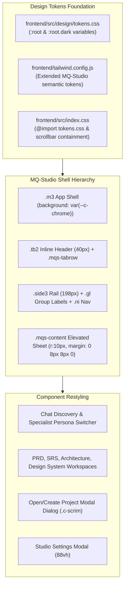

# Plan: Adopsi Design System & Color Tokens MQ-Studio 0.4.2

Dokumen spesifikasi dan rencana implementasi untuk menyelaraskan antarmuka **AI Requirements Studio** secara komprehensif mengikuti **Design System, Color Tokens, dan Shell Architecture** dari `_ref_ui/mq-studio-0.4.2`.

---

## 1. Goal Description

Menyesuaikan seluruh arsitektur visual dan styling aplikasi agar 100% mengikuti standar desain **MQ-Studio 0.4.2**:
- **Layering & Chrome Concept (`.m3` & `.mqs-content`):**
  - Mengubah layout aplikasi dari tampilan flat konvensional menjadi model *desktop chrome*: latar belakang jendela adalah `--c-chrome` (Warm Stone `#eeece8` pada mode light, Obsidian Slate `#121110` pada mode dark).
  - Area kerja utama (Chat Discovery, PRD, SRS, Architecture, Design System) menjadi **elevated white/dark sheet** (`.mqs-content`) dengan margin gutter `8px`, `border-radius: 10px`, border halus `1px solid var(--c-border)`, dan elevasi bayangan `box-shadow: 0 1px 2px rgba(28, 25, 23, 0.04)`.
- **Palette & Semantic Color Tokens:**
  - Mengadopsi seluruh variabel CSS `:root` dan `:root.dark` dari MQ-Studio: `--c-bg`, `--c-chrome`, `--c-panel`, `--c-fill`, `--c-border`, `--c-primary` (Cobalt `#2f6bf0` / `#5b8cff`), tone colors (`--c-tone-blue`, `--c-tone-violet`, `--c-tone-teal`, `--c-tone-orange`), serta status feedback (`--c-ok`, `--c-warn`, `--c-err`).
- **Title Bar & Figma Tabs (`.tb2` & `.mqs-tabrow`):**
  - Menggunakan metrik title bar `40px` dengan inline Figma project tabs berukuran `140px`, active elevated tab, inactive hover state dengan tombol close `×` transparan, tombol add `+`, dan action controls di sisi kanan.
- **Sidebar (`.side3`):**
  - Lebar presisi `198px`, berada langsung di atas permukaan `--c-chrome` tanpa border samping yang kaku, dilengkapi label grup `.gl` (*Browsing / Workspaces*), dan tombol navigasi `.ni` dengan hover dan active state cobalt tint (`--c-primary-soft`).
- **Typography Ramp:**
  - Standardisasi base font ke `13px/1.5` dengan sistem font keluarga MQ-Studio (sans-serif modern dan JetBrains Mono / monospace), teks label `12.5px`, dan meta/badge `11px`.

---

## 2. User Review Required

> [!IMPORTANT]
> **Perubahan Visual Menyeluruh (Look & Feel Modern Desktop):**
> Aplikasi akan bertransformasi dari palet default Tailwind Slate/Indigo menjadi palet bertingkat *Warm Stone & Cobalt* khas MQ-Studio 0.4.2:
> 1. Background dasar luar (sidebar + titlebar) akan berwarna batu hangat (*warm stone*) `#eeece8` (light) atau `#121110` (dark).
> 2. Kanvas tengah (chat & dokumen) akan menjadi panel putih/gelap melayang (*elevated sheet*) berjarak 8px dari tepi, memberikan kedalaman estetika profesional.
> 3. Warna aksi utama (*accent/primary*) bertransisi dari indigo-600 standar menjadi *Engineering Cobalt* (`#2f6bf0` light / `#5b8cff` dark).

---

## 3. Open Questions

Tidak ada pertanyaan penghalang (*blocking*). Jika pengguna ingin mempertahankan elemen tertentu seperti icon Lucide yang sudah ada, seluruh icon tetap dipertahankan namun dipadukan dengan semantic badge tones MQ-Studio.

---

## 4. Proposed Changes



---

### Component 1: Design Tokens Foundation

#### [NEW] `frontend/src/design/tokens.css`
Memindahkan sistem token warna dan aturan layout dari `_ref_ui/mq-studio-0.4.2/frontend/src/design/tokens.css`:
- **Surfaces:** `--c-bg`, `--c-chrome`, `--c-panel`, `--c-bar`, `--c-fill`, `--c-fill-soft`, `--c-fill-mute`, `--c-rule`.
- **Borders:** `--c-border`, `--c-border-soft`, `--c-border-dash`, `--c-border-strong`.
- **Foreground:** `--c-fg`, `--c-fg-2`, `--c-mono-dim`, `--c-muted`, `--c-muted-2`, `--c-disabled`.
- **Brand & Action:** `--c-primary` (`#2f6bf0`), `--c-primary-hover` (`#2459d6`), `--c-primary-soft` (`#ebf1ff`), `--c-primary-text` (`#2155cc`).
- **Tones:** Blue, Violet, Teal, Orange, Pink, Slate (dengan pasangan warna teks dan background badge).
- **Feedback:** `--c-ok`, `--c-warn`, `--c-err` (beserta border dan background tint).
- **Motion:** `--mo-fast` (0.12s), `--mo-base` (0.18s), `--mo-slow` (0.28s), `--mo-ease`.
- **Layout Classes:** `.m3`, `.mqs-main`, `.mqs-content`, `.tb2`, `.side3`, `.ni`, `.gl`, `.mqs-tabrow`, `.mqs-tab`, `.mqs-tab-add`, `.mqs-tab-close`, `.mqs-scroll`.

#### [MODIFY] `frontend/src/index.css`
- Menambahkan `@import './design/tokens.css';`.
- Menerapkan font stack MQ-Studio:
  ```css
  font-family: var(--app-ui-font, -apple-system, 'PingFang SC', 'Microsoft YaHei', system-ui, sans-serif);
  font-size: 13px;
  line-height: 1.5;
  ```
- Menjaga universal scrollbar containment agar tidak merusak layout desktop window.

#### [MODIFY] `frontend/tailwind.config.js`
- Mengonfigurasi Tailwind agar membaca CSS variables MQ-Studio:
  ```js
  theme: {
    extend: {
      colors: {
        chrome: 'var(--c-chrome)',
        surface: 'var(--c-bg)',
        panel: 'var(--c-panel)',
        fill: 'var(--c-fill)',
        border: 'var(--c-border)',
        fg: 'var(--c-fg)',
        muted: 'var(--c-muted)',
        primary: {
          DEFAULT: 'var(--c-primary)',
          hover: 'var(--c-primary-hover)',
          soft: 'var(--c-primary-soft)',
          text: 'var(--c-primary-text)',
        },
        tone: {
          blue: 'var(--c-tone-blue)',
          violet: 'var(--c-tone-violet)',
          teal: 'var(--c-tone-teal)',
          orange: 'var(--c-tone-orange)',
        },
        ok: 'var(--c-ok)',
        warn: 'var(--c-warn)',
        err: 'var(--c-err)',
      }
    }
  }
  ```

---

### Component 2: Shell Layout & Navigation

#### [MODIFY] `frontend/src/App.tsx`
- **Root Shell Container:**
  - Mengganti outer wrapper `flex h-screen w-screen overflow-hidden bg-slate-50...` menjadi `.m3` (`background: var(--c-chrome)`).
- **Top Title Bar (`.tb2`):**
  - Mengubah bar navigasi atas menjadi tinggi presisi `40px` dengan class `tb2`.
  - Mengadopsi tombol mark home/project manager `.mqs-tab-home`.
  - Menggunakan `.mqs-tabrow` untuk horizontal scrolling project tabs dengan style `.mqs-tab`, border radius `7px`, active state white elevation, dan close button hover overlay.
  - Mempercantik tombol `+` dengan `.mqs-tab-add`.
  - Merapikan ikon status AI, diagnostics, dan setting studio di sisi kanan.
- **Sidebar Navigation (`.side3`):**
  - Lebar presisi `198px`.
  - Mengelompokkan item dengan label grup `.gl` (*WORKSPACE MODES* & *PROJECT CONTEXT*).
  - Mengubah item navigasi menjadi button `.ni` dengan font 13px, active indicator `.ni.on`, badge status ringkas di sebelah kanan (*draft, approved, gated*).
  - Menyertakan Active Project Card di bagian bawah sidebar dengan style panel MQ-Studio.
- **Central Workspace Sheet (`.mqs-content`):**
  - Menggunakan wrapper `.mqs-content`:
    ```css
    margin: 0 8px 8px 0;
    border: 1px solid var(--c-border);
    border-radius: 10px;
    background: var(--c-bg);
    box-shadow: 0 1px 2px rgba(28, 25, 23, 0.04);
    ```
  - Kanvas ini membungkus Chat Discovery, PRD, SRS, Architecture, dan Design System, sehingga seluruh konten utama tampil rapi seperti *sheet paper* di atas meja kerja *chrome*.

---

### Component 3: Chat Discovery, Documents & Modals

#### [MODIFY] `frontend/src/App.tsx`
- **Specialist Agent Switcher in Chat:**
  - Mengubah strip tab 4 agen spesialis agar menggunakan MQ-Studio tone styles:
    - *Product Analyst:* Blue Tone (`--c-tone-blue` / `--c-tone-blue-bg`)
    - *System Analyst:* Teal Tone (`--c-tone-teal` / `--c-tone-teal-bg`)
    - *Software Architect:* Violet Tone (`--c-tone-violet` / `--c-tone-violet-bg`)
    - *UI/UX Agent:* Orange Tone (`--c-tone-orange` / `--c-tone-orange-bg`)
- **Chat Bubbles & Input Box:**
  - Message bubble pengguna: background `--c-primary-soft`, border `--c-primary`, text `--c-fg`.
  - Message bubble spesialis: background `--c-panel`, border `--c-border`, avatar badge dengan tone warna masing-masing.
  - Chat Input bar: container `--c-fill-soft` dengan border `--c-border`, paperclip attachment badge dengan tone neutral, dan tombol kirim Cobalt.
- **Document Workspaces (PRD, SRS, Architecture, Design System):**
  - Toolbar dokumen: background `--c-panel` dengan divider line `--c-rule`.
  - Status badges: menggunakan `--c-ok` (approved), `--c-warn` (gated/in-review), `--c-err` (outdated).
  - Markdown viewer: tipografi bersih dengan line-height 1.6, heading font yang tegas, dan code block bernuansa `--c-fill`.
- **Modals (Project Manager & Large Studio Settings):**
  - Menggunakan backdrop `--c-scrim` (transparan gelap elegan).
  - Dialog card: background `--c-bg`, border `1px solid var(--c-border)`, radius `12px`, header background `--c-panel`.
  - Tab navigasi settings vertikal/horizontal menggunakan gaya `.ni` dan active cobalt line.

---

## 5. Verification Plan

### Automated Tests
1. **Frontend Build Check:**
   ```powershell
   cd frontend
   npm run build
   ```
   *Kriteria lulus:* Berhasil kompilasi Vite + TypeScript dengan 0 errors / warnings.
2. **Go Backend Tests:**
   ```powershell
   $env:PATH += ";C:\Program Files\Go\bin;$env:USERPROFILE\go\bin"; go test -v ./internal/...
   ```
   *Kriteria lulus:* Semua 12 test suites tetap 100% lulus.
3. **Native Desktop Build:**
   ```powershell
   $env:PATH += ";C:\Program Files\Go\bin;$env:USERPROFILE\go\bin"; wails3 task build
   ```
   *Kriteria lulus:* Binary executable `bin/ai-requirements-studio.exe` tercipta tanpa kendala.

### Manual Verification
1. Buka aplikasi desktop `bin/ai-requirements-studio.exe`.
2. Periksa estetika visual:
   - Chrome luar bertekstur *warm stone* (`#eeece8`) pada light mode, dan obsidian (`#121110`) pada dark mode.
   - Kanvas utama memiliki gutter 8px, rounded corner 10px, dan subtle elevation shadow.
   - Project tabs di title bar berjarak rapat, responsif saat di-hover dan ditutup.
   - Sidebar navigasi 198px memiliki hierarki grup label `.gl` dan active state `.ni.on`.
   - Warna aksi utama (*buttons, focus rings, selected tabs*) konsisten menggunakan Cobalt Blue `#2f6bf0`.
   - 4 Agen spesialis menampilkan badge tone warna yang kontras dan elegan (Blue, Teal, Violet, Orange).
   - Dialog modal Project Manager dan Studio Settings tampil serasi dengan tema MQ-Studio.


---

## 6. Status & Implementation Checklist

- [x] Copy & adaptasi `frontend/src/design/tokens.css` dari `_ref_ui/mq-studio-0.4.2`
- [x] Import tokens di `frontend/src/index.css` & typography baseline
- [x] Konfigurasi extended theme di `frontend/tailwind.config.js`
- [x] Refactor window layout shell `.m3` & `.tb2` TitleBar di `frontend/src/App.tsx`
- [x] Refactor horizontal Figma tabs `.mqs-tabrow` & `.mqs-tab`
- [x] Refactor sidebar `.side3` dengan `.gl` group labels & `.ni` navigation items
- [x] Refactor elevated content sheet `.mqs-content` (gutter 8px, rounded 10px, border hairline)
- [x] Restyle Chat Discovery & Specialist Agent switcher dengan semantic tone styles
- [x] Restyle 4 Document Workspaces (PRD, SRS, Architecture, Design System)
- [x] Restyle Right Inspector Panel di dalam `.mqs-main`
- [x] Restyle Project Manager Modal & Edit Project Modal
- [x] Restyle Large Studio Settings Modal (88vh, 5 tabs)
- [x] Verifikasi build frontend `npm run build` (0 TypeScript errors)
- [x] Verifikasi backend tests `go test -v ./internal/...` (12 suites 100% lulus)
- [x] Verifikasi build native binary executable Wails v3 (`bin/ai-requirements-studio.exe` - 17.0 MB)
