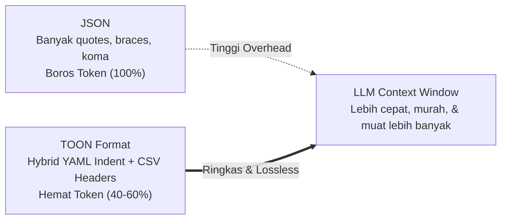

# Implementation Plan — Perbaikan Respon JSON OpenCode CLI & Elaborasi Penghematan Token dengan TOON Format

Dokumen ini membedah secara mendalam dua hal utama:
1. **Akar Masalah & Solusi:** Mengapa respon chat berubah menjadi format JSON mentah saat menggunakan **OpenCode CLI**.
2. **Elaborasi TOON Format ([toonformat.dev](https://toonformat.dev)):** Analisis arsitektur, kalkulasi efisiensi token (penghematan 30%–60%), perbandingan sintaks dengan JSON/YAML, serta rencana uji coba prototype di Go.

---

## 1. Goal Description

- **Masalah 1 (OpenCode Raw JSON in Chat):** Memperbaiki parser `internal/ai/discovery.go` agar mampu mengekstrak blok JSON secara cerdas (*robust boundary extraction*) meskipun model OpenCode CLI menyertakan teks pembuka (*preamble*), teks penutup, atau tanda kurung/backtick tidak standar, sehingga pengguna selalu melihat pesan percakapan yang bersih dan natural di bubble chat.
- **Masalah 2 (Token Optimization via TOON):** Menjelaskan konsep TOON (Token-Oriented Object Notation), mengukur efisiensi token pada prompt requirements, dan merancang skema opsional TOON encoder/decoder di Go untuk memangkas konsumsi token LLM hingga 50%.

---

## 2. Bedah Masalah 1: Mengapa Respon Chat Menjadi JSON Mentah di OpenCode?

### Alur Saat Ini:
1. **Prompt Konstruksi ([`internal/ai/discovery.go`](file:///E:/dev-agent-assistant/internal/ai/discovery.go#L103-L128)):**
   Sistem mewajibkan AI membalas dengan struktur JSON:
   ```json
   {
     "reply": "Pesan percakapan untuk user...",
     "role": "Product Analyst",
     "requirements": [...],
     "clarifications": [...],
     "assumptions": [...]
   }
   ```
2. **Karakter Output OpenCode CLI vs Antigravity:**
   - **Antigravity CLI:** Sangat patuh pada *strict JSON mode*, membalas murni diawali `{` dan diakhiri `}` tanpa teks tambahan.
   - **OpenCode CLI (beragam model open-source/API):** Sering kali menyertakan teks pembuka di luar blok JSON, contohnya:
     ```text
     Tentu, berikut adalah hasil analisis kebutuhan sistem:
     ```json
     {
       "reply": "Saya telah menganalisis kebutuhan inventaris...",
       "requirements": [...]
     }
     ```
     Semoga membantu!
     ```
3. **Celah pada Parser Saat Ini ([`internal/ai/discovery.go:134-159`](file:///E:/dev-agent-assistant/internal/ai/discovery.go#L134-L159)):**
   ```go
   // Parser saat ini HANYA mengecek jika teks DIAWALI '```':
   if strings.HasPrefix(clean, "```") { ... }
   ```
   - Karena ada kalimat pembuka *"Tentu, berikut..."*, kondisi `strings.HasPrefix(clean, "```")` bernilai **FALSE**.
   - Akibatnya, `json.Unmarshal([]byte(clean), &res)` gagal total (*syntax error* karena ada teks sebelum `{`).
   - Sistem lalu masuk ke blok *fallback*:
     ```go
     if err := json.Unmarshal([]byte(clean), &res); err != nil {
         return &DiscoveryResult{
             Reply: clean, // <-- Seluruh teks mentah (termasuk JSON) dijadikan isi chat!
         }, nil
     }
     ```
   - **Hasil di UI:** Chat bubble menampilkan seluruh kode JSON mentah, dan Right Inspector gagal menangkap daftar requirement baru!

### Solusi Perbaikan (Robust JSON Boundary Extractor):
Mengganti parser naif dengan teknik ekstraksi cerdas:
1. Cari blok ` ```json ... ``` ` atau ` ``` ... ``` ` di bagian mana pun dalam teks menggunakan *regex* / substring search.
2. Jika tidak ada code fence, cari indeks kemunculan karakter `{` pertama dan `}` terakhir (*outermost JSON bounds*).
3. Lakukan `json.Unmarshal` pada substring tersebut.
4. Jika `res.Reply` kosong tetapi ada teks pembuka di luar JSON, gunakan teks pembuka sebagai balasan percakapan yang ramah.
5. Dengan perbaikan ini, OpenCode CLI dijamin menampilkan teks manusiawi di chat dan mengekstrak entitas requirements ke Right Inspector.

---

## 3. Elaborasi TOON Format ([toonformat.dev](https://toonformat.dev))

### A. Apa itu TOON (Token-Oriented Object Notation)?
**TOON** adalah format serialisasi data modern yang dirancang khusus untuk **Large Language Models (LLM)** oleh komunitas open-source ([github.com/toon-format/toon](https://github.com/toon-format/toon)).

Jika JSON dirancang untuk mesin (*web APIs*) dan YAML dirancang untuk keterbacaan manusia (*config files*), **TOON dirancang untuk efisiensi Tokenizer LLM (BPE - Byte-Pair Encoding)**.



### B. Mengapa JSON Sangat Boros Token pada Kasus Rekayasa Kebutuhan?
Pada aplikasi **Specra**, kita sering mengirimkan atau meminta daftar berulang (*uniform arrays*), seperti daftar 20 requirement atau tabel spesifikasi:

#### Contoh JSON untuk 3 Requirements (~165 token):
```json
{
  "requirements": [
    {
      "key": "REQ-001",
      "category": "functional",
      "title": "Autentikasi Pengguna",
      "priority": "Must Have",
      "confidence": "high"
    },
    {
      "key": "REQ-002",
      "category": "functional",
      "title": "Integrasi OAuth Google",
      "priority": "Should Have",
      "confidence": "high"
    },
    {
      "key": "REQ-003",
      "category": "non-functional",
      "title": "Waktu Respons < 200ms",
      "priority": "Must Have",
      "confidence": "high"
    }
  ]
}
```
**Kelemahan JSON:** Kata `"key"`, `"category"`, `"title"`, `"priority"`, `"confidence"`, tanda petik `"`, dan kurung `{}` **diulang 3 kali** (dan jika ada 50 requirements, diulang 50 kali!). Setiap tanda petik dan nama field memakan token tokenizer.

#### Contoh Representasi TOON yang Ekuivalen (~78 token — Hemat ~53%!):
```yaml
requirements[3]{key,category,title,priority,confidence}:
  REQ-001,functional,Autentikasi Pengguna,Must Have,high
  REQ-002,functional,Integrasi OAuth Google,Should Have,high
  REQ-003,non-functional,Waktu Respons < 200ms,Must Have,high
```
**Keunggulan TOON:**
- Nama field hanya ditulis **1 kali** di bagian header schema: `{key,category,title,priority,confidence}`.
- Data di bawahnya disusun *tabular* bergaya CSV tanpa tanda petik yang berlebihan.
- Tanda kurung kurawal `{}` dan kurung siku `[]` per baris dihilangkan total.
- **Lossless:** Dapat dikonversi bolak-balik 100% identik ke struktur objek JSON.

### C. Keuntungan Jika Kita Mengadopsi TOON:
1. **Penghematan Biaya & Kuota:** Token input/output terpangkas 30%–60%, sangat menguntungkan saat menggunakan model berbayar (Gemini 1.5 Pro / GPT-4o).
2. **Kecepatan Respons (Latency):** Karena LLM men-generate token 50% lebih sedikit, durasi streaming/respons menjadi 1.5x–2x lebih cepat.
3. **Konteks Hulu (Upstream Context) Muat Lebih Banyak:** Saat *System Analyst* atau *Architect* membaca konteks PRD/SRS yang panjang, kita bisa menyajikan daftar fitur dalam format TOON sehingga tidak terpotong batas limit (*no truncation*).

### D. Tantangan & Rencana Eksperimen:
- **Eksosistem Parser:** Parser resmi TOON saat ini tersedia untuk JavaScript/TypeScript (`@toon-format/toon`), Python, Rust, dan Elixir. Untuk Go, belum ada library resmi.
- **Solusi Specra:** Kita dapat membuat **Micro-TOON Parser/Formatter di Go** (`internal/ai/toon.go`) yang khusus menangani serialisasi `requirements`, `clarifications`, dan `assumptions` kita.

---

## 4. Proposed Changes

### Komponen 1: Perbaikan Ekstraksi JSON (Immediate Fix)
#### [MODIFY] [`internal/ai/discovery.go`](file:///E:/dev-agent-assistant/internal/ai/discovery.go)
- Perbaiki `ParseDiscoveryOutput` dengan algoritma ekstraksi *smart regex & bracket matcher*:
  - Cari ` ```json ` atau ` ``` ` jika ada.
  - Cari indeks `{` pertama dan `}` terakhir jika model menyertakan teks sebelum/sesudah JSON.
  - Lakukan unmarshal hanya pada blok objek yang valid.
  - Jika unmarshal berhasil, ambil `res.Reply` untuk ditampilkan di chat bubble, dan teruskan daftar requirements/clarifications/assumptions ke database SQLite.

### Komponen 2: Eksperimen TOON Parser & Formatter Prototype
#### [NEW] [`internal/ai/toon.go`](file:///E:/dev-agent-assistant/internal/ai/toon.go)
- Implementasikan encoder & decoder sederhana untuk format TOON:
  - `EncodeRequirementsToTOON(reqs []domain.Requirement) string`
  - `DecodeTOONToRequirements(toonStr string) ([]domain.Requirement, error)`
- Tambahkan unit test untuk mengukur perbandingan token count JSON vs TOON.

#### [NEW] [`internal/ai/toon_test.go`](file:///E:/dev-agent-assistant/internal/ai/toon_test.go)
- Unit test verifikasi akurasi parsing dan perbandingan jumlah karakter/token.

---

## 5. Verification Plan

### Automated Tests
```powershell
# 1. Jalankan unit test internal AI & Parser
$env:PATH += ";C:\Program Files\Go\bin;$env:USERPROFILE\go\bin"
go test -v ./internal/ai -run "TestDiscoveryPromptAndParse|TestTOON"

# 2. Jalankan seluruh suite test backend
go test -v ./internal/...

# 3. Frontend compile test
cd frontend; npm run build
```

### Manual Verification
- Coba kirim pesan chat saat provider aktif diarahkan ke **OpenCode CLI**.
- Pastikan bubble chat menampilkan teks balasan percakapan yang bersih (bukan kode JSON).
- Pastikan entitas requirements yang dihasilkan muncul di Right Inspector.
