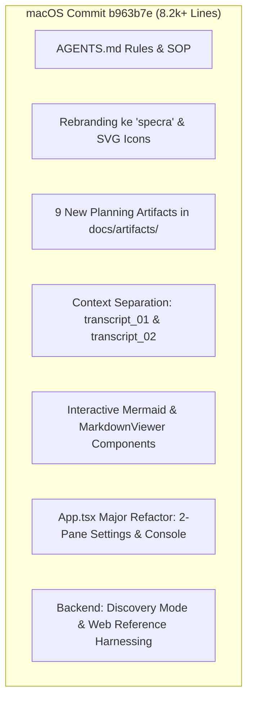

# Implementation Plan — Review & Synchronization of Multi-Device Updates (macOS Commit `b963b7e`)

Dokumen ini menyajikan audit menyeluruh atas perubahan yang baru saja dilakukan pada perangkat lain (macOS), analisis artefak perencanaan baru, pemeriksaan kontinuitas aturan `AGENTS.md`, serta langkah perbaikan minor pada lingkungan Windows agar aplikasi dapat dikompilasi kembali secara sempurna.

---

## 1. Goal Description

Melakukan verifikasi komparatif antara riwayat Git lokal dengan commit terbaru dari remote GitHub (`b963b7e`), menginventarisasi 9 artefak baru dan fitur-fitur baru (rebranding Specra, blok Mermaid interaktif, Markdown viewer, konsol terpadu), serta menyelesaikan isu *unused import* TypeScript agar build desktop Windows kembali 100% hijau (*clean build*).

---

## 2. Audit Ringkasan Perubahan dari Device Lain (Commit `b963b7e`)

Commit `b963b7e` berjudul **"Update"** dilakukan oleh `luftinur <luftinurfahmi@gmail.com>` dengan cakupan **31 file (8.229 baris penambahan, 1.111 baris perubahan)**:



### Rincian Perubahan per Komponen:

### A. Panduan Utama & Protokol Agen (`AGENTS.md`)
- Ditambahkan file otoritatif [`AGENTS.md`](file:///E:/dev-agent-assistant/AGENTS.md) sebagai *Primary Source of Truth*.
- Menetapkan protokol wajib:
  1. Sinkronisasi artefak perencanaan internal ke [`docs/artifacts/`](file:///E:/dev-agent-assistant/docs/artifacts/).
  2. Pemisahan transkrip percakapan per sesi dan platform di [`docs/context_history/`](file:///E:/dev-agent-assistant/docs/context_history/) (`transcript_01_windows.jsonl`, `transcript_02_macos.jsonl`, dst). Dilarang menimpa (*never overwrite*) riwayat lama.
  3. Pemeliharaan katalog di [`docs/README.md`](file:///E:/dev-agent-assistant/docs/README.md).
  4. Penegasan *Zero-Mock Policy*, *Strict TypeScript*, dan skala token *MQ-Studio*.

### B. Rebranding & Identitas Visual "Specra"
- Nama aplikasi resmi diubah dari generic "AI Requirements Studio" menjadi **`specra`**.
- Komponen branding baru: [`frontend/src/components/SpecraBrand.tsx`](file:///E:/dev-agent-assistant/frontend/src/components/SpecraBrand.tsx) (`SpecraLogo`, `SpecraIcon`, `SpecraWordmark`).
- Aset icon desktop dibuat ulang:
  - `build/appicon.svg` (512x512 squircle icon).
  - `build/appicon.png`, `build/darwin/icons.icns`, `build/windows/icon.ico`, dan `frontend/public/favicon.svg`.
- `main.go` dan `build/config.yml` disesuaikan menggunakan title dan nama `specra`.

### C. 9 Artefak Perencanaan Baru di `docs/artifacts/`
1. **[`plan_specra_logo_and_icon.md`](file:///E:/dev-agent-assistant/docs/artifacts/plan_specra_logo_and_icon.md)**: Desain identitas visual Specra, squircle SVG, dan aset ikon multi-OS.
2. **[`plan_mermaid_blocks_and_preview_mode.md`](file:///E:/dev-agent-assistant/docs/artifacts/plan_mermaid_blocks_and_preview_mode.md)**: Diagram Mermaid interaktif (Visual vs Code, Zoom/Pan 40%-250%, Copy button).
3. **[`plan_agentic_pipeline_and_unified_console.md`](file:///E:/dev-agent-assistant/docs/artifacts/plan_agentic_pipeline_and_unified_console.md)**: Unified Prompt Console, Pipeline Stepper, dan Interactive Q&A loop.
4. **[`plan_agentic_modes_and_slash_commands.md`](file:///E:/dev-agent-assistant/docs/artifacts/plan_agentic_modes_and_slash_commands.md)**: Slash Commands (`/plan`, `/discovery`, `/exec`, `/prd`), mode interaksi Discovery vs Execution.
5. **[`plan_skills_ux_and_right_inspector_wiring.md`](file:///E:/dev-agent-assistant/docs/artifacts/plan_skills_ux_and_right_inspector_wiring.md)**: Refactor UX Skills Persona (dropdown filter per persona) & interaktivitas Right Inspector.
6. **[`plan_workspace_and_canvas_experience_refactor.md`](file:///E:/dev-agent-assistant/docs/artifacts/plan_workspace_and_canvas_experience_refactor.md)**: Rekonstruksi kanvas workspace kosong, elevasi 3-pane, dan elevated chat input.
7. **[`plan_settings_modal_two_pane_refactor.md`](file:///E:/dev-agent-assistant/docs/artifacts/plan_settings_modal_two_pane_refactor.md)**: Rekonstruksi modal pengaturan menjadi Two-Pane Master-Detail standar desktop.
8. **[`plan_sidebar_two_lines_and_typography_refinement.md`](file:///E:/dev-agent-assistant/docs/artifacts/plan_sidebar_two_lines_and_typography_refinement.md)**: Penataan lebar sidebar 256px dan tipografi lega.
9. **[`plan_agents_rules_and_environment_continuity.md`](file:///E:/dev-agent-assistant/docs/artifacts/plan_agents_rules_and_environment_continuity.md)**: Peresmian protokol `AGENTS.md` dan pemisahan transkrip.

### D. Fitur & Komponen Baru Frontend
- **`<MermaidBlock />` ([`frontend/src/components/MermaidBlock.tsx`](file:///E:/dev-agent-assistant/frontend/src/components/MermaidBlock.tsx)):**
  - Render SVG Mermaid dinamis dengan deteksi otomatis tipe diagram (`Flowchart`, `C4 Architecture`, `Sequence Diagram`, `ERD`, dll).
  - Segmented switcher `[👁️ Visual]` vs `[< > Code]`.
  - Tombol 1-klik `[📋 Copy Mermaid]` dengan indikator `[✓ Copied!]`.
  - Kontrol Zoom In (+), Zoom Out (-), dan Reset.
  - Error fallback yang anggun (*graceful fallback*).
- **`<MarkdownViewer />` ([`frontend/src/components/MarkdownViewer.tsx`](file:///E:/dev-agent-assistant/frontend/src/components/MarkdownViewer.tsx)):**
  - Menggunakan `react-markdown` dan `remark-gfm` untuk merender tabel, list, headings MQ-Studio, dan secara otomatis mendeteksi blok ```mermaid untuk didelegasikan ke `<MermaidBlock />`.
- **Auto-Detect Coding Agents:**
  - `handleDetectAgents(true)` berjalan otomatis saat startup, mendeteksi ketersediaan `Antigravity CLI` dan `OpenCode` di komputer pengguna.
- **Adaptive Upward Dropdowns:**
  - Dropdown menu persona dan mode interaksi di bottom console menggunakan `bottom-full mb-2` sehingga tidak terpotong tepi bawah layar.

### E. Backend Enhancement (`internal/ai/discovery.go`)
- Deteksi `[MODE: EXECUTION]` dalam prompt: AI beralih dari bertanya klarifikasi menjadi pasif & langsung menghasilkan spesifikasi terstruktur.
- Deteksi URL (`http://` / `https://`): Prompt menyertakan arahan untuk mengekstrak token desain, palet warna, dan konvensi tata letak dari referensi web yang diberikan pengguna.

---

## 3. Isu Ditemukan pada Lingkungan Windows & Solusinya

> [!WARNING]
> **TypeScript Strict Mode Build Error:**
> Saat menjalankan `npm run build` di Windows, kompilasi TypeScript gagal dengan pesan:
> ```text
> src/App.tsx(58,34): error TS6133: 'SpecraWordmark' is declared but its value is never read.
> ```
> Ini terjadi karena `SpecraWordmark` diimpor di baris 58 tetapi tidak dipanggil di dalam JSX `App.tsx`.

### Rencana Perbaikan:
1. **[MODIFY] [`frontend/src/App.tsx`](file:///E:/dev-agent-assistant/frontend/src/App.tsx#L58):**
   Ubah impor dari:
   ```tsx
   import { SpecraLogo, SpecraIcon, SpecraWordmark } from './components/SpecraBrand';
   ```
   Menjadi:
   ```tsx
   import { SpecraLogo, SpecraIcon } from './components/SpecraBrand';
   ```
2. **Kompilasi Frontend & Backend:**
   - Jalankan `cd frontend && npm run build` untuk memverifikasi 0 TypeScript error.
   - Jalankan `go test -v ./internal/...` untuk memastikan semua 13 test suites tetap 100% lulus.
   - Jalankan `wails3 task build` untuk menghasilkan biner desktop Windows terbaru (`bin/ai-requirements-studio.exe`).

---

## 4. Verification Plan

### Automated Tests
```powershell
# 1. Frontend Build Verification
cd frontend; npm run build

# 2. Go Backend Suites Verification
$env:PATH += ";C:\Program Files\Go\bin;$env:USERPROFILE\go\bin"
go test -v ./internal/...

# 3. Native Windows Desktop Build
wails3 task build
```

### Manual Verification
- Jalankan biner aplikasi untuk melihat logo Specra, dropdown console adaptif ke atas, dan render visual diagram Mermaid pada dokumen PRD/SRS/Architecture/Design.
