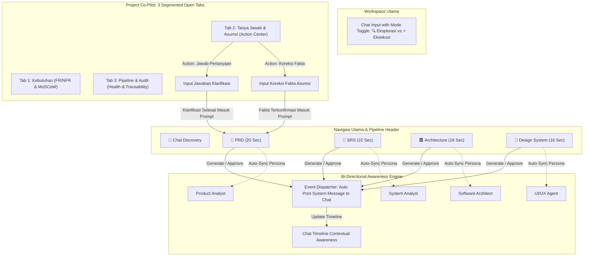

# Rencana Komprehensif Rekonstruksi UX & Integrasi Workflow

Dokumen ini memetakan rekonstruksi menyeluruh untuk menyatukan **Chat Discovery**, **Sidebar Kanan (Project Co-Pilot)**, **Alur Pipeline Multi-Agent**, dan **Dokumen Canvas (PRD/SRS/Arch/Design)** menjadi satu ekosistem yang kohesif, transparan, dan intuitif.

---

## 1. Analisis Kritis Masalah UX & Feedback Pengguna

Berdasarkan pertanyaan dan evaluasi pengguna:
1. **Asumsi Tidak Bisa Dijawab / Dikoreksi**:
   - Kartu asumsi saat ini hanya memiliki tombol `Confirm` dan `Reject`. Jika asumsi AI keliru (misal: AI berasumsi payment gateway menggunakan Stripe, padahal pengguna ingin Midtrans/QRIS), pengguna tidak memiliki kotak input untuk memberikan jawaban fakta yang benar.
2. **Keterpisahan Antara Canvas Dokumen dan Chat Discovery**:
   - Saat pengguna membuka menu PRD dan mengklik tombol **"Generate PRD"** di canvas, dokumen PRD berhasil dibuat di database dan file markdown. Namun, **Chat Discovery sama sekali tidak tahu bahwa PRD telah dibuat**.
   - Ketika pengguna kembali ke Chat, riwayat percakapan tidak menampilkan pemberitahuan apapun, menciptakan ilusi bahwa Chat dan Canvas adalah dua dunia yang terputus.
3. **Kebingungan Dropdown Persona & Mode Interaksi**:
   - Pengguna mempertanyakan: *"Apakah dropdown persona (Product Analyst, System Analyst, dll) dan dropdown mode (Discovery vs Exec) ini sebenarnya terpakai atau mubazir?"*
   - **Kenyataan Sistem**: Fitur ini sangat fungsional di backend (mengatur persona AI dan prompt directives), tetapi **eksekusi UX-nya saat ini terisolasi dan membingungkan**. Pengguna bertanya-tanya mengapa mereka harus memilih "System Analyst" secara manual jika mereka sudah berada di tab SRS, atau apa perbedaan nyata antara Discovery Mode dan Execution Mode.
4. **Sidebar Kanan ("Inspector") yang Tersembunyi & Membingungkan**:
   - Menu 3-titik (`MoreVertical`) menyembunyikan 5 sub-view penting (Requirements, Validation, Traceability, Assumptions, Clarifications). Pengguna merasa tersesat dan tidak memahami hubungan antara chat di tengah dan inspector di kanan.

---

## 2. Arsitektur Solusi & Peta Integrasi End-to-End

---

## 3. Rincian Desain 4 Pilar Utama

### Pilar 1: Interaktivitas Asumsi — Konfirmasi, Koreksi, & Penolakan
Asumsi AI (*AI Inferred Assumptions*) adalah inisiatif cerdas AI agar alur kerja tidak terhenti ketika informasi awal pengguna masih minim. Cara pengguna merespons:
1. **✓ Benar (Konfirmasi Langsung)**:
   - Menyetujui asumsi AI apa adanya menjadi fakta proyek resmi (status `confirmed`).
2. **✎ Koreksi (Inline Input Box)**:
   - Mengklik tombol "Koreksi" membuka kotak teks inline:
     > *"Tuliskan fakta atau preferensi yang benar (misal: 'Bukan Stripe, kita menggunakan Midtrans QRIS'):"*
   - Saat disimpan: deskripsi asumsi diperbarui dengan teks koreksi pengguna, status otomatis menjadi `confirmed`, dan fakta tersebut langsung diinjeksikan ke prompt generasi dokumen berikutnya.
3. **✕ Tolak (Reject / Out-of-Scope)**:
   - Menandai asumsi sebagai `rejected` sehingga tidak akan dimasukkan ke dalam PRD/SRS.

### Pilar 2: Bi-Directional Canvas-to-Chat Synchronization
Menghubungkan tombol canvas dengan linimasa Chat Discovery:
1. **Otomatis Posting Event Message ke Chat**:
   - Saat pengguna mengklik **Generate PRD** di canvas atau via auto-pipeline:
     Chat Discovery otomatis mencatat pesan event sistem:
     > 📄 **[MILESTONE] PRD Draft v1 (20 Sections) Berhasil Dibuat**  
     > *Dieksekusi oleh Product Analyst Agent.*  
     > - Kebutuhan teridentifikasi: **8 Functional**, **3 Non-Functional**  
     > - Asumsi terdeteksi: **4 item** (perlu konfirmasi di Co-Pilot)  
     > 👉 *Klik tab PRD di atas untuk membaca dokumen lengkap, atau ketik masukan revisi di sini.*
   - Saat pengguna mengklik **Approve PRD**:
     Chat Discovery otomatis mencatat:
     > ✅ **[STATUS] PRD Telah Disetujui (Approved)**  
     > *Gerbang downstream terbuka: Dokumen SRS (IEEE 830) kini siap digenerate oleh System Analyst.*
2. **Injeksi Status Dokumen ke Prompt Chat AI**:
   - Jika pengguna bertanya di chat: *"Sampai mana dokumen kita sekarang?"* atau *"Apakah SRS sudah dibuat?"*, AI langsung mengetahui status dokumen (PRD: Approved, SRS: Draft, dll.) karena status dokumen diinjeksikan ke dalam system prompt discovery.

### Pilar 3: Revitalisasi Persona Selector & Interaction Mode
Menjadikan Persona dan Mode interaksi jelas fungsinya dan tidak mubazir:
1. **Context-Aware Persona Auto-Switching**:
   - Saat pengguna membuka tab **PRD** ➔ Persona aktif otomatis berpindah ke **Product Analyst**.
   - Saat pengguna membuka tab **SRS** ➔ Persona aktif otomatis berpindah ke **System Analyst**.
   - Saat pengguna membuka tab **Architecture** ➔ Persona aktif otomatis berpindah ke **Software Architect**.
   - Saat pengguna membuka tab **Design System** ➔ Persona aktif otomatis berpindah ke **UI/UX Agent**.
   - Di tab **Chat Discovery**: Pengguna dapat melihat **Persona Team Switcher** yang elegan dengan avatar, nama, dan peran spesifik (misal: *"System Analyst — Spesialis FR-xxx & IEEE 830"*), sehingga pengguna paham siapa yang sedang diajak bicara.
2. **Penyederhanaan Mode: Segmented Toggle Pill**:
   - Mengganti dropdown tersembunyi dengan **Toggle Pill Horizontal** di atas input bar chat:
     - **`🔍 Mode Eksplorasi` (Default)**: AI proaktif mencari celah, mengajukan pertanyaan klarifikasi, dan mendeteksi asumsi dari ide kasar pengguna.
     - **`⚡ Mode Eksekusi`**: AI langsung menghasilkan output terstruktur, merancang schema, atau menulis spesifikasi dokumen tanpa banyak tanya.
   - Dilengkapi tooltip/deskripsi ringkas sehingga tujuan mode ini langsung dipahami pengguna.

### Pilar 4: Workspace Co-Pilot (Sidebar Kanan)
Menghilangkan istilah teknis "Inspector" dan menu 3-titik yang tersembunyi:
1. **3 Segmented Tabs Permanen**:
   - **`Kebutuhan (N)`**: Backlog kebutuhan FR/NFR, MoSCoW prioritization (Must, Should, Could, Won't), dan status kelengkapan.
   - **`Tanya Jawab & Asumsi (N)`**: Pusat Aksi (*Action Center*) gabungan yang menampilkan:
     - Sub-bagian 1: **Pertanyaan AI (Clarifications)** dengan kotak jawaban langsung.
     - Sub-bagian 2: **Asumsi Sistem (Assumptions)** dengan tombol Benar / Koreksi / Tolak.
     - Dilengkapi **Badge Counter** kuning/merah jika ada pertanyaan atau asumsi yang belum dijawab.
   - **`Pipeline & Audit`**: Visualisasi alur dokumen (PRD ➔ SRS ➔ Arch ➔ Design), status Traceability Matrix, dan temuan validasi/konflik.
2. **Otomatis Berfokus (*Smart Auto-Focus*)**:
   - Jika AI mengekstrak pertanyaan atau asumsi baru dari chat, sidebar kanan otomatis berpindah ke tab **Tanya Jawab & Asumsi**.

---

## 4. Rincian Rencana Implementasi Teknis

### Fase 1: Backend Layer (Go & SQLite)
1. **Pembaruan Repositori Asumsi (`internal/storage/conversation_repo.go`)**:
   - Tambahkan fungsi `UpdateAssumption(ctx, id, description, status)` untuk menyimpan deskripsi yang telah dikoreksi pengguna sekaligus memperbarui statusnya menjadi `confirmed`.
2. **Pembaruan Service Layer (`internal/services/requirement_service.go`)**:
   - Tambahkan metode `CorrectAssumption(id string, correctedText string) error`.
3. **Pencatatan Event Sistem Dokumen ke Percakapan (`internal/services/conversation_service.go`)**:
   - Tambahkan metode `PostSystemEvent(conversationID, projectID, title, message string) (*domain.Message, error)` untuk mencatat event milestone (PRD generated, PRD approved, SRS generated, dll.).
4. **Penyertaan Status Dokumen dalam Discovery Prompt (`internal/ai/prompt.go`)**:
   - Lampirkan ringkasan status dokumen proyek (PRD, SRS, Arch, Design) ke dalam context builder discovery.

### Fase 2: Frontend Layer (`frontend/src/App.tsx`)
1. **Komponen Kartu Asumsi Interaktif**:
   - State untuk inline editing: `editingAssumptionId`, `editedAssumptionText`.
   - Tombol `[✓ Benar]`, `[✎ Koreksi]`, `[✕ Tolak]`.
   - Form inline edit dengan tombol `[Simpan Koreksi]` dan `[Batal]`.
2. **Segmented Tabs Header Sidebar Kanan**:
   - Hapus menu 3-titik `MoreVertical`.
   - Pasang 3 tombol tab horizontal: `Kebutuhan`, `Tanya Jawab & Asumsi` (dengan notification badge jika ada pending), `Pipeline & Audit`.
3. **Sinkronisasi Tab Dokumen ➔ Persona AI**:
   - Tambahkan `useEffect` yang menyelaraskan `activeChatAgent` saat `currentView` berubah (`prd` ➔ `product-analyst`, `srs` ➔ `system-analyst`, dst.).
4. **Segmented Toggle Mode Interaksi**:
   - Tampilkan toggle pill di samping input bar chat: `[ 🔍 Eksplorasi | ⚡ Eksekusi ]`.
5. **Dispatch Notifikasi Milestone**:
   - Panggil `ConversationService.PostSystemEvent` saat `handleGeneratePRD`, `handleApprovePRD`, `handleGenerateSRS`, `handleGenerateArchitecture`, dan `handleGenerateDesign` selesai dijalankan.

---

## 5. Rencana Verifikasi & Uji Mutu

1. **Uji Asumsi Interaktif**:
   - Buat asumsi via chat.
   - Klik "✎ Koreksi", tuliskan fakta baru (misal ganti provider pembayaran).
   - Pastikan data tersimpan di SQLite dan status berubah menjadi `confirmed`.
   - Generate ulang PRD dan pastikan fakta hasil koreksi tercermin dalam dokumen PRD.
2. **Uji Bi-Directional Event Sync**:
   - Buka tab PRD, klik "Generate PRD".
   - Pindah ke tab Chat Discovery, verifikasi bahwa pesan milestone PRD telah tercatat di linimasa chat.
3. **Uji Auto-Sync Persona**:
   - Pindah antara tab PRD, SRS, Architecture, dan Design System, pastikan persona AI di chat otomatis menyesuaikan dengan peran dokumen tersebut.
4. **Uji Kompilasi & Concurrency**:
   - Jalankan `go test -v ./internal/...`
   - Jalankan `npm --prefix frontend run build`

---

## 6. Persetujuan Pengguna

Rencana ini siap dieksekusi. Silakan konfirmasi untuk memulai implementasi teknis.
