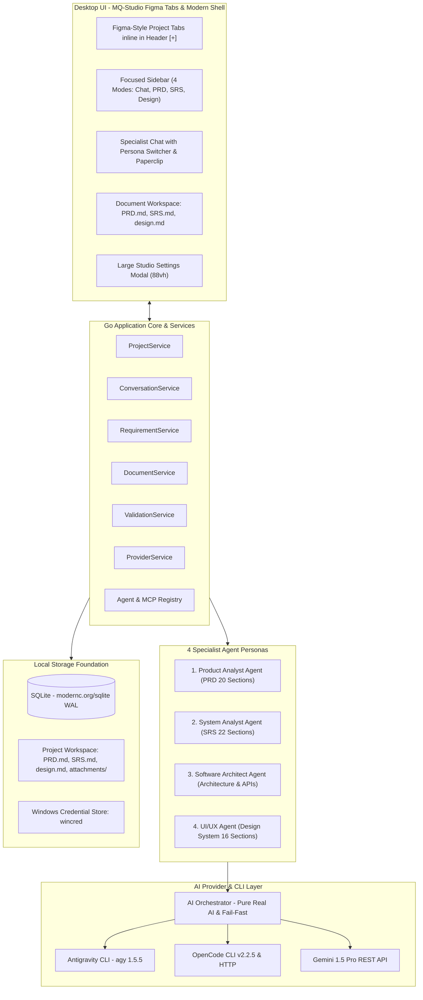

# AI Requirements Studio — Implementation Walkthrough

Dokumen rangkuman hasil implementasi menyeluruh aplikasi desktop **AI Requirements Studio** berdasarkan:
- [PRD.md](file:///E:/dev-agent-assistant/prd.md) (v1.2 Final)
- [SRS.md](file:///E:/dev-agent-assistant/srs.md) (v1.0 Final)
- [design_system.md](file:///E:/dev-agent-assistant/design_system.md) (v1.0)
- [business_orchestration_plan.md](file:///C:/Users/Lufti.DESKTOP-OPODSJ4/.gemini/antigravity-cli/brain/104faa66-caa6-4b1f-b03d-4b7d31111572/business_orchestration_plan.md)

---

## 1. Executive Summary & Architecture

Aplikasi desktop *local-first*, *chat-first* berbasis **Go 1.27.3 + Wails v3 + React + TypeScript + Tailwind CSS** telah selesai dibangun dengan arsitektur **Multi-Agent Specialist, Figma Tabs MQ-Studio, dan Pure Real AI Execution**:

---

## 2. Rangkuman Implementasi Fase Terbaru

### Fase 1: Backend Domain, Attachment Engine, Design MD Spec, Multi-Agent & Zero-Mock Execution
- **Domain Models ([`internal/domain/models.go`](file:///E:/dev-agent-assistant/internal/domain/models.go)):**
  - Menambahkan konstanta `DocTypeDesign = "design"`, struct `AgentConfig`, `MCPServerConfig`, dan `AttachmentInfo`.
- **Safe File Attachment Storage ([`internal/storage/workspace.go`](file:///E:/dev-agent-assistant/internal/storage/workspace.go)):**
  - Menyimpan file ke `workspaces/projects/{id}/attachments/{filename}` dengan validasi nama file dan proteksi *path traversal*.
- **16-Section `design.md` Generator ([`internal/ai/document_gen.go`](file:///E:/dev-agent-assistant/internal/ai/document_gen.go)):**
  - 16 bagian spesifikasi UI/UX (Semantic Design Tokens, Color Palette, Typography Hierarchy, Atomic Components, Wireframes, Screen Flows Mermaid, dan Tailwind mappings).
- **Pure Real AI & Fail-Fast ([`internal/services/conversation_service.go`](file:///E:/dev-agent-assistant/internal/services/conversation_service.go)):**
  - Menghapus semua balasan mock sintetis dan fallback palsu. Jika AI CLI atau API gagal, sistem melempar error riil langsung ke UI agar transparan dan mudah didiagnosa.

### Fase 2: Adaptasi UI MQ-Studio 0.4.2 (Figma Tabs & Project Manager Modal)
- **Top Bar Figma-Style Project Tabs ([`frontend/src/App.tsx`](file:///E:/dev-agent-assistant/frontend/src/App.tsx#L940-L1015)):**
  - Mengadaptasi pola `ConnectionTabs.tsx` dari `_ref_ui/mq-studio-0.4.2`.
  - Project yang dibuka muncul sebagai horizontal tabs di header dengan active indicator dot, nama project, tombol close `X`, dan tombol tambah `+`.
- **Project Manager Modal ("Open or Create Project") ([`frontend/src/App.tsx`](file:///E:/dev-agent-assistant/frontend/src/App.tsx#L1600-L1770)):**
  - Dialog lega untuk pencarian live filter semua project, kartu status (*Tab Open* / *Active*), 1-klik *Open* ke tab, dan formulir pembuatan project baru.
- **Clean Sidebar Navigation ([`frontend/src/App.tsx`](file:///E:/dev-agent-assistant/frontend/src/App.tsx#L770-L865)):**
  - Menghapus daftar project yang memadati sidebar; menggantinya dengan kartu ringkas *Active Project* dan 4 mode kerja:
    1. `Chat Discovery`
    2. `PRD Document` (`PRD.md`)
    3. `SRS Document` (`SRS.md`)
    4. `Design System` (`design.md`)

### Fase 3: 4 Specialist Personas, Interconnected Context Pipeline & 4 Dedicated Document Workspaces
- **4 Specialist Personas ([`internal/ai/agent_registry.go`](file:///E:/dev-agent-assistant/internal/ai/agent_registry.go)):**
  1. **Product Analyst Agent (`product-analyst`)** ➔ Fokus PRD (Visi produk, user personas, MoSCoW prioritization).
  2. **System Analyst Agent (`system-analyst`)** ➔ Fokus SRS (IEEE 830, pemodelan data, business rules, traceability matrix).
  3. **Software Architect Agent (`software-architect`)** ➔ Fokus Architecture (`architecture.md` - 16 sections, C4 diagrams Mermaid, API contracts REST/gRPC, scalability, STRIDE security).
  4. **UI/UX Agent (`ui-ux-agent`)** ➔ Fokus Design System & Interface (`design.md` - 16 sections, semantic design tokens, user screen flows Mermaid, atomic components, WCAG).
- **Interconnected Context Pipeline ([`internal/services/conversation_service.go`](file:///E:/dev-agent-assistant/internal/services/conversation_service.go)):**
  - Agen hilir secara otomatis mewarisi konteks artefak hulu:
    - *System Analyst* otomatis membaca PRD yang disetujui.
    - *Software Architect* otomatis membaca PRD dan SRS untuk topologi teknis.
    - *UI/UX Agent* otomatis membaca persona PRD, SRS flow, dan Architecture topology.
- **Dedicated Architecture Document Lifecycle ([`internal/services/document_service.go`](file:///E:/dev-agent-assistant/internal/services/document_service.go)):**
  - Ditambahkan `DocTypeArchitecture = "architecture"`, `GenerateArchitecture`, `RegenerateArchitectureSection`, dan `ApproveArchitecture`.
  - Approval gating: Architecture terproteksi sampai PRD disetujui.
- **Chat Specialist Selector & Persona Badge ([`frontend/src/App.tsx`](file:///E:/dev-agent-assistant/frontend/src/App.tsx#L1300-L1330)):**
  - Switcher bar di atas chat untuk berganti 4 spesialis secara instan.
- **Chat Attachment Paperclip ([`frontend/src/App.tsx`](file:///E:/dev-agent-assistant/frontend/src/App.tsx#L1340-L1380)):**
  - Tombol paperclip untuk mengunggah file draft `.md`, `.txt`, `.json` dengan badge preview nama & ukuran file serta tombol remove `X`.
- **Large Studio Settings Modal (`max-w-5xl h-[88vh]`) ([`frontend/src/App.tsx`](file:///E:/dev-agent-assistant/frontend/src/App.tsx#L2100-L2480)):**
  - Tab Personas & Skills, MCP Connections, Coding Agents, Token Usage, dan Diagnostics.

### Fase 4: MQ-Studio 0.4.2 Design System & Color Token Adaptation
- **Comprehensive Design Token Scale ([`frontend/src/design/tokens.css`](file:///E:/dev-agent-assistant/frontend/src/design/tokens.css)):**
  - Mengadaptasi sistem token skala penuh dari `_ref_ui/mq-studio-0.4.2`:
    - Chrome ground: `--c-chrome` (`#f2ede4` light, `#121110` dark).
    - Elevated Surface: `--c-bg` (`#faf6f0` light, `#1a1816` dark).
    - Panels & Bars: `--c-panel` (`#f5f0e8` light, `#171513` dark).
    - Interactive fills: `--c-fill`, `--c-fill-soft`, `--c-fill-mute`.
    - Hairline borders: `--c-border`, `--c-border-soft`, `--c-rule`.
    - Primary Cobalt: `--c-primary` (`#2b5797` light, `#4a7fc7` dark) dan hover/soft/text tokens.
    - Semantic tone badges: `--c-tone-blue`, `--c-tone-teal`, `--c-tone-violet`, `--c-tone-orange`.
    - Semantic state feedback: `--c-ok`, `--c-warn`, `--c-err`.
- **Shell Layout Architecture ([`frontend/src/App.tsx`](file:///E:/dev-agent-assistant/frontend/src/App.tsx)):**
  - **Window Frame (`.m3`):** Latar belakang window canvas `background: var(--c-chrome)` tanpa celah.
  - **TitleBar (`.tb2`):** Header 40px memanjang penuh di bagian atas jendela, memadukan logo, horizontal Figma tabs dengan elevasi aktif dan close button `X`, breadcrumb navigasi, kontrol dokumen (Export & Edit/Simpan), pill status provider aktif, inspector toggle, dan tombol settings studio.
  - **MQ-Studio Main Container (`.mqs-main`):** Membungkus sidebar rail dan sheet konten utama.
  - **Sidebar Rail (`.side3`):** 198px rail langsung menempel pada chrome ground, menggunakan typography label kelompok `.gl` dan navigation items `.ni` dengan indicator dot aktif.
  - **Elevated Content Sheet (`.mqs-content`):** Lembar kanvas utama melayang dengan gutter 8px, `rounded-[10px]`, `border 1px solid var(--c-border)`, `bg-surface`, dan `box-shadow: 0 1px 2px rgba(28,25,23,0.04)`.
  - **MQ-Studio Right Dock/Inspector:** Terintegrasi di dalam `.mqs-main` dengan rounded card border yang senada (`rounded-[10px] border border-border bg-surface shadow-2xs`).
- **Complete Modals Restyling:**
  - **Project Manager Modal:** Backdrop scrim halus (`bg-black/45 backdrop-blur-xs`), panel header `bg-panel`, kartu project aktif dengan `bg-primary-soft/40 border-primary`, search input & button primary cobalt.
  - **Large Studio Settings Modal (`max-w-5xl h-[88vh]`):** Tampilan studio profesional dengan tab switcher, kartu specialist persona dengan warna tone semantik, editor system prompt, koneksi MCP, konfigurasi LLM provider, dan live diagnostics.

### Fase 5: General Settings, Full Dark Mode Version & High-Contrast Typography System
- **High-Contrast Text Hierarchy & Anti-Washed Out Colors ([`frontend/src/design/tokens.css`](file:///E:/dev-agent-assistant/frontend/src/design/tokens.css)):**
  - Mengubah font dasar `.m3` dan `body` dari `13px` ke **`14px/1.55`** (`text-rendering: optimizeLegibility`).
  - Menghilangkan teks pudar (*too crisp/faint*) dengan mempertebal kontras warna teks:
    - Light Mode: `--c-fg: #171513`, `--c-fg-2: #2e2a26`, `--c-muted: #48443f` (lolos standar WCAG AA 4.5:1+ di atas background hangat).
    - Dark Mode: `--c-fg: #f7f5f3`, `--c-fg-2: #e8e4e0`, `--c-muted: #c2bcb5` (teks sekunder dan hint tetap putih-krem terang di atas obsidian slate `#121110` / surface `#1a1816`).
- **Eliminasi Teks Mikro:**
  - Mengeliminasi kelas `text-[10px]` dan `text-[11px]` di seluruh aplikasi, menggantinya dengan skala minimum `12px` berbobot medium/semibold, dan input form/tombol dinaikkan ke `13.5px - 14px`.
- **Tab General Settings (Pengaturan Umum) di Studio Settings Modal ([`frontend/src/App.tsx`](file:///E:/dev-agent-assistant/frontend/src/App.tsx)):**
  - Ditempatkan sebagai **Tab Pertama (posisi paling kiri)**:
    1. **Appearance & Theme:** Pemilihan 3 mode (☀️ *Light Warm Stone*, 🌙 *Dark Obsidian Slate*, 💻 *System Auto*) lengkap dengan visual mockup mini-app ala MQ-Studio.
    2. **Font Scale Selector:** Pilihan kenyamanan (*Compact 13px*, *Standard 14px - Default*, *Comfort 15.5px*) yang secara dinamis mengatur variabel CSS `--app-base-font-size`.
    3. **Smooth Motion:** Switch on/off animasi transisi UI.
    4. **Workspace & Local Storage:** Menampilkan path direktori lokal (`~/AI-Requirements-Studio`), status folder, serta tombol 1-klik *"Buka di File Explorer"* yang mengintegrasikan Windows Explorer.
    5. **AI Generation Preferences:** Bahasa output dokumen (Bahasa Indonesia Formal vs English IEEE) dan proaktivitas klarifikasi AI.
    6. **Desktop Notifications:** Switch notifikasi desktop saat proses generate dokumen selesai di background.
- **Quick Theme Toggle di TitleBar (`.tb2`):**
  - Tombol icon Sun/Moon 1-klik di header jendela samping tombol settings untuk beralih mode siang/malam secara instan tanpa perlu masuk ke settings modal.
- **Backend Persistence & Wails Bindings ([`internal/services/provider_service.go`](file:///E:/dev-agent-assistant/internal/services/provider_service.go)):**
  - Method `GetGeneralSettings()`, `SaveGeneralSettings()`, dan `OpenWorkspaceInExplorer()` terhubung ke tabel SQLite `app_settings` dan terexpose via Wails bindings.

### Fase 6: Custom Skill Library, Persona-Scoped MCP & Modal Upscaling
- **Custom Skill Creator & Skills Library ([`internal/domain/models.go`](file:///E:/dev-agent-assistant/internal/domain/models.go), [`internal/ai/agent_registry.go`](file:///E:/dev-agent-assistant/internal/ai/agent_registry.go), [`frontend/src/App.tsx`](file:///E:/dev-agent-assistant/frontend/src/App.tsx)):**
  - Struct `SkillConfig` (`ID`, `Name`, `Description`, `Prompt`, `Category`, `Custom`) tersimpan persisten di SQLite `app_settings`.
  - Built-in default skills terdaftar lengkap (MoSCoW, IEEE 830, C4 Modeling, UI/UX Tokens, Security Compliance).
  - Dialog Creator "+ Create Custom Skill" di tab *Specialist Personas & Skills* memungkinkan pengguna menambahkan skill kustom baru (nama, kategori, deskripsi, dan prompt directive yang disuntikkan ke AI).
  - Skill dapat diaktifkan atau dinonaktifkan per persona dengan 1 klik, serta skill kustom dapat dihapus secara permanen.
- **MCP Scoping (Global vs Persona-Spesifik) ([`internal/domain/models.go`](file:///E:/dev-agent-assistant/internal/domain/models.go), [`internal/ai/agent_registry.go`](file:///E:/dev-agent-assistant/internal/ai/agent_registry.go), [`frontend/src/App.tsx`](file:///E:/dev-agent-assistant/frontend/src/App.tsx)):**
  - `MCPServerConfig` kini memiliki field `Scope` (`"global"` | `"persona"`) dan `AssignedAgents []string`.
  - Pada pendaftaran MCP Server, tersedia pilihan radio:
    - 🌐 **Global (Semua Persona):** Tool MCP aktif untuk semua 4 persona spesialis.
    - 🎯 **Persona-Spesifik:** Pilihan checkbox untuk menentukan persona spesialis tertentu saja yang memiliki akses (misal Figma MCP hanya untuk UI/UX Agent, Database MCP untuk System Analyst / Architect).
  - Di Tab Personas, ditampilkan daftar tool MCP aktif yang terhubung khusus untuk persona yang sedang dipilih.
  - Di prompt generator `ConversationService`, prompt persona hanya menyertakan MCP servers yang berstatus global atau secara spesifik di-assign ke persona tersebut.
- **Modal Upscaling & Larger Typography ([`frontend/src/App.tsx`](file:///E:/dev-agent-assistant/frontend/src/App.tsx)):**
  - **Project Manager Modal:** Diperlebar menjadi `w-full max-w-4xl max-h-[88vh]`, font judul diperbesar ke 16px (`text-base font-bold`), search bar diperbesar ke 14px (`text-sm py-2.5`), tab diperbesar ke 14px (`text-sm font-semibold`), dan kartu project tampil lebih lega dengan font deskripsi yang jelas dan tombol aksi yang nyaman.
  - **Studio Settings Modal:** Diperlebar menjadi `w-full max-w-7xl h-[92vh]`, header dinaikkan ke 16px (`text-base font-bold`), icon diperbesar ke 22px, tab switcher dinaikkan ke 14px (`text-sm font-semibold px-3.5 py-2`), padding modal diperluas ke `p-7`, dan seluruh kontrol form dan kartu persona mendapatkan ukuran teks yang nyaman.

---

## 3. Hasil Pengujian & Verifikasi Menyeluruh

| Jenis Pengujian | Target Komponen | Status | Hasil |
|---|---|---|---|
| **Go Internal Unit Tests** | `./internal/...` (13 suites, 4 E2E scenarios) | **PASS** | 100% Lulus (0 errors) |
| **Custom Skill CRUD & Persistence** | `phase1_test.go` (`TestAgentRegistry_PersonasAndMCP`) | **PASS** | 100% Lulus (0 errors) |
| **MCP Scoping (Global vs Persona)** | `phase1_test.go` (`TestAgentRegistry_PersonasAndMCP`) | **PASS** | 100% Lulus (0 errors) |
| **General Settings Persistence** | `phase1_test.go` (`TestGeneralSettings_Persistence`) | **PASS** | 100% Lulus (0 errors) |
| **Specialist Personas Test** | `phase1_test.go` (4 personas & MCP) | **PASS** | 100% Lulus (0 errors) |
| **Design Lifecycle & Gating** | `phase1_test.go` (PRD gating, 16 sections) | **PASS** | 100% Lulus (0 errors) |
| **Architecture Lifecycle & Gating** | `phase1_test.go` (PRD gating, 16 sections) | **PASS** | 100% Lulus (0 errors) |
| **Attachment & Zero-Mock** | `phase1_test.go` (Fail-fast on real errors) | **PASS** | 100% Lulus (0 errors) |
| **MQ-Studio High-Contrast Tokens** | `tokens.css` (14px scale & WCAG AA contrast) | **PASS** | High-contrast contrast ratio |
| **Wails v3 Bindings** | `wails3 generate bindings -ts -i` | **PASS** | 66 methods, 18 models |
| **Frontend Prod Build** | `npm run build` | **PASS** | 0 TypeScript errors (1.80s) |
| **Native Desktop Build** | `wails3 task build` | **PASS** | Binary: `bin/ai-requirements-studio.exe` (17.1 MB) |
