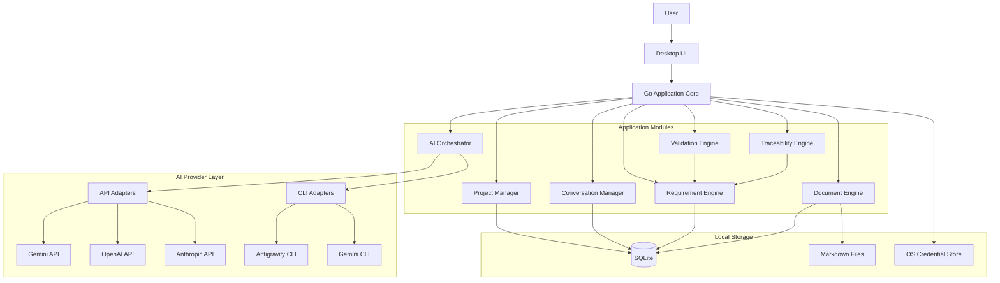
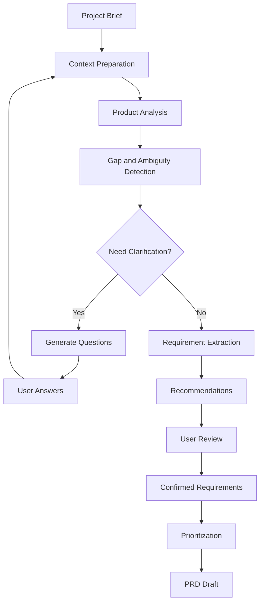
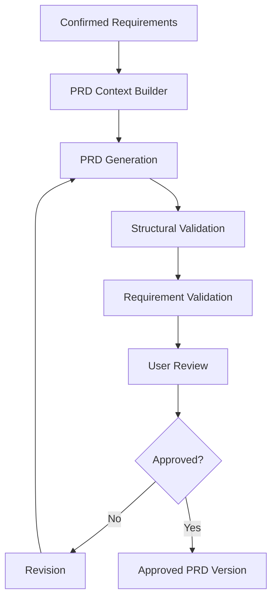
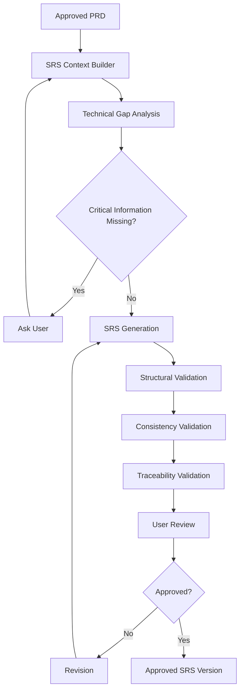
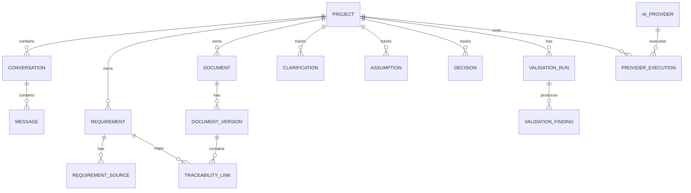

# AI Requirements Studio
## Software Requirements Specification (SRS)

**Version:** 1.0 — Final  
**Status:** Approved Technical Baseline  
**Related PRD:** AI Requirements Studio PRD v1.2  
**Application Type:** Desktop Application  
**Primary Language:** Go  
**Architecture:** Modular Desktop Application  
**Database:** SQLite  
**Document Storage:** Local Markdown Files

---

# 1. Introduction

## 1.1 Purpose

Dokumen ini menjelaskan kebutuhan teknis dan perilaku sistem AI Requirements Studio sebagai acuan implementasi.

SRS menerjemahkan kebutuhan produk dalam PRD menjadi spesifikasi sistem yang meliputi:

- System architecture.
- Application modules.
- Functional behavior.
- Data model.
- AI provider integration.
- Requirement processing.
- Document generation.
- Validation and traceability.
- Security.
- Error handling.
- Testing and acceptance criteria.

## 1.2 Scope

AI Requirements Studio adalah desktop application untuk requirement engineering.

Sistem menerima project brief melalui chat, mengelola proses discovery, menyimpan requirement terstruktur, menghasilkan PRD dan SRS, memvalidasi konsistensi, serta menyediakan ekspor Markdown.

Sistem tidak melakukan code generation atau menjalankan software development workflow.

## 1.3 Definitions

| Term | Description |
|---|---|
| Project Brief | Deskripsi awal kebutuhan proyek |
| Requirement | Kebutuhan produk atau sistem yang terstruktur |
| PRD | Product Requirements Document |
| SRS | Software Requirements Specification |
| Traceability | Hubungan antara sumber kebutuhan dan requirement turunannya |
| Provider | AI service atau CLI yang menjalankan pemrosesan |
| Adapter | Implementasi integrasi provider tertentu |
| Discovery | Proses analisis dan klarifikasi kebutuhan |
| Assumption | Informasi yang diasumsikan tetapi belum dikonfirmasi |
| Approved | Status dokumen atau requirement yang disetujui pengguna |

---

# 2. System Overview

## 2.1 System Context

Sistem terdiri dari empat bagian utama:

1. Desktop application.
2. Local project storage.
3. AI provider integration.
4. Document generation and validation engine.

Pengguna berinteraksi melalui desktop UI. UI berkomunikasi dengan application services di dalam Go application.

Application services menggunakan repository untuk menyimpan data lokal dan AI orchestrator untuk berkomunikasi dengan provider.

## 2.2 High-Level Architecture



## 2.3 Architectural Principles

- Modular monolith.
- Local-first.
- Provider-agnostic.
- Separation of UI and business logic.
- Explicit user approval.
- Structured internal data.
- Markdown as portable document output.
- No dependency on one AI provider.
- No autonomous shell execution.

---

# 3. Recommended Technology Stack

| Layer | Technology | Purpose |
|---|---|---|
| Primary language | Go | Application core |
| Desktop framework | Wails v2/v3 or compatible framework | Desktop shell |
| Frontend | React + TypeScript | Chat-first interface |
| Styling | Tailwind CSS | UI styling |
| Local database | SQLite | Project and requirement metadata |
| Database access | database/sql or SQLC | Persistence |
| Document format | Markdown | PRD and SRS |
| Markdown rendering | CommonMark-compatible renderer | Preview |
| AI integration | HTTP + subprocess adapters | Provider integration |
| Credential storage | OS keychain / secure credential store | API keys |
| Logging | Go structured logging | Diagnostics |
| Testing | Go testing + frontend testing tools | Quality assurance |

The desktop framework must be confirmed through a short technical spike before implementation. The architecture must not depend on framework-specific business logic.

---

# 4. Application Modules

## 4.1 Project Manager

Responsibilities:

- Create project.
- Update project metadata.
- Archive project.
- Delete project.
- Load project workspace.
- Manage project status.
- Maintain project isolation.

## 4.2 Conversation Manager

Responsibilities:

- Store conversation history.
- Manage messages.
- Maintain project context.
- Attach AI responses to the correct project.
- Store clarification questions and answers.
- Support conversation continuation.

## 4.3 Requirement Engine

Responsibilities:

- Create requirements.
- Update requirements.
- Assign requirement IDs.
- Categorize requirements.
- Set priorities.
- Track source references.
- Track status and approval.

## 4.4 AI Orchestrator

Responsibilities:

- Resolve active provider.
- Build AI requests.
- Attach project context.
- Select logical AI role.
- Execute provider requests.
- Normalize responses.
- Handle timeout and failure.
- Maintain provider execution metadata.

## 4.5 Document Engine

Responsibilities:

- Generate PRD.
- Generate SRS.
- Render Markdown.
- Edit document content.
- Manage document versions.
- Export documents.
- Mark downstream documents as outdated when relevant source documents change.

## 4.6 Validation Engine

Responsibilities:

- Check document completeness.
- Check requirement consistency.
- Detect ambiguity.
- Detect conflicting requirements.
- Detect missing acceptance criteria.
- Detect unsupported assumptions.
- Report validation findings.

## 4.7 Traceability Engine

Responsibilities:

- Map PRD requirements to SRS requirements.
- Detect orphan requirements.
- Detect unlinked system requirements.
- Display traceability matrix.
- Evaluate change impact.

## 4.8 Provider Manager

Responsibilities:

- Register providers.
- Configure provider settings.
- Detect CLI installations.
- Check provider availability.
- Check authentication.
- Manage provider selection.
- Store non-secret provider metadata.
- Integrate secure credential storage.

---

# 5. AI Provider Architecture

## 5.1 Provider Categories

### API-based

- Gemini API.
- OpenAI API.
- Anthropic API.

### CLI-based

- Antigravity CLI.
- Gemini CLI.
- Other compatible CLI agents.

The system must treat each provider as an adapter implementing a common internal contract.

## 5.2 Provider Interface

Proposed Go interface:

```go
type AIProvider interface {
    ID() string
    Name() string
    Type() ProviderType

    CheckAvailability(
        ctx context.Context,
    ) error

    CheckAuthentication(
        ctx context.Context,
    ) error

    Generate(
        ctx context.Context,
        req GenerateRequest,
    ) (*GenerateResponse, error)
}
```

Supporting types:

```go
type ProviderType string

const (
    ProviderAPI ProviderType = "api"
    ProviderCLI ProviderType = "cli"
)

type GenerateRequest struct {
    ProjectID string
    Role      string
    System    string
    Prompt    string
    Context   map[string]any
    Model     string
}

type GenerateResponse struct {
    Content    string
    ProviderID string
    Model      string
    Usage      *TokenUsage
    Metadata   map[string]any
}

type TokenUsage struct {
    InputTokens  int
    OutputTokens int
}
```

The internal contract is provider-neutral. Provider-specific features must be handled through adapter configuration or optional capability interfaces, not by leaking provider-specific logic into the requirement engine.

## 5.3 Provider Adapter Structure

```text
internal/
├── ai/
│   ├── provider.go
│   ├── types.go
│   ├── orchestrator.go
│   ├── registry.go
│   ├── capabilities.go
│   └── adapters/
│       ├── gemini/
│       ├── openai/
│       ├── anthropic/
│       ├── antigravity/
│       └── gemini_cli/
```

## 5.4 Antigravity CLI Adapter

Antigravity CLI must be supported as a first-class CLI adapter.

Required capabilities:

- Detect executable availability.
- Read installed CLI version.
- Check authentication status where supported.
- Execute a supported non-interactive command.
- Pass prompt and project context.
- Capture stdout and stderr.
- Normalize returned content.
- Handle process exit codes.
- Apply execution timeout.
- Support cancellation.
- Record execution metadata.

### Execution Rules

1. Use documented CLI behavior.
2. Do not assume output is always JSON.
3. Treat CLI output as untrusted input.
4. Do not execute commands suggested by the AI automatically.
5. Do not grant unrestricted project or filesystem access.
6. Do not use permission-bypass flags as a default.
7. Isolate working directory to the application-managed project workspace where possible.
8. Preserve stdout and stderr for diagnostics, subject to sensitive-data redaction.
9. Validate output before accepting it as structured requirements or document content.

### Initial Integration Strategy

The initial adapter may use a supported non-interactive command such as `agy -p` where compatible with the installed version.

Exact command arguments, authentication checks, and output parsing must be validated against the installed CLI version.

The adapter must expose a diagnostic result when the installed CLI version is unsupported.

## 5.5 Provider Response Normalization

All providers must return normalized internal responses.

The AI orchestrator must distinguish:

- Successful response.
- Empty response.
- Malformed structured output.
- Provider authentication error.
- Provider unavailable.
- Timeout.
- Process failure.
- Rate limit.
- Network error.
- Unsupported operation.

Structured generation must use schema validation where possible.

If a provider returns invalid structured content, the application may request a bounded correction attempt. It must not silently accept malformed data.

## 5.6 Provider Switching

Switching providers must not change:

- Project ID.
- Requirement IDs.
- Approved requirements.
- Conversation history.
- PRD versions.
- SRS versions.
- Traceability relationships.

Provider execution metadata must be recorded separately from project requirements.

---

# 6. Functional System Requirements

## 6.1 Project Management

| ID | Requirement |
|---|---|
| SYS-PROJ-001 | System shall create a project with unique ID |
| SYS-PROJ-002 | System shall store project name, description, status, and timestamps |
| SYS-PROJ-003 | System shall update project metadata |
| SYS-PROJ-004 | System shall archive projects |
| SYS-PROJ-005 | System shall delete projects only after confirmation |
| SYS-PROJ-006 | System shall isolate data by project ID |

## 6.2 Conversation

| ID | Requirement |
|---|---|
| SYS-CHAT-001 | System shall create conversation sessions per project |
| SYS-CHAT-002 | System shall persist user messages |
| SYS-CHAT-003 | System shall persist AI responses |
| SYS-CHAT-004 | System shall preserve chronological order |
| SYS-CHAT-005 | System shall associate messages with provider execution metadata |
| SYS-CHAT-006 | System shall support clarification question and answer records |
| SYS-CHAT-007 | System shall preserve conversation context across application restarts |

## 6.3 Requirement Management

| ID | Requirement |
|---|---|
| SYS-REQ-001 | System shall create structured requirements |
| SYS-REQ-002 | System shall assign unique requirement IDs |
| SYS-REQ-003 | System shall categorize requirements |
| SYS-REQ-004 | System shall store requirement descriptions |
| SYS-REQ-005 | System shall store priority |
| SYS-REQ-006 | System shall store status |
| SYS-REQ-007 | System shall record source references |
| SYS-REQ-008 | System shall support requirement approval |
| SYS-REQ-009 | System shall preserve requirement history |
| SYS-REQ-010 | System shall distinguish confirmed requirements from assumptions |

## 6.4 PRD Generation

| ID | Requirement |
|---|---|
| SYS-PRD-001 | System shall generate PRD from project context and requirements |
| SYS-PRD-002 | System shall use a defined PRD template |
| SYS-PRD-003 | System shall identify missing PRD sections |
| SYS-PRD-004 | System shall allow section-level regeneration |
| SYS-PRD-005 | System shall save PRD versions |
| SYS-PRD-006 | System shall support PRD approval |
| SYS-PRD-007 | System shall preserve approved PRD versions |

## 6.5 SRS Generation

| ID | Requirement |
|---|---|
| SYS-SRS-001 | System shall generate SRS from an approved PRD |
| SYS-SRS-002 | System shall derive system requirements from product requirements |
| SYS-SRS-003 | System shall use a defined SRS template |
| SYS-SRS-004 | System shall identify missing technical information |
| SYS-SRS-005 | System shall allow section-level regeneration |
| SYS-SRS-006 | System shall save SRS versions |
| SYS-SRS-007 | System shall support SRS approval |
| SYS-SRS-008 | System shall mark SRS outdated after relevant PRD changes |

## 6.6 Validation

| ID | Requirement |
|---|---|
| SYS-VAL-001 | System shall validate PRD completeness |
| SYS-VAL-002 | System shall validate SRS completeness |
| SYS-VAL-003 | System shall detect ambiguous requirements |
| SYS-VAL-004 | System shall detect conflicting requirements |
| SYS-VAL-005 | System shall detect missing acceptance criteria |
| SYS-VAL-006 | System shall detect unsupported assumptions |
| SYS-VAL-007 | System shall validate PRD-SRS consistency |
| SYS-VAL-008 | System shall present findings with severity and explanation |

## 6.7 Traceability

| ID | Requirement |
|---|---|
| SYS-TRACE-001 | System shall associate SRS requirements with source PRD requirements |
| SYS-TRACE-002 | System shall generate traceability matrix |
| SYS-TRACE-003 | System shall detect PRD requirements without SRS mapping |
| SYS-TRACE-004 | System shall detect SRS requirements without PRD source |
| SYS-TRACE-005 | System shall identify affected SRS requirements after PRD changes |

## 6.8 Provider Management

| ID | Requirement |
|---|---|
| SYS-AI-001 | System shall register API providers |
| SYS-AI-002 | System shall register CLI providers |
| SYS-AI-003 | System shall check provider availability |
| SYS-AI-004 | System shall check provider authentication |
| SYS-AI-005 | System shall detect installed CLI versions |
| SYS-AI-006 | System shall configure provider-specific options |
| SYS-AI-007 | System shall normalize provider responses |
| SYS-AI-008 | System shall support provider switching |
| SYS-AI-009 | System shall record provider execution status |
| SYS-AI-010 | System shall enforce execution timeouts |
| SYS-AI-011 | System shall support request cancellation |
| SYS-AI-012 | System shall redact sensitive diagnostic data |

---

# 7. Requirement Processing Workflow

## 7.1 Discovery Pipeline



## 7.2 Discovery Rules

- AI must analyze before generating final requirements.
- AI should ask focused clarification questions.
- Questions should be prioritized by their impact on product scope and system design.
- AI should not repeatedly ask questions already answered in the project context.
- AI should separate confirmed information from inferred information.
- User decisions override AI recommendations.
- The system must preserve unanswered questions as open items.

## 7.3 PRD Pipeline



## 7.4 SRS Pipeline



---

# 8. Document Specification

## 8.1 PRD Output

The document generator must support:

1. Executive Summary
2. Product Vision
3. Product Objectives
4. Problem Statement
5. Target Audience
6. Personas
7. Business Goals and KPIs
8. Product Scope
9. Features
10. User Stories
11. User Journeys
12. User Flows
13. Prioritization
14. Business Rules
15. Assumptions
16. Constraints
17. Dependencies
18. Risks
19. Acceptance Criteria
20. Open Questions

## 8.2 SRS Output

The document generator must support:

1. Introduction
2. System Overview
3. System Context
4. Architecture
5. Technology Stack
6. Functional Requirements
7. Non-Functional Requirements
8. Data Model
9. Database Design
10. API Specifications, if applicable
11. Application Workflows
12. Business Logic
13. Authentication and Authorization, if applicable
14. Security
15. Privacy
16. Integration Specifications
17. Error Handling
18. Logging and Diagnostics
19. Testing Strategy
20. Acceptance Criteria
21. Traceability Matrix
22. Constraints and Assumptions

Not every section must contain implementation details when the project does not require them. The system must explicitly mark not applicable or unresolved sections.

## 8.3 Document Versioning

Each document version must record:

- Document ID.
- Project ID.
- Version number.
- Document type.
- Content.
- Status.
- Created timestamp.
- Updated timestamp.
- Source version.
- Approval timestamp, if approved.

Document status:

- Draft
- In Review
- Approved
- Superseded
- Outdated

---

# 9. Data Model

## 9.1 Core Entities

```text
Project
Conversation
Message
Requirement
RequirementSource
Clarification
Assumption
Decision
Document
DocumentVersion
TraceabilityLink
ValidationRun
ValidationFinding
AIProvider
ProviderExecution
```

## 9.2 Entity Relationships



## 9.3 SQLite Schema — Initial Baseline

```sql
CREATE TABLE projects (
    id TEXT PRIMARY KEY,
    name TEXT NOT NULL,
    description TEXT,
    status TEXT NOT NULL DEFAULT 'active',
    created_at DATETIME NOT NULL,
    updated_at DATETIME NOT NULL
);

CREATE TABLE conversations (
    id TEXT PRIMARY KEY,
    project_id TEXT NOT NULL,
    title TEXT,
    created_at DATETIME NOT NULL,
    updated_at DATETIME NOT NULL,
    FOREIGN KEY (project_id) REFERENCES projects(id)
);

CREATE TABLE messages (
    id TEXT PRIMARY KEY,
    conversation_id TEXT NOT NULL,
    role TEXT NOT NULL,
    content TEXT NOT NULL,
    provider_execution_id TEXT,
    created_at DATETIME NOT NULL,
    FOREIGN KEY (conversation_id) REFERENCES conversations(id)
);

CREATE TABLE requirements (
    id TEXT PRIMARY KEY,
    project_id TEXT NOT NULL,
    requirement_key TEXT NOT NULL,
    category TEXT NOT NULL,
    title TEXT NOT NULL,
    description TEXT NOT NULL,
    priority TEXT,
    status TEXT NOT NULL DEFAULT 'draft',
    confidence TEXT,
    created_at DATETIME NOT NULL,
    updated_at DATETIME NOT NULL,
    UNIQUE(project_id, requirement_key),
    FOREIGN KEY (project_id) REFERENCES projects(id)
);

CREATE TABLE requirement_sources (
    id TEXT PRIMARY KEY,
    requirement_id TEXT NOT NULL,
    source_type TEXT NOT NULL,
    source_id TEXT,
    source_reference TEXT,
    FOREIGN KEY (requirement_id) REFERENCES requirements(id)
);

CREATE TABLE clarifications (
    id TEXT PRIMARY KEY,
    project_id TEXT NOT NULL,
    question TEXT NOT NULL,
    answer TEXT,
    status TEXT NOT NULL DEFAULT 'open',
    created_at DATETIME NOT NULL,
    answered_at DATETIME,
    FOREIGN KEY (project_id) REFERENCES projects(id)
);

CREATE TABLE assumptions (
    id TEXT PRIMARY KEY,
    project_id TEXT NOT NULL,
    description TEXT NOT NULL,
    status TEXT NOT NULL DEFAULT 'unconfirmed',
    source_reference TEXT,
    created_at DATETIME NOT NULL,
    FOREIGN KEY (project_id) REFERENCES projects(id)
);

CREATE TABLE decisions (
    id TEXT PRIMARY KEY,
    project_id TEXT NOT NULL,
    description TEXT NOT NULL,
    rationale TEXT,
    created_at DATETIME NOT NULL,
    FOREIGN KEY (project_id) REFERENCES projects(id)
);

CREATE TABLE documents (
    id TEXT PRIMARY KEY,
    project_id TEXT NOT NULL,
    document_type TEXT NOT NULL,
    status TEXT NOT NULL DEFAULT 'draft',
    current_version_id TEXT,
    created_at DATETIME NOT NULL,
    updated_at DATETIME NOT NULL,
    FOREIGN KEY (project_id) REFERENCES projects(id)
);

CREATE TABLE document_versions (
    id TEXT PRIMARY KEY,
    document_id TEXT NOT NULL,
    version_number INTEGER NOT NULL,
    content TEXT NOT NULL,
    content_hash TEXT,
    source_version_id TEXT,
    created_at DATETIME NOT NULL,
    approved_at DATETIME,
    UNIQUE(document_id, version_number),
    FOREIGN KEY (document_id) REFERENCES documents(id)
);

CREATE TABLE traceability_links (
    id TEXT PRIMARY KEY,
    source_requirement_id TEXT NOT NULL,
    target_requirement_id TEXT NOT NULL,
    relationship_type TEXT NOT NULL,
    created_at DATETIME NOT NULL,
    FOREIGN KEY (source_requirement_id) REFERENCES requirements(id),
    FOREIGN KEY (target_requirement_id) REFERENCES requirements(id)
);

CREATE TABLE validation_runs (
    id TEXT PRIMARY KEY,
    project_id TEXT NOT NULL,
    validation_type TEXT NOT NULL,
    status TEXT NOT NULL,
    created_at DATETIME NOT NULL,
    FOREIGN KEY (project_id) REFERENCES projects(id)
);

CREATE TABLE validation_findings (
    id TEXT PRIMARY KEY,
    validation_run_id TEXT NOT NULL,
    severity TEXT NOT NULL,
    finding_type TEXT NOT NULL,
    description TEXT NOT NULL,
    requirement_id TEXT,
    document_version_id TEXT,
    FOREIGN KEY (validation_run_id) REFERENCES validation_runs(id)
);

CREATE TABLE ai_providers (
    id TEXT PRIMARY KEY,
    provider_type TEXT NOT NULL,
    name TEXT NOT NULL,
    executable_path TEXT,
    model TEXT,
    config_json TEXT,
    enabled BOOLEAN NOT NULL DEFAULT 1
);

CREATE TABLE provider_executions (
    id TEXT PRIMARY KEY,
    project_id TEXT NOT NULL,
    provider_id TEXT NOT NULL,
    operation TEXT NOT NULL,
    status TEXT NOT NULL,
    model TEXT,
    started_at DATETIME NOT NULL,
    completed_at DATETIME,
    error_code TEXT,
    FOREIGN KEY (project_id) REFERENCES projects(id),
    FOREIGN KEY (provider_id) REFERENCES ai_providers(id)
);
```

This schema is the initial implementation baseline. Migrations must be used for subsequent schema changes. Provider secrets must not be stored in `config_json`.

---

# 10. Storage Strategy

## 10.1 Local Workspace

Suggested directory:

```text
AI-Requirements-Studio/
├── app.db
├── projects/
│   └── {project-id}/
│       ├── project.json
│       ├── brief.md
│       ├── PRD.md
│       ├── SRS.md
│       ├── documents/
│       │   ├── prd/
│       │   └── srs/
│       ├── exports/
│       └── attachments/
├── logs/
└── backups/
```

SQLite stores structured data and application state.

Markdown files provide portable, human-readable document output.

The database and exported files must have clear ownership rules. The application should use document versions as its canonical history and synchronize the current Markdown representation safely.

## 10.2 File Operations

- Use atomic file replacement where supported.
- Validate paths before writing.
- Prevent path traversal.
- Keep project files within the configured workspace.
- Avoid overwriting external files without explicit user action.
- Maintain a backup before destructive document operations.

---

# 11. Application UI Specification

## 11.1 Main Workspace

The primary screen consists of:

- Project sidebar.
- Main chat panel.
- Optional context inspector.
- Document workspace.
- Global provider status.

## 11.2 Chat Interaction

The chat interface must support:

- User messages.
- AI responses.
- Clarification prompts.
- Requirement summaries.
- Recommendation summaries.
- Approval actions.
- Generation status.
- Retry actions.
- Error messages.

## 11.3 Document Workspace

Must support:

- PRD and SRS navigation.
- Markdown preview.
- Content editing.
- Section-level regeneration.
- Validation findings.
- Version history.
- Export.

## 11.4 Provider Settings

Must display:

- Provider name.
- Provider type.
- Enabled state.
- Availability.
- Authentication status.
- Model or CLI version where applicable.
- Last diagnostic result.

A provider must not be presented as connected until its availability and authentication checks have actually succeeded.

---

# 12. Security and Privacy

## 12.1 Credential Security

- Store API credentials using the operating system's secure credential facility where available.
- Never store raw API keys in SQLite or project Markdown.
- Mask secrets in the UI.
- Redact secrets from logs.
- Provide a way to remove configured credentials.

## 12.2 CLI Security

- Use subprocess APIs with explicit argument arrays.
- Avoid shell string concatenation.
- Apply timeouts and cancellation.
- Restrict working directories.
- Do not automatically execute generated shell commands.
- Do not grant unnecessary filesystem permissions.
- Do not silently enable dangerous CLI flags.
- Capture exit status and diagnostics.

## 12.3 Data Privacy

- Inform users when project context is transmitted to an external provider.
- Send only the context necessary for the current operation.
- Keep local project storage as the default.
- Do not upload documents to a remote service unless the selected provider requires it for the requested operation.
- Do not claim that CLI execution is local-only if the CLI itself communicates with remote services.

---

# 13. Error Handling

| Error | Expected System Behavior |
|---|---|
| Provider unavailable | Display provider status and recovery guidance |
| Authentication failure | Ask user to re-authenticate |
| API rate limit | Display rate limit and allow retry |
| Network timeout | Cancel request and preserve project state |
| CLI not installed | Show installation guidance |
| CLI version unsupported | Show compatibility diagnostic |
| CLI process failure | Capture exit code and sanitized stderr |
| Invalid AI output | Reject malformed output and offer bounded correction |
| Database error | Stop unsafe write and preserve recoverable state |
| File write failure | Report failure and preserve previous valid file |
| Document validation failure | Display findings without discarding the draft |
| User cancellation | Stop processing and preserve saved data |

No error should silently destroy approved requirements or document versions.

---

# 14. Non-Functional Requirements

## 14.1 Performance

- Local project navigation should feel responsive.
- Database operations should be asynchronous where appropriate.
- Long AI operations must not freeze the UI.
- Markdown preview should update without requiring full application reload.
- Large conversation histories should support pagination or incremental loading.

## 14.2 Reliability

- Database writes should use transactions.
- File writes should use safe replacement.
- Failed generation must not overwrite an approved document.
- Application restart must restore the last persisted state.

## 14.3 Maintainability

- Separate domain models from UI models.
- Keep provider adapters isolated.
- Use database migrations.
- Use typed internal request and response structures.
- Keep prompts and document templates versioned.

## 14.4 Portability

- Support Windows, macOS, and Linux subject to framework compatibility.
- Abstract OS credential storage.
- Abstract platform-specific executable discovery.
- Handle different path conventions safely.

---

# 15. Testing Strategy

## 15.1 Unit Tests

Test:

- Requirement ID generation.
- Requirement categorization.
- Prioritization.
- Document versioning.
- Traceability mapping.
- Validation rules.
- Provider response normalization.
- File path validation.
- Document status transitions.

## 15.2 Integration Tests

Test:

- SQLite persistence.
- Project isolation.
- Conversation persistence.
- Document generation pipeline.
- Markdown export.
- Provider adapter behavior.
- CLI execution and cancellation.
- Credential storage integration.

## 15.3 Provider Compatibility Tests

Each provider adapter must have:

- Availability test.
- Authentication test.
- Basic generation test.
- Timeout test.
- Invalid response test.
- Error normalization test.

Antigravity CLI tests must validate the installed executable and actual supported command behavior. Tests should not depend on a fixed CLI version.

## 15.4 End-to-End Tests

Scenario A — Project to PRD:

1. Create project.
2. Submit brief.
3. Analyze requirements.
4. Answer clarification questions.
5. Review requirements.
6. Generate PRD.
7. Approve PRD.
8. Export Markdown.

Scenario B — PRD to SRS:

1. Load approved PRD.
2. Analyze technical gaps.
3. Generate SRS.
4. Validate consistency.
5. Review traceability.
6. Approve SRS.
7. Export Markdown.

Scenario C — Provider Switching:

1. Create project using Provider A.
2. Generate requirements.
3. Switch to Provider B.
4. Continue discovery.
5. Confirm project data and approved requirements remain unchanged.

Scenario D — PRD Change Impact:

1. Generate and approve PRD.
2. Generate SRS.
3. Change a relevant PRD requirement.
4. Detect affected SRS requirements.
5. Mark SRS as outdated.
6. Revalidate after revision.

---

# 16. Acceptance Criteria

The system is technically accepted when:

1. Project data persists in SQLite.
2. Multiple projects remain isolated.
3. Conversation history is persistent.
4. Requirements have unique identifiers.
5. AI discovery can create structured requirements.
6. PRD generation uses confirmed project context.
7. SRS generation requires an approved PRD.
8. PRD and SRS support versioning.
9. Validation findings are persisted.
10. Traceability links can be inspected.
11. PRD changes can invalidate affected SRS content.
12. Markdown export works.
13. API providers can be configured through adapters.
14. CLI providers can be configured through adapters.
15. Antigravity CLI can be detected and tested.
16. Provider responses are normalized.
17. CLI processes can be cancelled and timed out.
18. Secrets are not written to project documents or ordinary logs.
19. Failed AI requests do not corrupt local data.
20. The application remains usable for viewing and editing local documents without an AI provider connection.

---

# 17. Implementation Phases

## Phase 0 — Technical Spike

Objective: validate technical foundations before full implementation.

Tasks:

- Select desktop framework.
- Build Go desktop shell.
- Validate SQLite integration.
- Validate Markdown rendering and editing.
- Test API provider adapter.
- Test Antigravity CLI detection and non-interactive execution.
- Validate secure credential storage.
- Confirm packaging approach.

Deliverable: technical proof of concept and confirmed implementation stack.

## Phase 1 — Core Application

- Project management.
- Local workspace.
- SQLite persistence.
- Conversation manager.
- Basic chat UI.
- Provider manager.
- API adapter foundation.
- CLI adapter foundation.

## Phase 2 — Requirement Discovery

- Project brief analysis.
- Gap detection.
- Clarification workflow.
- Requirement extraction.
- Requirement management.
- Assumptions and decisions.
- Prioritization.

## Phase 3 — PRD and SRS

- PRD templates.
- PRD generation.
- PRD review and approval.
- SRS templates.
- SRS generation.
- Document editing.
- Versioning and export.

## Phase 4 — Validation

- Completeness validation.
- Ambiguity detection.
- Conflict detection.
- PRD-SRS consistency.
- Traceability matrix.
- Change impact detection.

## Phase 5 — Stabilization

- Security review.
- Provider compatibility tests.
- Error handling.
- Backup and recovery.
- Cross-platform packaging.
- End-to-end testing.

---

# 18. Final Technical Decisions

| Area | Decision |
|---|---|
| Product | AI Requirements Studio |
| Application | Desktop |
| Architecture | Modular monolith |
| Primary language | Go |
| Desktop framework | Confirm through Phase 0 |
| Frontend | React + TypeScript |
| Database | SQLite |
| Document format | Markdown |
| Storage | Local-first |
| AI architecture | Provider adapter pattern |
| API integration | Gemini, OpenAI, Anthropic |
| CLI integration | Antigravity CLI, Gemini CLI |
| Provider execution | HTTP / controlled subprocess |
| AI orchestration | Go application core |
| Requirement processing | Structured domain models |
| Document generation | Versioned templates |
| Validation | Rule-based checks + AI-assisted analysis |
| Traceability | Requirement relationship model |
| Authentication | Single-user local application |
| Credential storage | OS secure credential store |
| Cloud sync | Not in MVP |
| Code generation | Out of scope |

---

# 19. Final System Definition

AI Requirements Studio is a Go-based, local-first desktop application that provides an AI-assisted requirements engineering workflow.

It uses a provider-agnostic architecture supporting both API and CLI-based AI providers, including Antigravity CLI.

The system transforms project briefs into structured and reviewed requirements, generates PRD and SRS documents, validates consistency, maintains requirement traceability, and exports portable Markdown files.

The user remains responsible for all important product and system decisions. The AI acts as an analyst and documentation assistant, not an autonomous software developer.